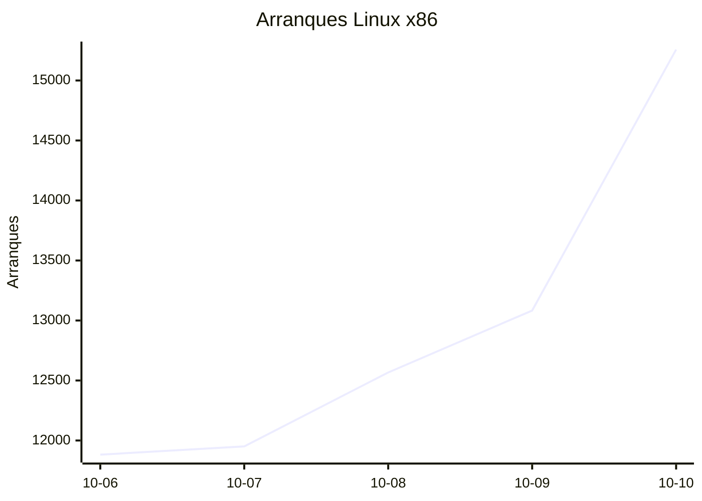
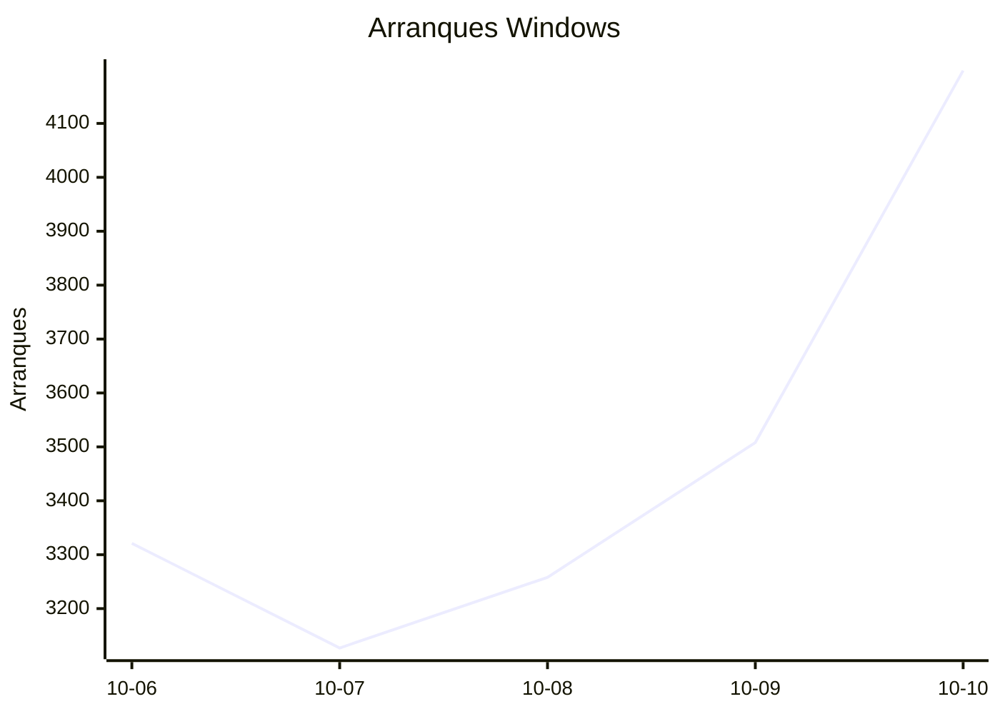
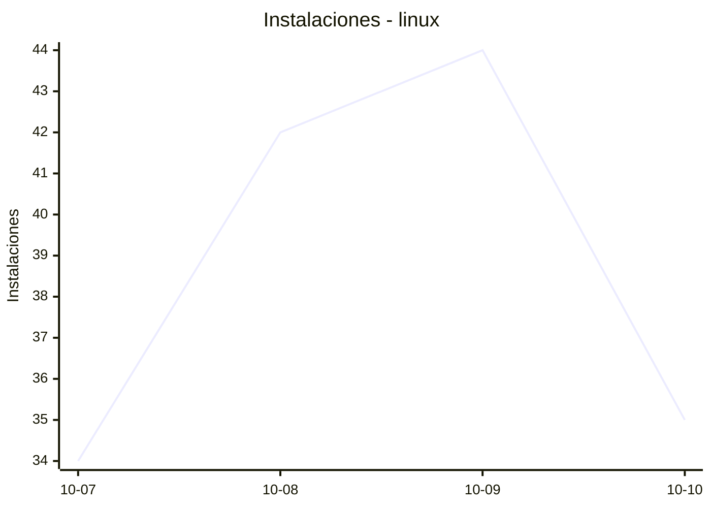
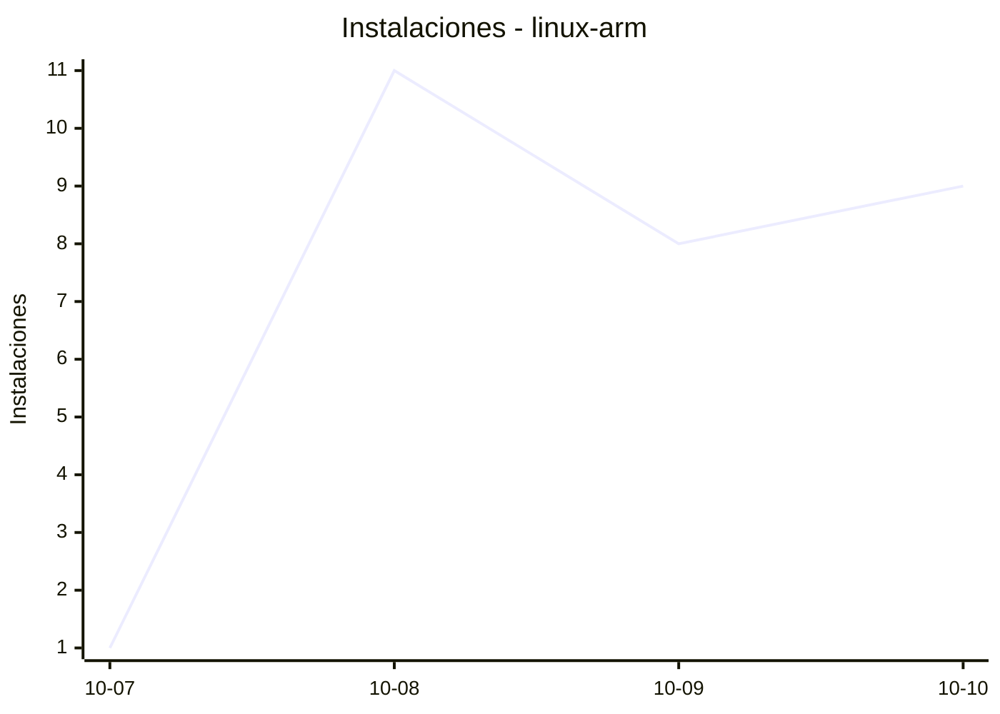
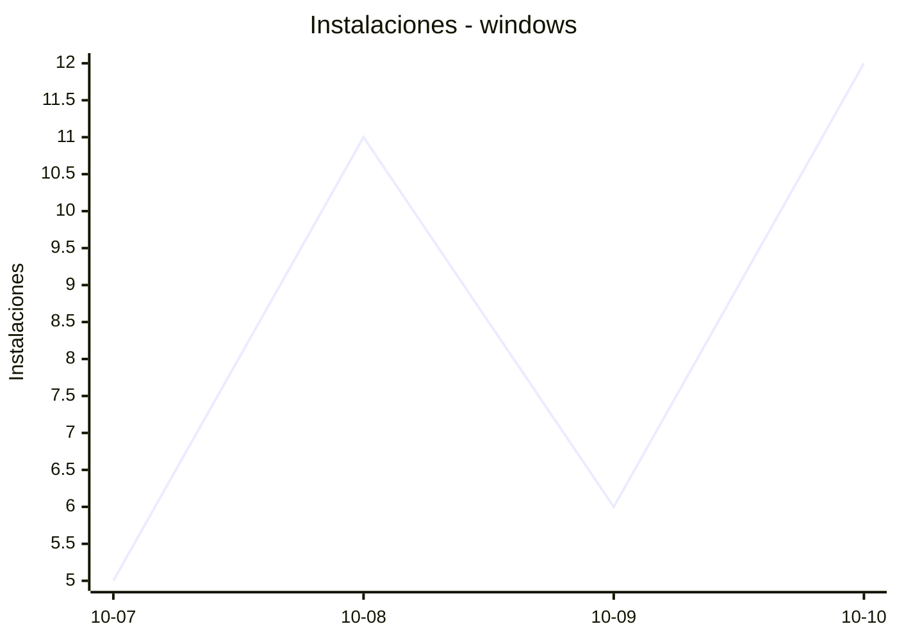
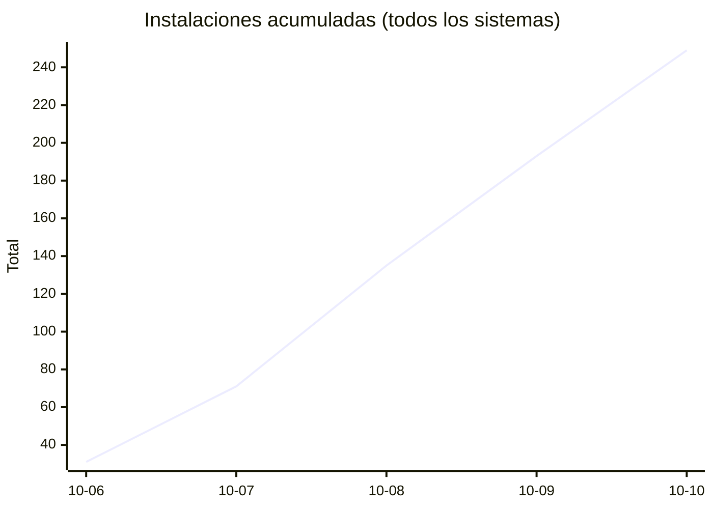
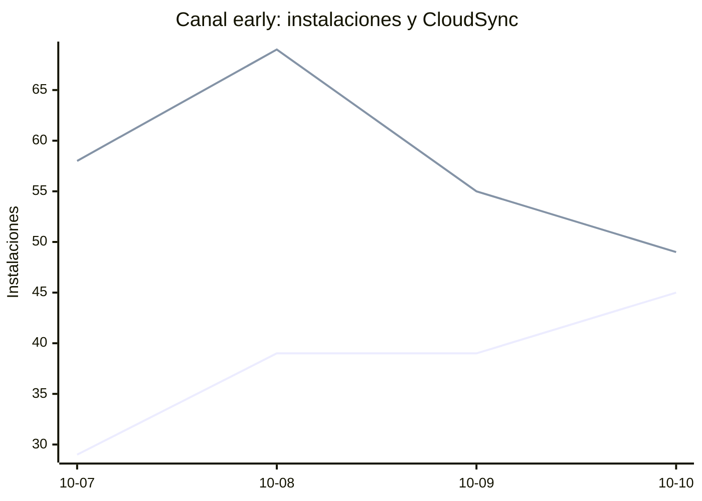

# Estadísticas de EmuDeck

Actualizado: 2026-10-11 20:41 UTC. Las gráficas no incluyen el día de hoy porque aún está incompleto.

## Arranques de la app (comprobaciones de actualización)

Cada arranque descarga el `latest*.yml` de su sistema. Cuenta arranques, no personas.

| Sistema | Ayer | Últimos 7 días |
|---|---|---|
| Linux x86 | 15258 | 64741 |
| Linux ARM | 222 | 971 |
| Windows | 4198 | 17412 |
| Mac | 0 | 0 |

Instalaciones nuevas estimadas en Windows (7 días, `.exe` menos `.blockmap`): **968**

## Instalaciones de EmuDeck (beacons)

Cada `setup` descarga `system-<sistema>.txt` y cada instalación de un emulador `<emulador>-<plataforma>.txt`. Los emuladores cuentan también las actualizaciones. Histórico completo desde el primer día.

| Sistema | Ayer | Últimos 7 días | Últimos 30 días | Total |
|---|---|---|---|---|
| linux | 35 | 155 | 155 | 225 |
| linux-arm | 9 | 29 | 29 | 35 |
| windows | 12 | 34 | 34 | 50 |

### Por mes

| Mes | Linux | Linux ARM | Windows | Total |
|---|---|---|---|---|
| 2026-10 | 155 | 29 | 34 | 218 |

### Canal early (early + early-unstable)

Instalaciones de EmuDeck con el backend en una rama early, y cuántas de ellas instalan CloudSync.

| | Últimos 7 días | Últimos 30 días | Total |
|---|---|---|---|
| Instalaciones early | 152 | 152 | 217 |
| Con CloudSync | 231 | 231 | 342 |
| % con CloudSync | | | 158% |

Línea de arriba: instalaciones early. Línea de abajo: de ellas, con CloudSync.

### Por emulador

| Emulador | Linux (total) | Linux ARM (total) | Windows (total) | Últimos 7 días | Últimos 30 días | Total |
|---|---|---|---|---|---|---|
| pcsx2 | 534 | 12 | 67 | 441 | 441 | 613 |
| azahar | 475 | 44 | 67 | 422 | 422 | 586 |
| esde | 442 | 39 | 103 | 415 | 415 | 584 |
| duckstation | 518 | 42 | 23 | 416 | 416 | 583 |
| ryujinx | 452 | 45 | 65 | 412 | 412 | 562 |
| rpcs3 | 475 | 41 | 22 | 385 | 385 | 538 |
| cemu | 470 | 43 | 16 | 386 | 386 | 529 |
| xenia | 423 | 37 | 47 | 362 | 362 | 507 |
| srm | 419 | 31 | 43 | 365 | 365 | 493 |
| shadps4 | 408 | 42 | 35 | 341 | 341 | 485 |
| vita3k | 423 | 37 | 11 | 332 | 332 | 471 |
| cloudsync | 250 | 13 | 97 | 244 | 244 | 360 |
| ppsspp | 199 | 30 | 47 | 187 | 187 | 276 |
| ra | 222 | 33 | 20 | 196 | 196 | 275 |
| dolphin | 215 | 32 | 24 | 189 | 189 | 271 |
| xemu | 181 | 23 | 20 | 153 | 153 | 224 |
| melonds | 183 | 22 | 17 | 150 | 150 | 222 |
| mgba | 179 | 17 | 17 | 164 | 164 | 213 |
| primehack | 161 | 24 | 21 | 150 | 150 | 206 |
| scummvm | 154 | 23 | 12 | 129 | 129 | 189 |
| model2 | 155 | 30 | 2 | 133 | 133 | 187 |
| supermodel | 151 | 30 | 5 | 130 | 130 | 186 |
| bigpemu | 129 | 3 | 2 | 101 | 101 | 134 |
| armsx2 | 40 | 45 | 0 | 65 | 65 | 85 |
| flycast | 43 | 5 | 5 | 42 | 42 | 53 |
| rmg | 37 | 10 | 0 | 41 | 41 | 47 |
| mame | 31 | 1 | 8 | 32 | 32 | 40 |
| eden | 13 | 3 | 0 | 4 | 4 | 16 |
| pegasus | 5 | 0 | 1 | 3 | 3 | 6 |
| yuzu | 3 | 0 | 0 | 2 | 2 | 3 |
| ares | 1 | 1 | 0 | 2 | 2 | 2 |
| citron | 1 | 0 | 0 | 0 | 0 | 1 |
