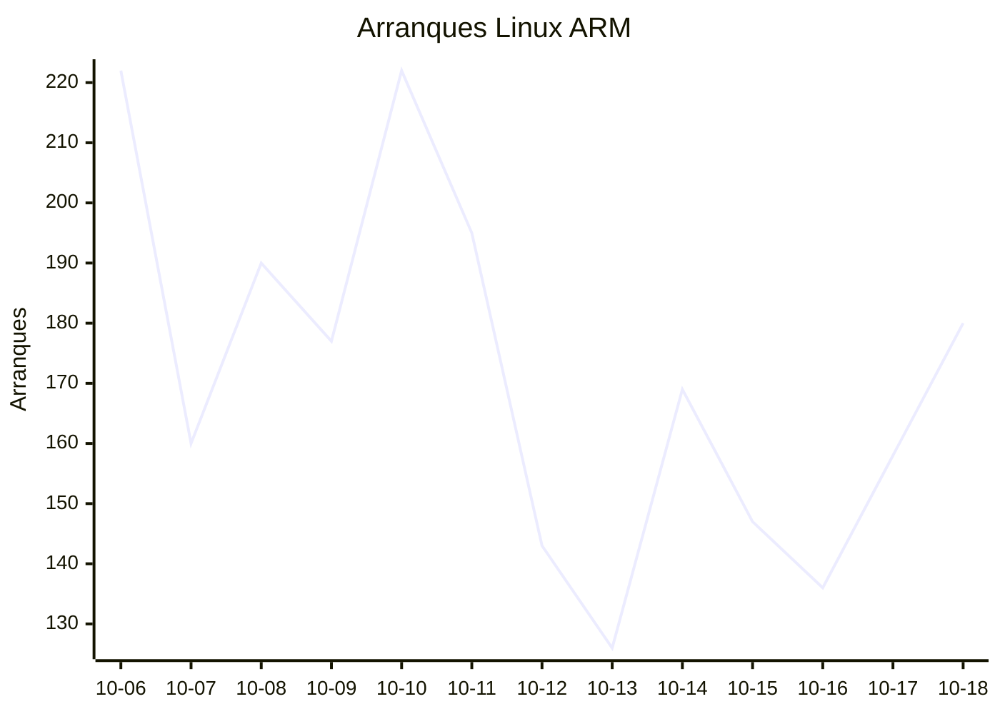
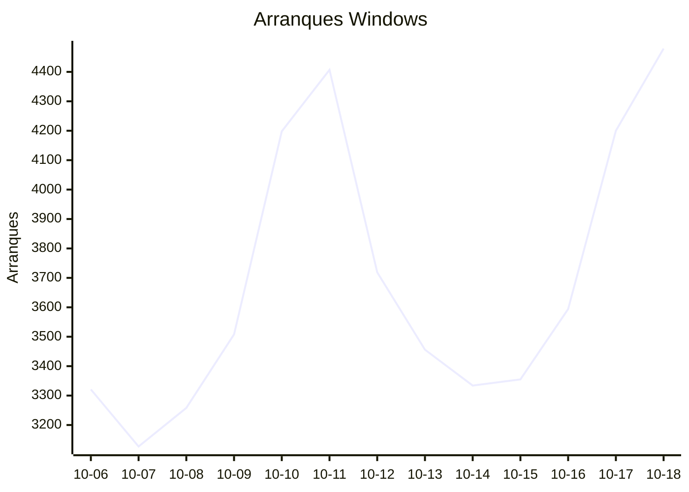
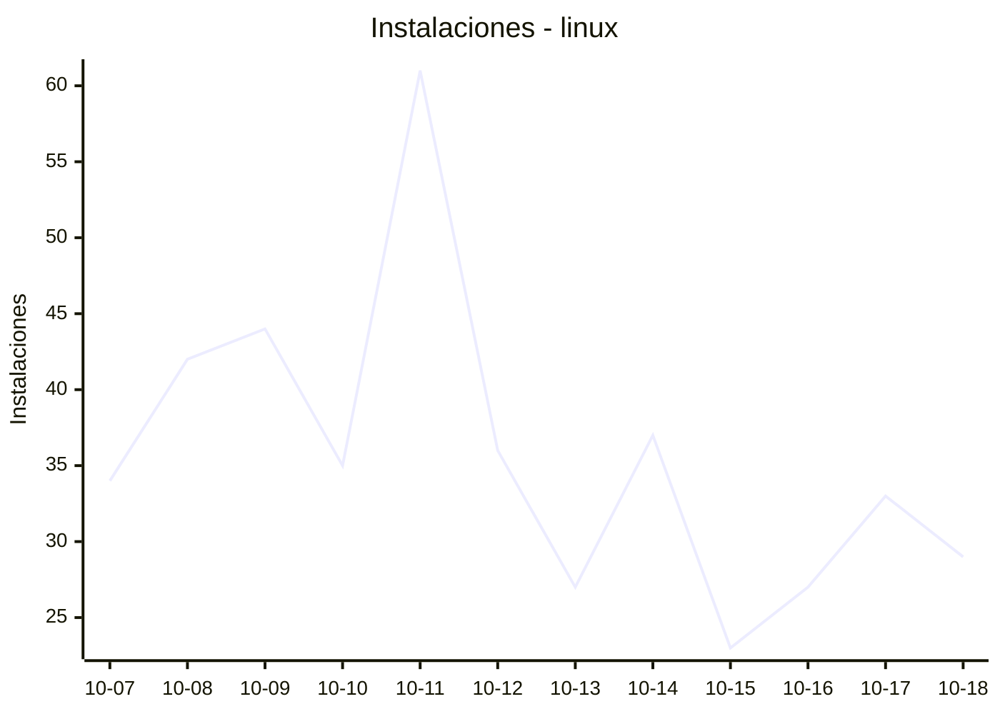
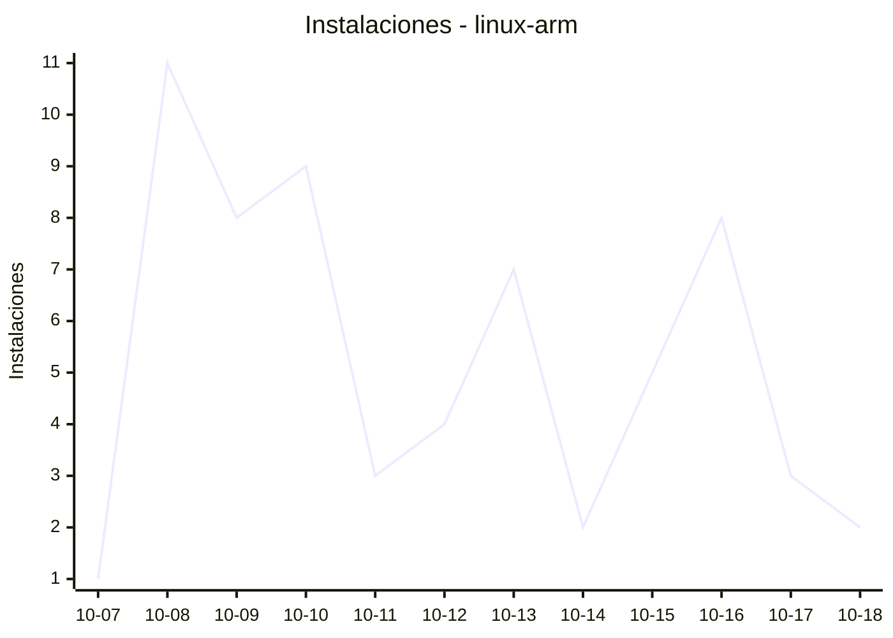
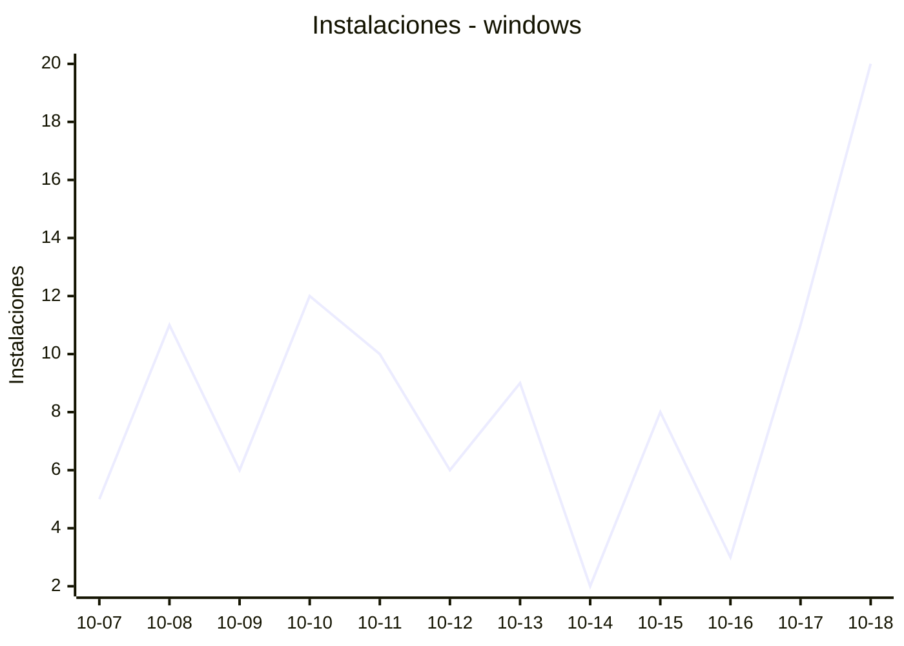
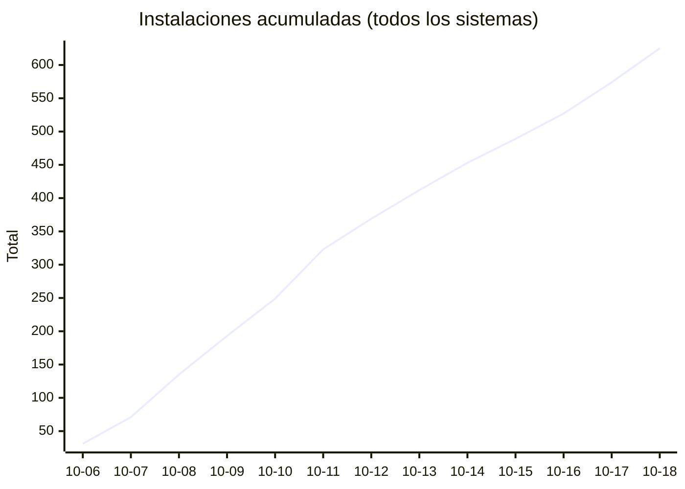
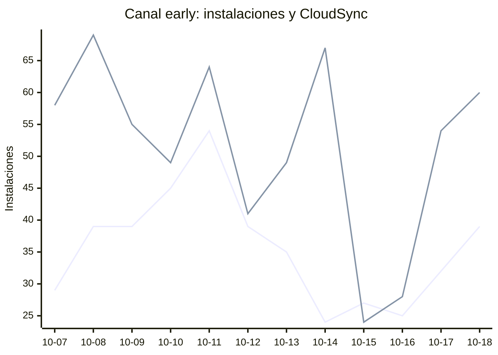

# Estadísticas de EmuDeck

Actualizado: 2026-10-19 04:17 UTC. Las gráficas no incluyen el día de hoy porque aún está incompleto.

## Arranques de la app (comprobaciones de actualización)

Cada arranque descarga el `latest*.yml` de su sistema. Cuenta arranques, no personas.

| Sistema | Ayer | Últimos 7 días |
|---|---|---|
| Linux x86 | 16587 | 99603 |
| Linux ARM | 180 | 1059 |
| Windows | 4479 | 26137 |
| Mac | 0 | 0 |

Instalaciones nuevas estimadas en Windows (7 días, `.exe` menos `.blockmap`): **2010**

## Instalaciones de EmuDeck (beacons)

Cada `setup` descarga `system-<sistema>.txt` y cada instalación de un emulador `<emulador>-<plataforma>.txt`. Los emuladores cuentan también las actualizaciones. Histórico completo desde el primer día.

| Sistema | Ayer | Últimos 7 días | Últimos 30 días | Total |
|---|---|---|---|---|
| linux | 29 | 212 | 428 | 457 |
| linux-arm | 2 | 31 | 63 | 67 |
| windows | 20 | 59 | 103 | 116 |

### Por mes

| Mes | Linux | Linux ARM | Windows | Total |
|---|---|---|---|---|
| 2026-10 | 428 | 63 | 103 | 594 |

### Canal early (early + early-unstable)

Instalaciones de EmuDeck con el backend en una rama early, y cuántas de ellas instalan CloudSync.

| | Últimos 7 días | Últimos 30 días | Total |
|---|---|---|---|
| Instalaciones early | 221 | 427 | 460 |
| Con CloudSync | 323 | 618 | 701 |
| % con CloudSync | | | 152% |

Línea de arriba: instalaciones early. Línea de abajo: de ellas, con CloudSync.

### Por emulador

| Emulador | Linux (total) | Linux ARM (total) | Windows (total) | Últimos 7 días | Últimos 30 días | Total |
|---|---|---|---|---|---|---|
| pcsx2 | 1203 | 18 | 146 | 701 | 1262 | 1367 |
| duckstation | 1162 | 83 | 50 | 667 | 1197 | 1295 |
| azahar | 1069 | 85 | 140 | 660 | 1191 | 1294 |
| esde | 974 | 74 | 213 | 633 | 1138 | 1261 |
| ryujinx | 1032 | 86 | 139 | 648 | 1166 | 1257 |
| rpcs3 | 1084 | 84 | 50 | 642 | 1129 | 1218 |
| cemu | 1066 | 84 | 37 | 617 | 1104 | 1187 |
| xenia | 970 | 70 | 109 | 599 | 1065 | 1149 |
| srm | 947 | 68 | 132 | 616 | 1076 | 1147 |
| shadps4 | 925 | 69 | 103 | 573 | 1012 | 1097 |
| vita3k | 982 | 74 | 28 | 573 | 998 | 1084 |
| cloudsync | 501 | 17 | 207 | 329 | 640 | 725 |
| dolphin | 452 | 60 | 57 | 272 | 526 | 569 |
| ppsspp | 412 | 56 | 100 | 264 | 522 | 568 |
| ra | 442 | 61 | 56 | 262 | 521 | 559 |
| mgba | 426 | 34 | 32 | 265 | 462 | 492 |
| melonds | 390 | 46 | 40 | 234 | 438 | 476 |
| xemu | 381 | 49 | 39 | 224 | 434 | 469 |
| primehack | 335 | 47 | 39 | 197 | 387 | 421 |
| supermodel | 329 | 55 | 9 | 191 | 367 | 393 |
| model2 | 324 | 58 | 6 | 185 | 361 | 388 |
| scummvm | 321 | 42 | 21 | 180 | 354 | 384 |
| bigpemu | 295 | 3 | 8 | 157 | 278 | 306 |
| armsx2 | 89 | 91 | 0 | 89 | 165 | 180 |
| flycast | 86 | 13 | 10 | 49 | 102 | 109 |
| rmg | 84 | 21 | 0 | 54 | 99 | 105 |
| eden | 59 | 7 | 0 | 50 | 58 | 66 |
| mame | 52 | 2 | 10 | 20 | 58 | 64 |
| pegasus | 9 | 0 | 10 | 13 | 17 | 19 |
| yuzu | 6 | 0 | 0 | 2 | 6 | 6 |
| ares | 3 | 1 | 0 | 2 | 4 | 4 |
| citron | 4 | 0 | 0 | 3 | 4 | 4 |
