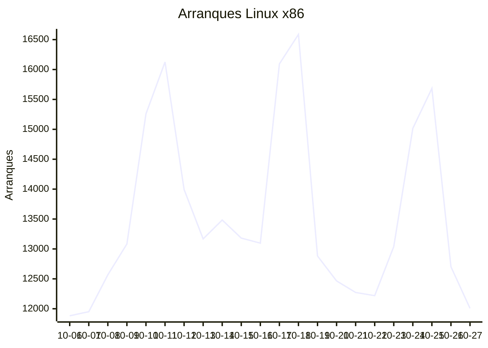
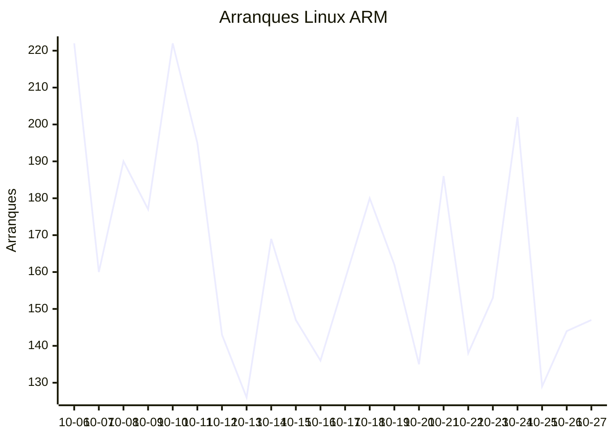
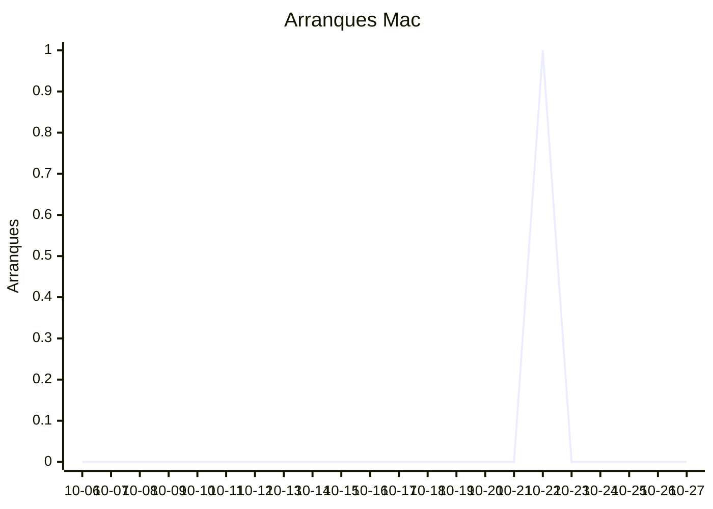
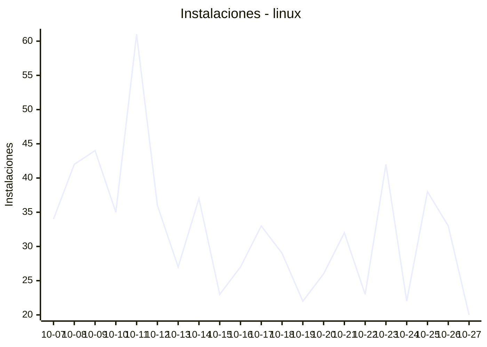
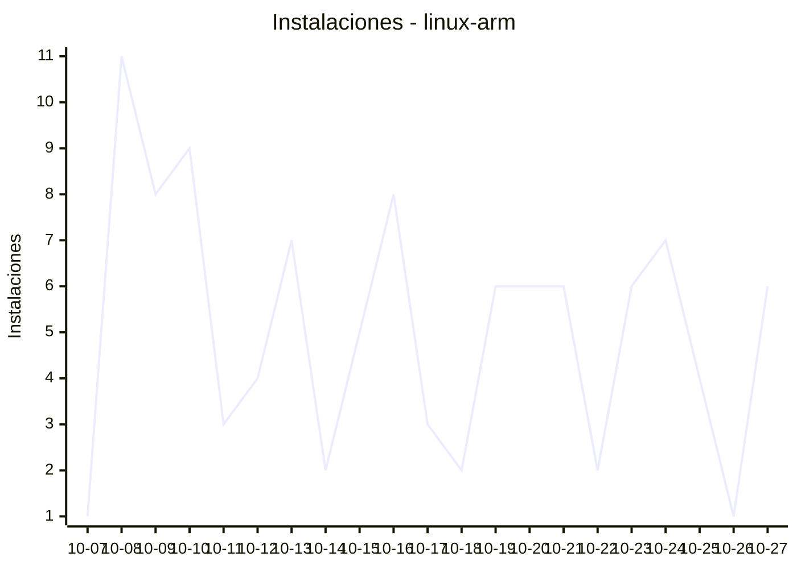
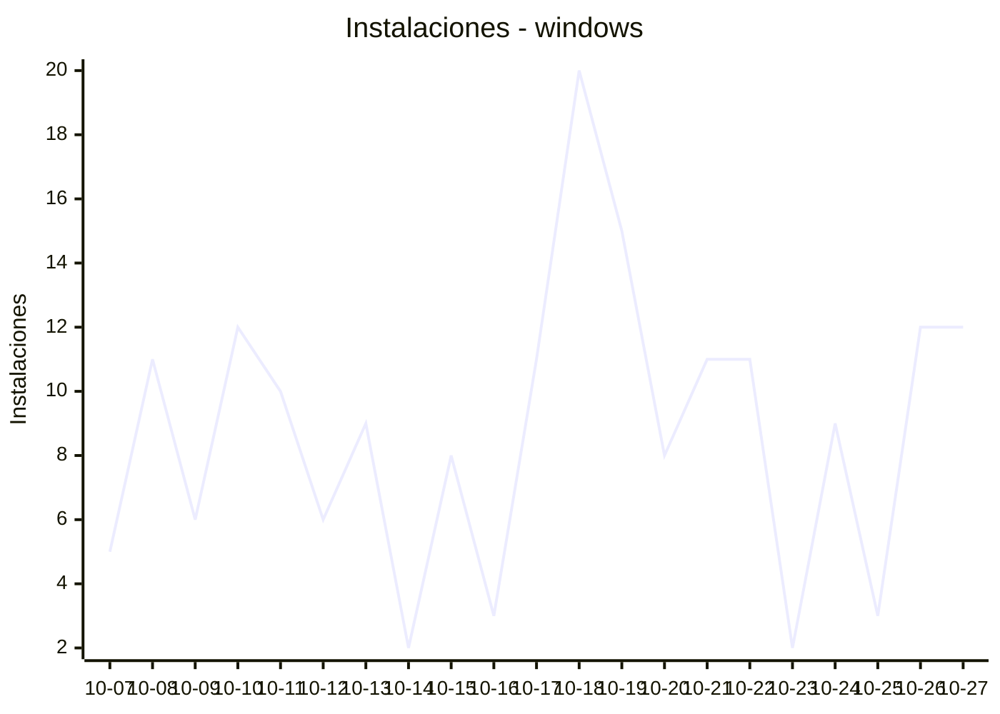
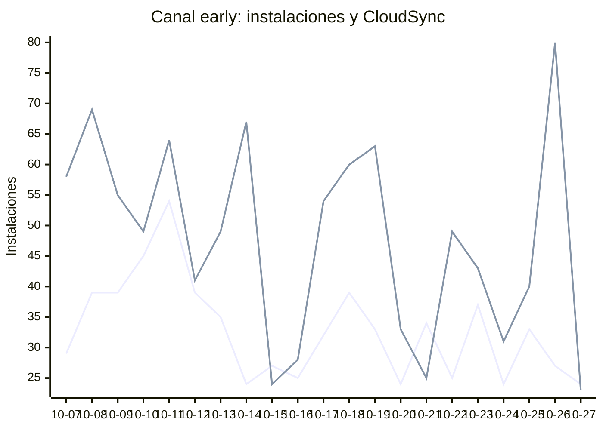

# Estadísticas de EmuDeck

Actualizado: 2026-10-28 00:28 UTC. Las gráficas no incluyen el día de hoy porque aún está incompleto.

## Arranques de la app (comprobaciones de actualización)

Cada arranque descarga el `latest*.yml` de su sistema. Cuenta arranques, no personas.

| Sistema | Ayer | Últimos 7 días |
|---|---|---|
| Linux x86 | 12007 | 92938 |
| Linux ARM | 147 | 1099 |
| Windows | 3222 | 24512 |
| Mac | 0 | 1 |

Instalaciones nuevas estimadas en Windows (7 días, `.exe` menos `.blockmap`): **2257**

## Instalaciones de EmuDeck (beacons)

Cada `setup` descarga `system-<sistema>.txt` y cada instalación de un emulador `<emulador>-<plataforma>.txt`. Los emuladores cuentan también las actualizaciones. Histórico completo desde el primer día.

| Sistema | Ayer | Últimos 7 días | Últimos 30 días | Total |
|---|---|---|---|---|
| linux | 20 | 210 | 686 | 708 |
| linux-arm | 6 | 32 | 107 | 110 |
| windows | 12 | 60 | 186 | 193 |

### Por mes

| Mes | Linux | Linux ARM | Windows | Total |
|---|---|---|---|---|
| 2026-10 | 686 | 107 | 186 | 979 |

### Canal early (early + early-unstable)

Instalaciones de EmuDeck con el backend en una rama early, y cuántas de ellas instalan CloudSync.

| | Últimos 7 días | Últimos 30 días | Total |
|---|---|---|---|
| Instalaciones early | 204 | 688 | 712 |
| Con CloudSync | 291 | 1005 | 1072 |
| % con CloudSync | | | 151% |

Línea de arriba: instalaciones early. Línea de abajo: de ellas, con CloudSync.

### Por emulador

| Emulador | Linux (total) | Linux ARM (total) | Windows (total) | Últimos 7 días | Últimos 30 días | Total |
|---|---|---|---|---|---|---|
| pcsx2 | 1950 | 22 | 227 | 698 | 2124 | 2199 |
| duckstation | 1867 | 147 | 96 | 680 | 2036 | 2110 |
| azahar | 1700 | 164 | 228 | 665 | 2016 | 2092 |
| esde | 1581 | 132 | 360 | 678 | 1980 | 2073 |
| ryujinx | 1665 | 156 | 234 | 669 | 1987 | 2055 |
| rpcs3 | 1756 | 149 | 95 | 655 | 1932 | 2000 |
| cemu | 1711 | 152 | 77 | 627 | 1876 | 1940 |
| srm | 1550 | 137 | 248 | 662 | 1886 | 1935 |
| xenia | 1586 | 119 | 194 | 617 | 1838 | 1899 |
| shadps4 | 1485 | 122 | 173 | 568 | 1715 | 1780 |
| vita3k | 1550 | 131 | 62 | 546 | 1678 | 1743 |
| cloudsync | 745 | 33 | 333 | 301 | 1042 | 1111 |
| ppsspp | 630 | 92 | 174 | 272 | 864 | 896 |
| ra | 684 | 97 | 109 | 273 | 861 | 890 |
| dolphin | 683 | 101 | 98 | 266 | 852 | 882 |
| mgba | 687 | 51 | 53 | 249 | 770 | 791 |
| xemu | 589 | 82 | 73 | 230 | 718 | 744 |
| melonds | 574 | 78 | 71 | 204 | 695 | 723 |
| primehack | 507 | 76 | 74 | 195 | 632 | 657 |
| supermodel | 494 | 89 | 18 | 170 | 580 | 601 |
| scummvm | 478 | 65 | 48 | 169 | 567 | 591 |
| model2 | 486 | 92 | 8 | 158 | 565 | 586 |
| bigpemu | 473 | 10 | 12 | 157 | 477 | 495 |
| armsx2 | 148 | 174 | 0 | 119 | 313 | 322 |
| flycast | 130 | 16 | 18 | 49 | 159 | 164 |
| rmg | 128 | 27 | 0 | 44 | 151 | 155 |
| eden | 82 | 9 | 1 | 16 | 84 | 92 |
| mame | 71 | 2 | 16 | 22 | 85 | 89 |
| pegasus | 18 | 0 | 12 | 11 | 28 | 30 |
| yuzu | 8 | 0 | 2 | 4 | 10 | 10 |
| ares | 8 | 1 | 0 | 4 | 9 | 9 |
| citron | 5 | 0 | 0 | 1 | 5 | 5 |
