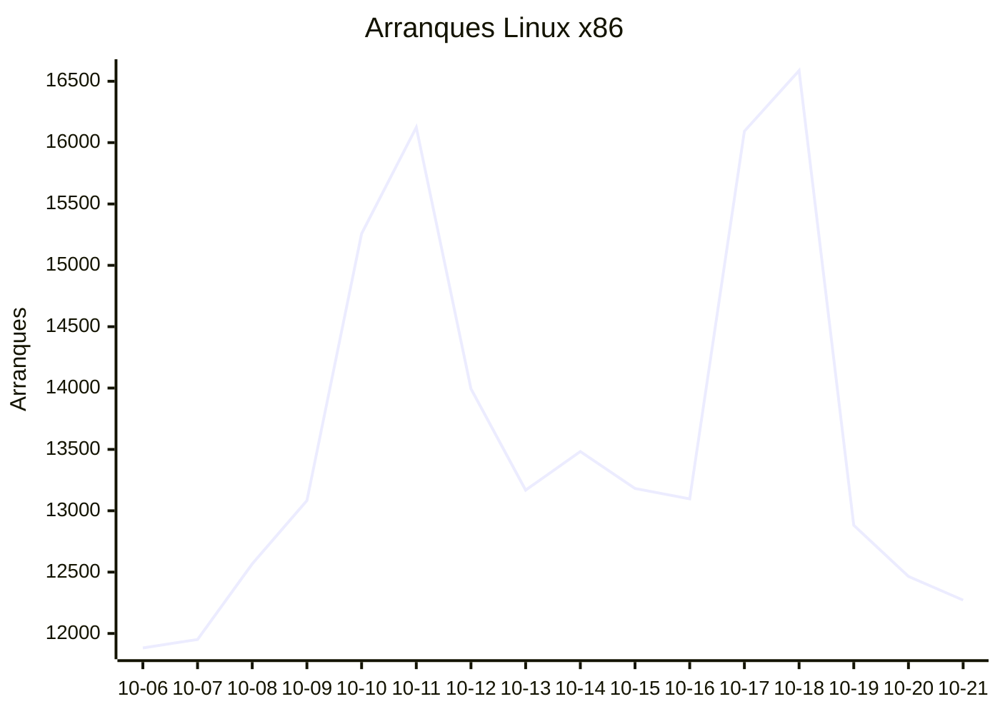
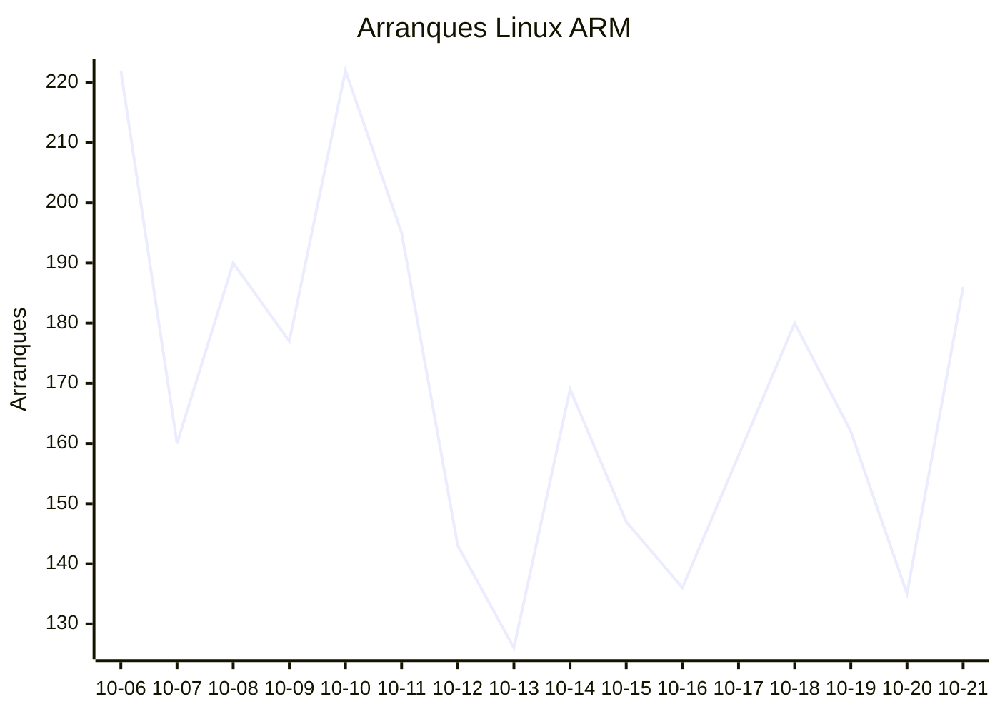
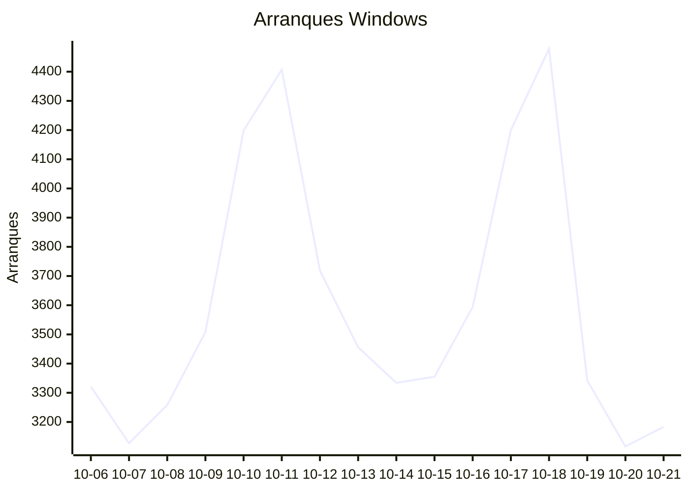
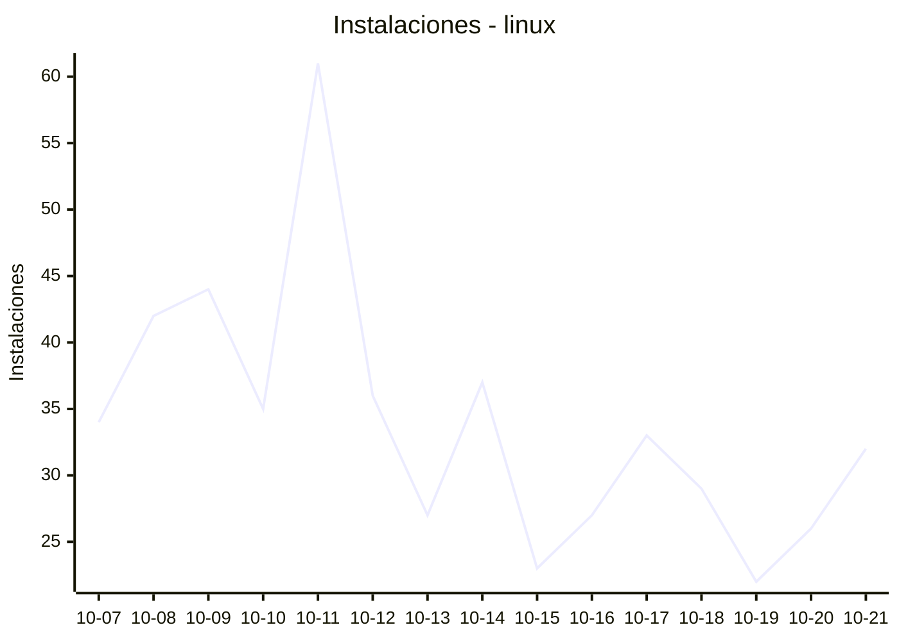
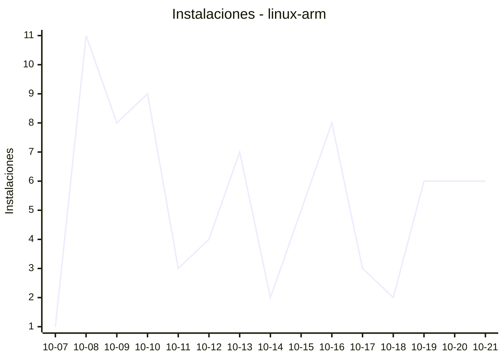
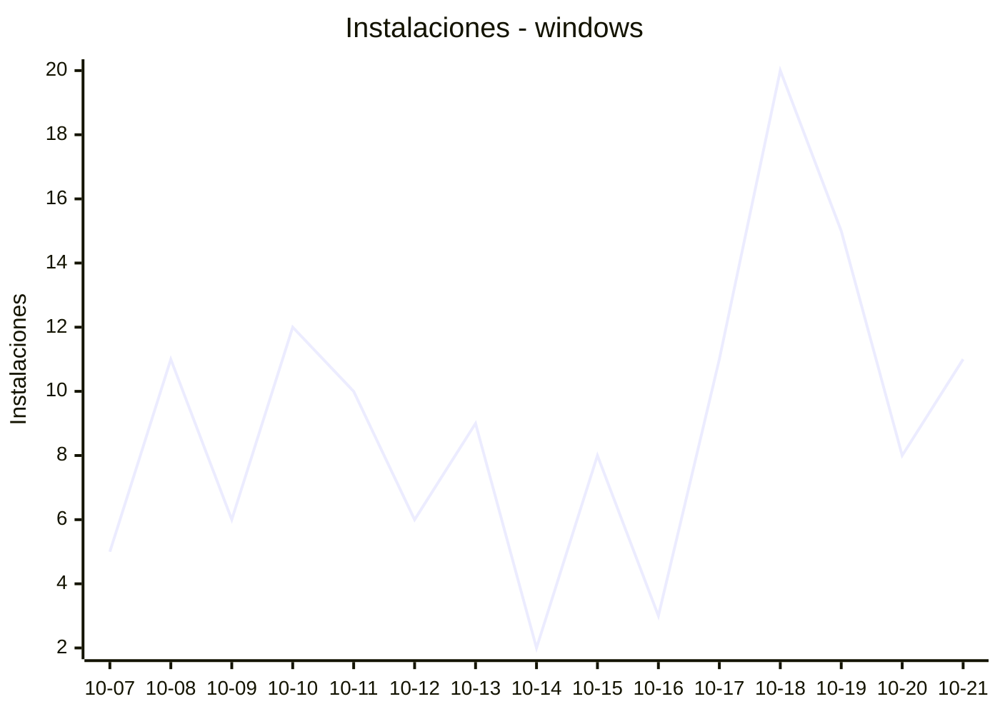
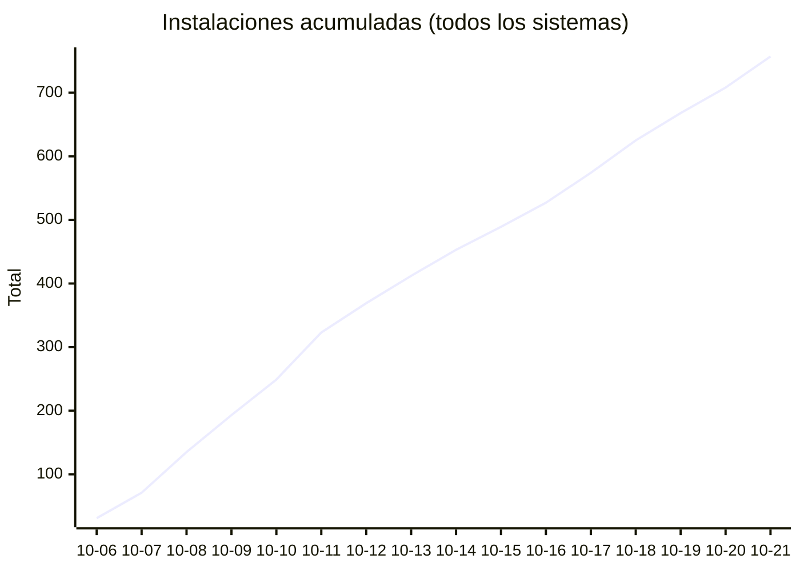
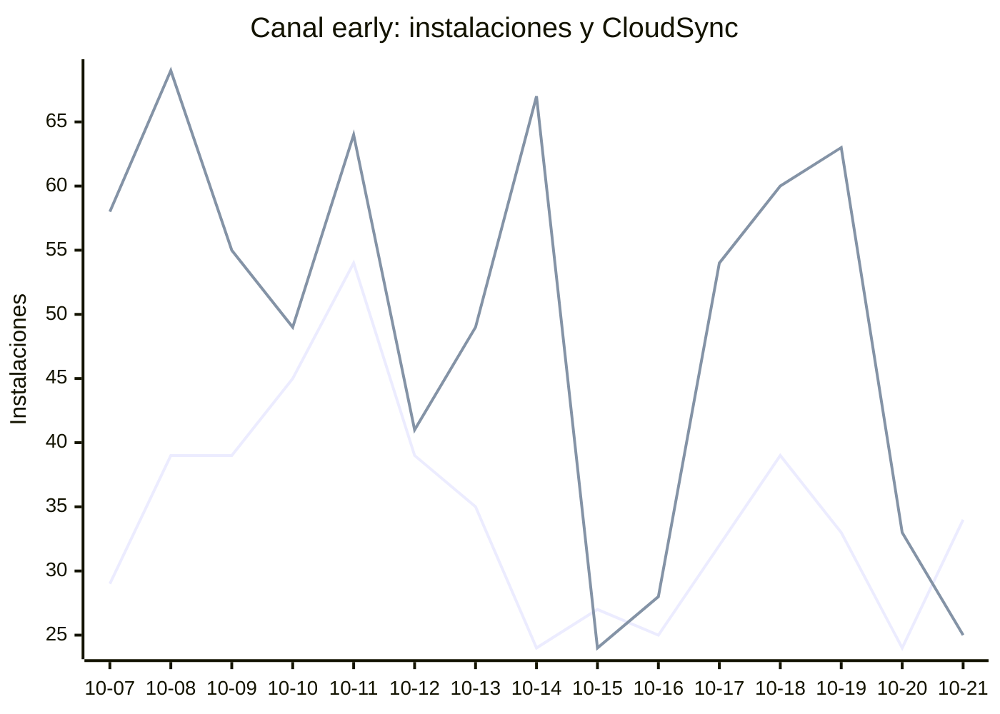

# Estadísticas de EmuDeck

Actualizado: 2026-10-22 18:17 UTC. Las gráficas no incluyen el día de hoy porque aún está incompleto.

## Arranques de la app (comprobaciones de actualización)

Cada arranque descarga el `latest*.yml` de su sistema. Cuenta arranques, no personas.

| Sistema | Ayer | Últimos 7 días |
|---|---|---|
| Linux x86 | 12272 | 96577 |
| Linux ARM | 186 | 1104 |
| Windows | 3183 | 25269 |
| Mac | 0 | 0 |

Instalaciones nuevas estimadas en Windows (7 días, `.exe` menos `.blockmap`): **2120**

## Instalaciones de EmuDeck (beacons)

Cada `setup` descarga `system-<sistema>.txt` y cada instalación de un emulador `<emulador>-<plataforma>.txt`. Los emuladores cuentan también las actualizaciones. Histórico completo desde el primer día.

| Sistema | Ayer | Últimos 7 días | Últimos 30 días | Total |
|---|---|---|---|---|
| linux | 32 | 192 | 508 | 542 |
| linux-arm | 6 | 36 | 81 | 86 |
| windows | 11 | 76 | 137 | 154 |

### Por mes

| Mes | Linux | Linux ARM | Windows | Total |
|---|---|---|---|---|
| 2026-10 | 508 | 81 | 137 | 726 |

### Canal early (early + early-unstable)

Instalaciones de EmuDeck con el backend en una rama early, y cuántas de ellas instalan CloudSync.

| | Últimos 7 días | Últimos 30 días | Total |
|---|---|---|---|
| Instalaciones early | 214 | 518 | 556 |
| Con CloudSync | 287 | 739 | 820 |
| % con CloudSync | | | 147% |

Línea de arriba: instalaciones early. Línea de abajo: de ellas, con CloudSync.

### Por emulador

| Emulador | Linux (total) | Linux ARM (total) | Windows (total) | Últimos 7 días | Últimos 30 días | Total |
|---|---|---|---|---|---|---|
| pcsx2 | 1452 | 19 | 180 | 658 | 1531 | 1651 |
| azahar | 1289 | 118 | 173 | 633 | 1460 | 1580 |
| duckstation | 1399 | 111 | 69 | 638 | 1463 | 1579 |
| esde | 1182 | 92 | 274 | 605 | 1398 | 1548 |
| ryujinx | 1246 | 114 | 170 | 633 | 1421 | 1530 |
| rpcs3 | 1309 | 110 | 71 | 604 | 1380 | 1490 |
| cemu | 1287 | 113 | 54 | 570 | 1345 | 1454 |
| srm | 1160 | 98 | 178 | 642 | 1346 | 1436 |
| xenia | 1177 | 94 | 143 | 572 | 1319 | 1414 |
| shadps4 | 1107 | 94 | 128 | 548 | 1232 | 1329 |
| vita3k | 1173 | 98 | 44 | 536 | 1218 | 1315 |
| cloudsync | 577 | 24 | 248 | 296 | 766 | 849 |
| ra | 519 | 76 | 85 | 248 | 629 | 680 |
| ppsspp | 476 | 72 | 131 | 248 | 627 | 679 |
| dolphin | 524 | 78 | 75 | 244 | 628 | 677 |
| mgba | 513 | 42 | 41 | 246 | 559 | 596 |
| melonds | 449 | 62 | 54 | 206 | 523 | 565 |
| xemu | 446 | 64 | 53 | 209 | 523 | 563 |
| primehack | 388 | 59 | 56 | 180 | 463 | 503 |
| supermodel | 382 | 74 | 11 | 160 | 437 | 467 |
| model2 | 377 | 77 | 7 | 159 | 432 | 461 |
| scummvm | 372 | 53 | 34 | 163 | 423 | 459 |
| bigpemu | 361 | 5 | 8 | 147 | 344 | 374 |
| armsx2 | 112 | 122 | 0 | 90 | 215 | 234 |
| flycast | 101 | 14 | 12 | 40 | 118 | 127 |
| rmg | 98 | 26 | 0 | 46 | 117 | 124 |
| eden | 72 | 7 | 0 | 41 | 70 | 79 |
| mame | 57 | 2 | 13 | 17 | 66 | 72 |
| pegasus | 11 | 0 | 11 | 11 | 19 | 22 |
| ares | 5 | 1 | 0 | 1 | 5 | 6 |
| yuzu | 6 | 0 | 0 | 0 | 6 | 6 |
| citron | 4 | 0 | 0 | 2 | 4 | 4 |
