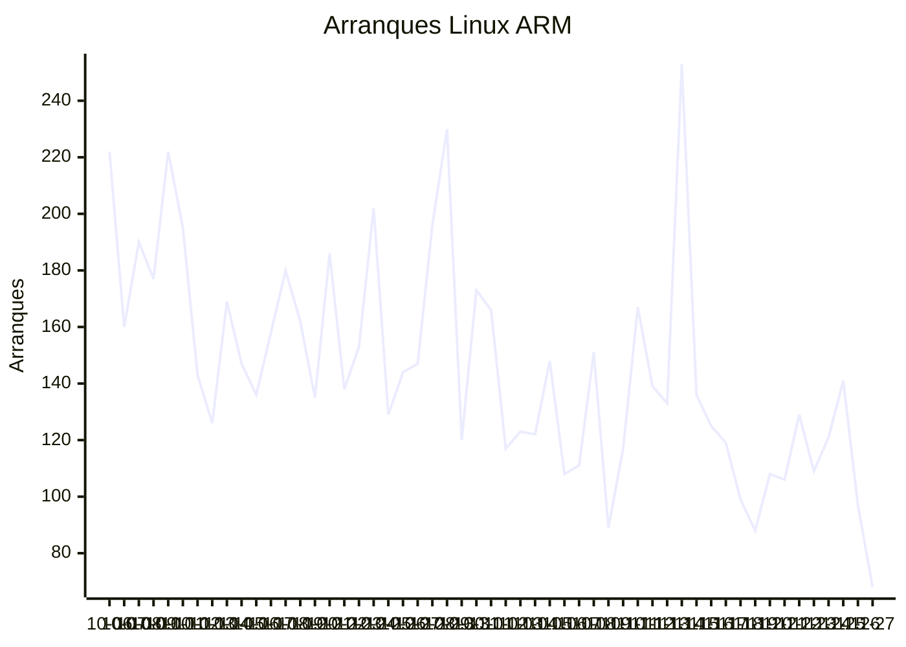
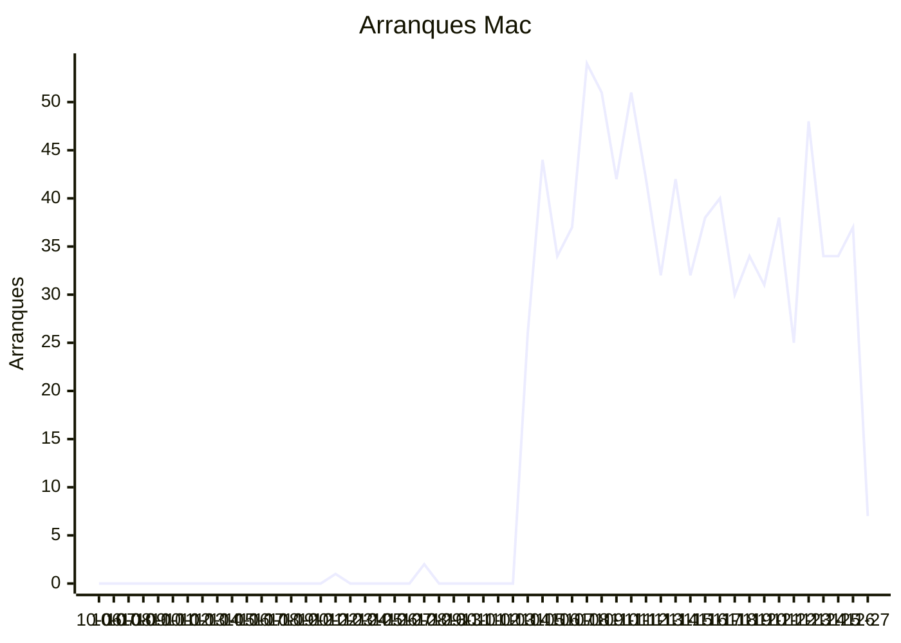
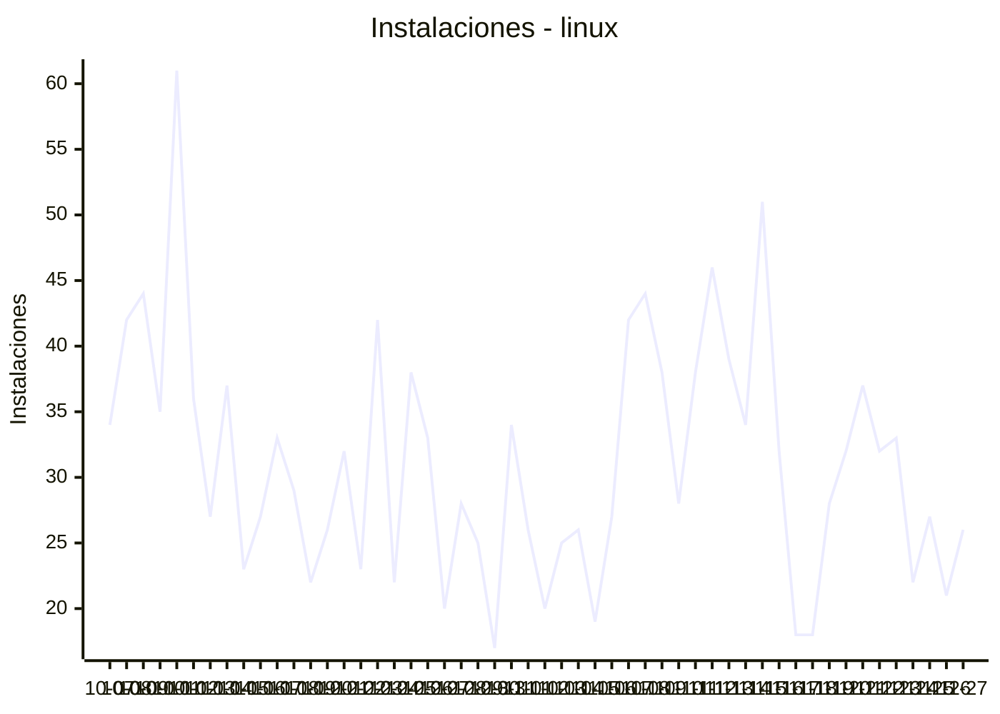
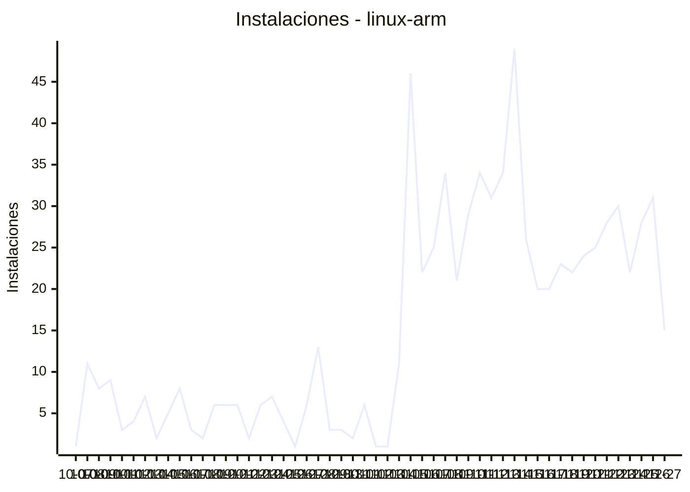
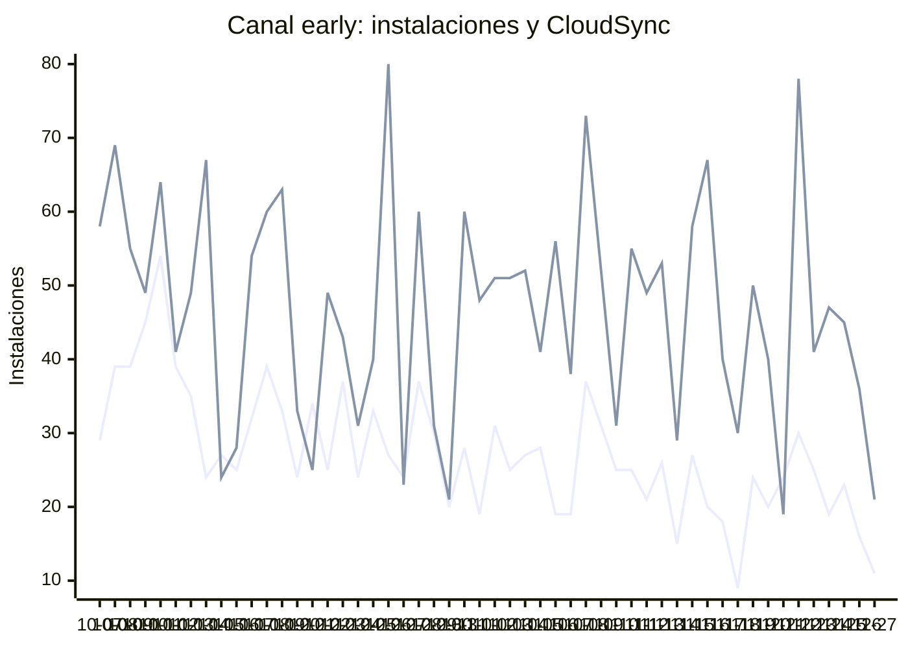

# Estadísticas de EmuDeck

Actualizado: 2026-11-28 04:10 UTC. Las gráficas no incluyen el día de hoy porque aún está incompleto.

## Arranques de la app (comprobaciones de actualización)

Cada arranque descarga el `latest*.yml` de su sistema. Cuenta arranques, no personas.

| Sistema | Ayer | Últimos 7 días |
|---|---|---|
| Linux x86 | 10841 | 81805 |
| Linux ARM | 68 | 771 |
| Windows | 2448 | 18885 |
| Mac | 7 | 223 |

Instalaciones nuevas estimadas en Windows (7 días, `.exe` menos `.blockmap`): **1911**

## Instalaciones de EmuDeck (beacons)

Cada `setup` descarga `system-<sistema>.txt` y cada instalación de un emulador `<emulador>-<plataforma>.txt`. Los emuladores cuentan también las actualizaciones. Histórico completo desde el primer día.

| Sistema | Ayer | Últimos 7 días | Últimos 30 días | Total |
|---|---|---|---|---|
| linux | 26 | 198 | 905 | 1648 |
| linux-arm | 15 | 179 | 666 | 796 |
| windows | 5 | 69 | 309 | 512 |

### Por mes

| Mes | Linux | Linux ARM | Windows | Total |
|---|---|---|---|---|
| 2026-11 | 829 | 658 | 265 | 1752 |
| 2026-10 | 790 | 128 | 237 | 1155 |

### Canal early (early + early-unstable)

Instalaciones de EmuDeck con el backend en una rama early, y cuántas de ellas instalan CloudSync.

| | Últimos 7 días | Últimos 30 días | Total |
|---|---|---|---|
| Instalaciones early | 148 | 692 | 1444 |
| Con CloudSync | 287 | 1363 | 2506 |
| % con CloudSync | | | 174% |

Línea de arriba: instalaciones early. Línea de abajo: de ellas, con CloudSync.

### Por emulador

| Emulador | Linux (total) | Linux ARM (total) | Windows (total) | Últimos 7 días | Últimos 30 días | Total |
|---|---|---|---|---|---|---|
| esde | 3722 | 797 | 1042 | 770 | 3384 | 5561 |
| azahar | 3929 | 940 | 566 | 776 | 3222 | 5435 |
| ryujinx | 3879 | 940 | 542 | 764 | 3201 | 5361 |
| duckstation | 4231 | 865 | 214 | 752 | 3093 | 5310 |
| rpcs3 | 4072 | 887 | 213 | 750 | 3061 | 5172 |
| srm | 3720 | 734 | 685 | 709 | 3106 | 5139 |
| pcsx2 | 4446 | 43 | 594 | 641 | 2786 | 5083 |
| cemu | 3837 | 832 | 197 | 669 | 2814 | 4866 |
| xenia | 3582 | 716 | 486 | 672 | 2786 | 4784 |
| vita3k | 3498 | 761 | 144 | 632 | 2564 | 4403 |
| shadps4 | 3358 | 264 | 425 | 503 | 2170 | 4047 |
| cloudsync | 1648 | 87 | 867 | 297 | 1419 | 2602 |
| ppsspp | 1395 | 634 | 474 | 385 | 1552 | 2503 |
| dolphin | 1522 | 703 | 227 | 354 | 1511 | 2452 |
| ra | 1531 | 658 | 257 | 359 | 1507 | 2446 |
| xemu | 1288 | 547 | 167 | 299 | 1213 | 2002 |
| melonds | 1255 | 556 | 154 | 291 | 1200 | 1965 |
| mgba | 1645 | 193 | 111 | 272 | 1126 | 1949 |
| primehack | 1175 | 567 | 171 | 285 | 1213 | 1913 |
| supermodel | 1090 | 515 | 52 | 242 | 1024 | 1657 |
| scummvm | 1051 | 484 | 109 | 254 | 1018 | 1644 |
| model2 | 1072 | 536 | 14 | 245 | 1005 | 1622 |
| armsx2 | 348 | 966 | 0 | 237 | 959 | 1314 |
| bigpemu | 1048 | 59 | 50 | 145 | 645 | 1157 |
| flycast | 270 | 74 | 44 | 42 | 218 | 388 |
| rmg | 270 | 109 | 0 | 56 | 223 | 379 |
| mame | 147 | 27 | 69 | 35 | 152 | 243 |
| eden | 177 | 11 | 22 | 33 | 115 | 210 |
| pegasus | 59 | 3 | 32 | 12 | 63 | 94 |
| ares | 23 | 3 | 0 | 3 | 16 | 26 |
| yuzu | 18 | 0 | 8 | 0 | 16 | 26 |
| citron | 6 | 2 | 3 | 1 | 6 | 11 |
