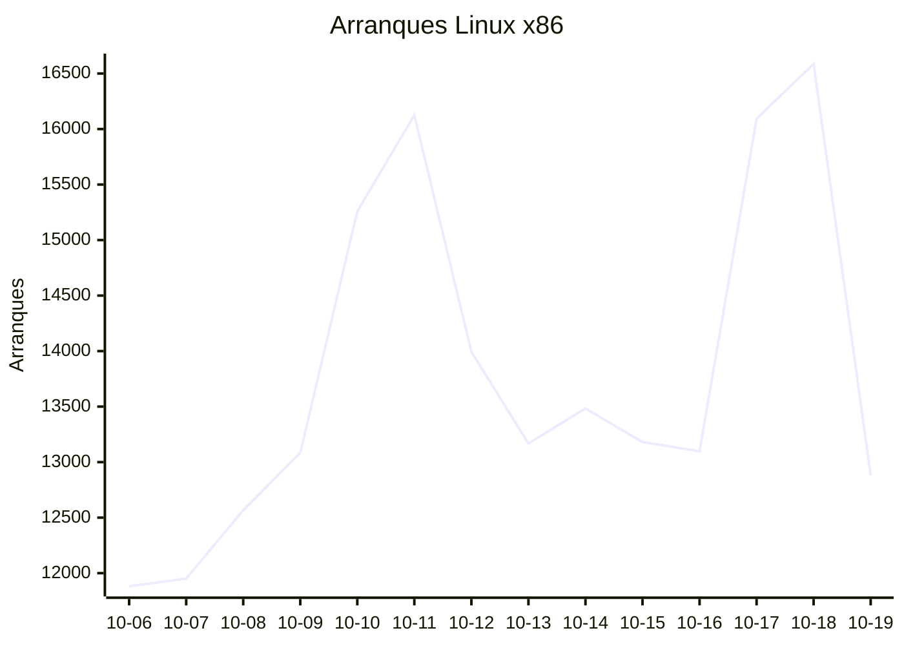
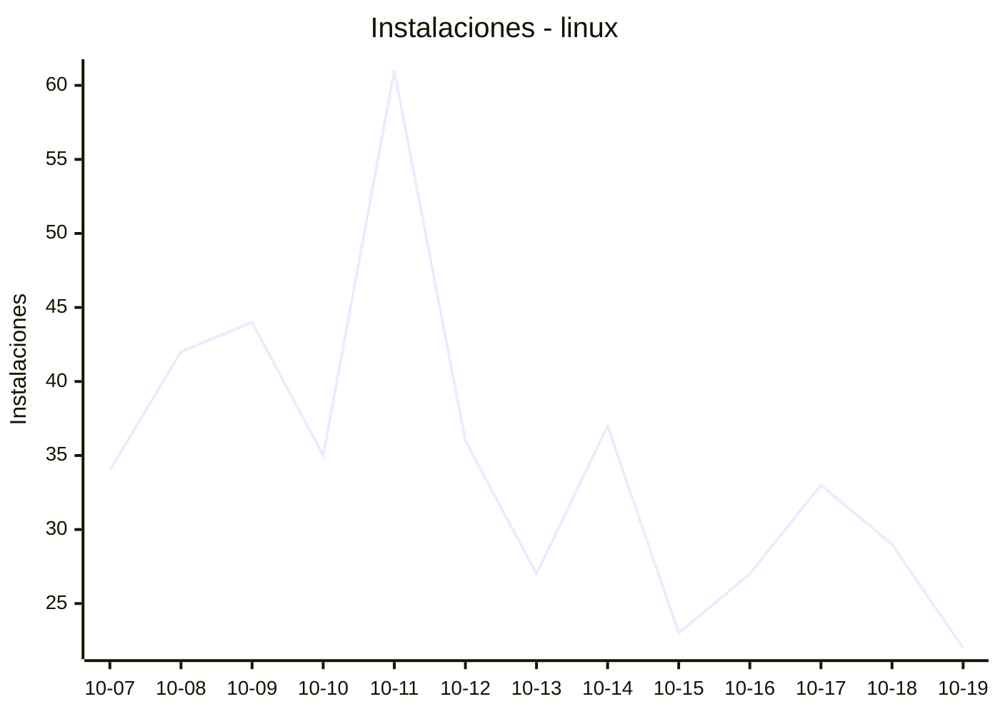
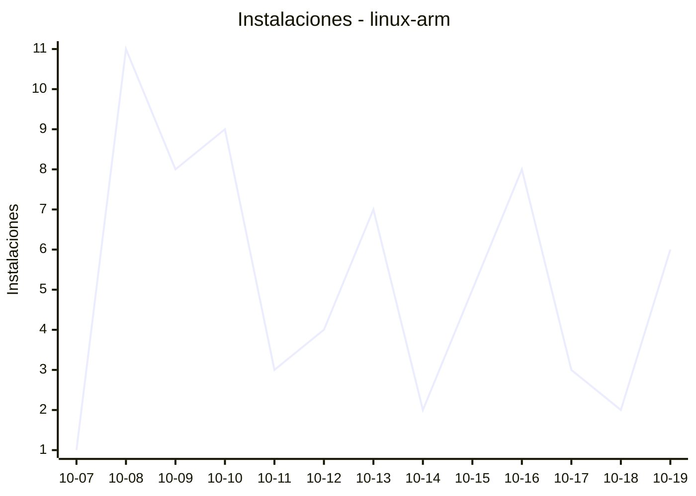
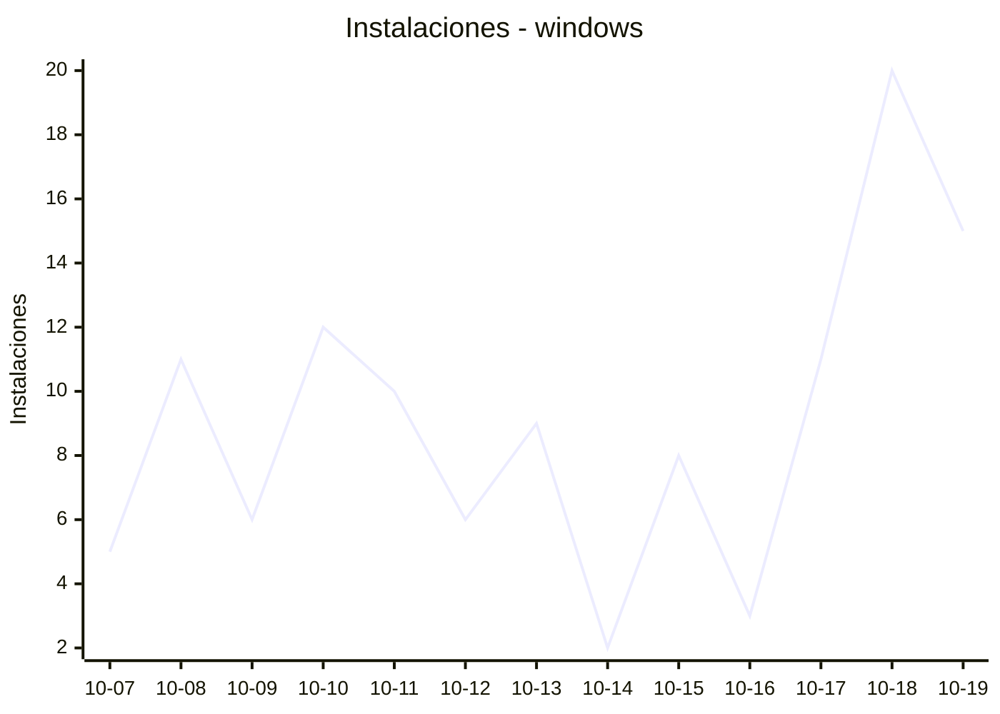
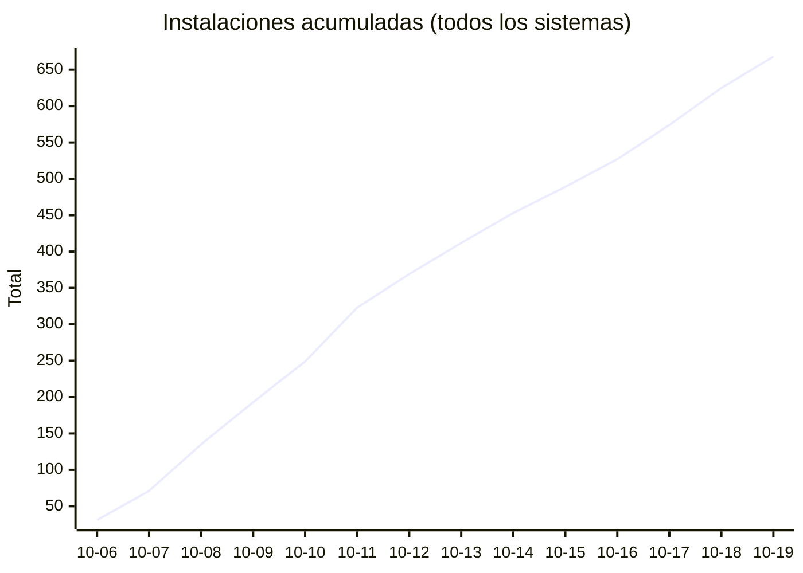
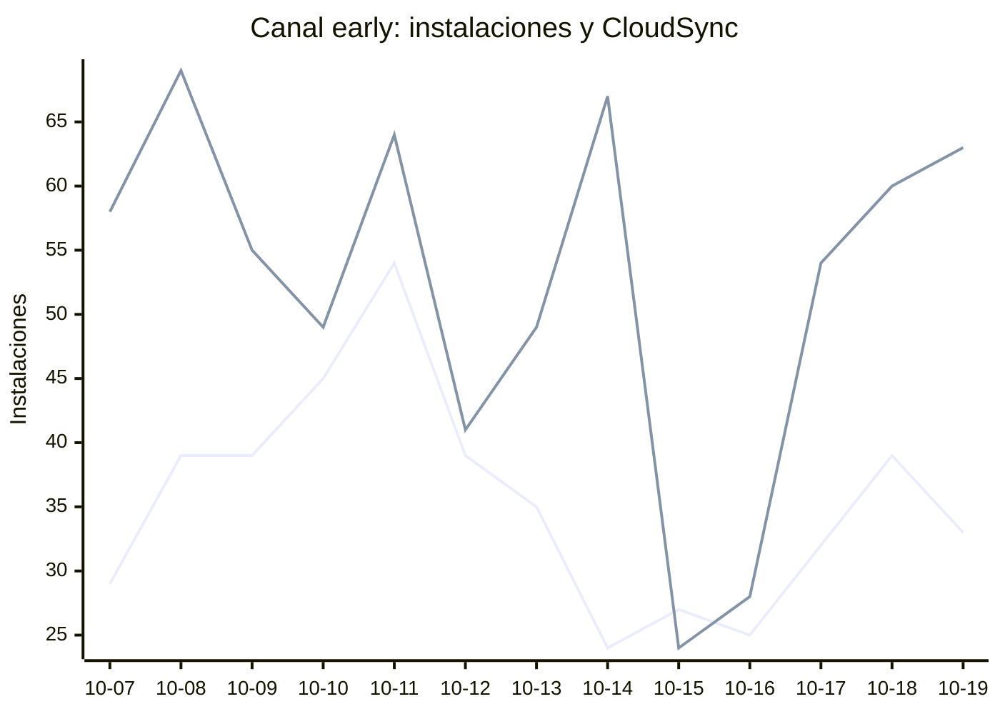

# Estadísticas de EmuDeck

Actualizado: 2026-10-20 22:13 UTC. Las gráficas no incluyen el día de hoy porque aún está incompleto.

## Arranques de la app (comprobaciones de actualización)

Cada arranque descarga el `latest*.yml` de su sistema. Cuenta arranques, no personas.

| Sistema | Ayer | Últimos 7 días |
|---|---|---|
| Linux x86 | 12882 | 98491 |
| Linux ARM | 162 | 1078 |
| Windows | 3342 | 25760 |
| Mac | 0 | 0 |

Instalaciones nuevas estimadas en Windows (7 días, `.exe` menos `.blockmap`): **2032**

## Instalaciones de EmuDeck (beacons)

Cada `setup` descarga `system-<sistema>.txt` y cada instalación de un emulador `<emulador>-<plataforma>.txt`. Los emuladores cuentan también las actualizaciones. Histórico completo desde el primer día.

| Sistema | Ayer | Últimos 7 días | Últimos 30 días | Total |
|---|---|---|---|---|
| linux | 22 | 198 | 450 | 495 |
| linux-arm | 6 | 33 | 69 | 78 |
| windows | 15 | 68 | 118 | 132 |

### Por mes

| Mes | Linux | Linux ARM | Windows | Total |
|---|---|---|---|---|
| 2026-10 | 450 | 69 | 118 | 637 |

### Canal early (early + early-unstable)

Instalaciones de EmuDeck con el backend en una rama early, y cuántas de ellas instalan CloudSync.

| | Últimos 7 días | Últimos 30 días | Total |
|---|---|---|---|
| Instalaciones early | 215 | 460 | 504 |
| Con CloudSync | 345 | 681 | 776 |
| % con CloudSync | | | 154% |

Línea de arriba: instalaciones early. Línea de abajo: de ellas, con CloudSync.

### Por emulador

| Emulador | Linux (total) | Linux ARM (total) | Windows (total) | Últimos 7 días | Últimos 30 días | Total |
|---|---|---|---|---|---|---|
| pcsx2 | 1314 | 19 | 159 | 698 | 1355 | 1492 |
| duckstation | 1272 | 97 | 53 | 668 | 1290 | 1422 |
| azahar | 1165 | 103 | 151 | 658 | 1281 | 1419 |
| esde | 1062 | 87 | 238 | 641 | 1233 | 1387 |
| ryujinx | 1124 | 103 | 151 | 654 | 1254 | 1378 |
| rpcs3 | 1184 | 99 | 53 | 639 | 1211 | 1336 |
| cemu | 1163 | 100 | 41 | 605 | 1187 | 1304 |
| xenia | 1060 | 87 | 125 | 596 | 1153 | 1272 |
| srm | 1030 | 83 | 153 | 622 | 1156 | 1266 |
| shadps4 | 1007 | 82 | 114 | 575 | 1086 | 1203 |
| vita3k | 1069 | 87 | 32 | 567 | 1073 | 1188 |
| cloudsync | 544 | 20 | 241 | 350 | 704 | 805 |
| ppsspp | 442 | 66 | 112 | 260 | 560 | 620 |
| ra | 478 | 69 | 66 | 256 | 558 | 613 |
| dolphin | 482 | 70 | 60 | 266 | 560 | 612 |
| mgba | 468 | 37 | 34 | 261 | 494 | 539 |
| melonds | 417 | 55 | 43 | 225 | 465 | 515 |
| xemu | 411 | 58 | 41 | 215 | 463 | 510 |
| primehack | 360 | 53 | 45 | 191 | 413 | 458 |
| supermodel | 353 | 66 | 9 | 181 | 388 | 428 |
| model2 | 349 | 69 | 7 | 180 | 385 | 425 |
| scummvm | 345 | 49 | 24 | 173 | 375 | 418 |
| bigpemu | 325 | 4 | 8 | 170 | 306 | 337 |
| armsx2 | 97 | 106 | 0 | 95 | 183 | 203 |
| flycast | 90 | 14 | 10 | 45 | 105 | 114 |
| rmg | 87 | 23 | 0 | 52 | 104 | 110 |
| eden | 69 | 7 | 0 | 52 | 64 | 76 |
| mame | 55 | 2 | 10 | 22 | 61 | 67 |
| pegasus | 9 | 0 | 10 | 13 | 17 | 19 |
| yuzu | 6 | 0 | 0 | 2 | 6 | 6 |
| ares | 4 | 1 | 0 | 1 | 5 | 5 |
| citron | 4 | 0 | 0 | 3 | 4 | 4 |
