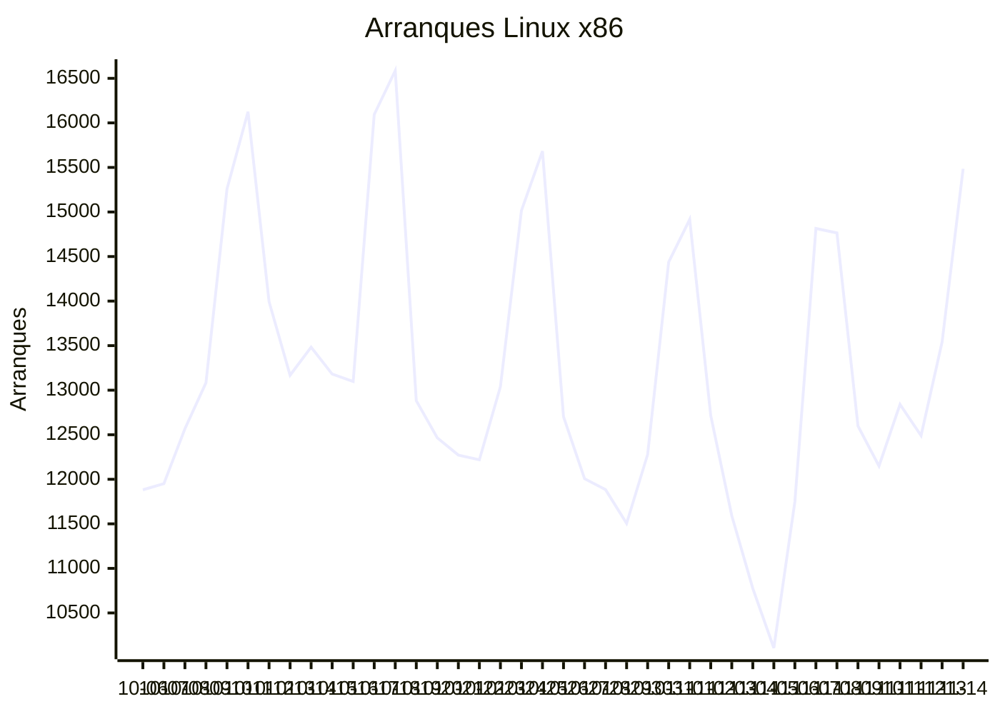
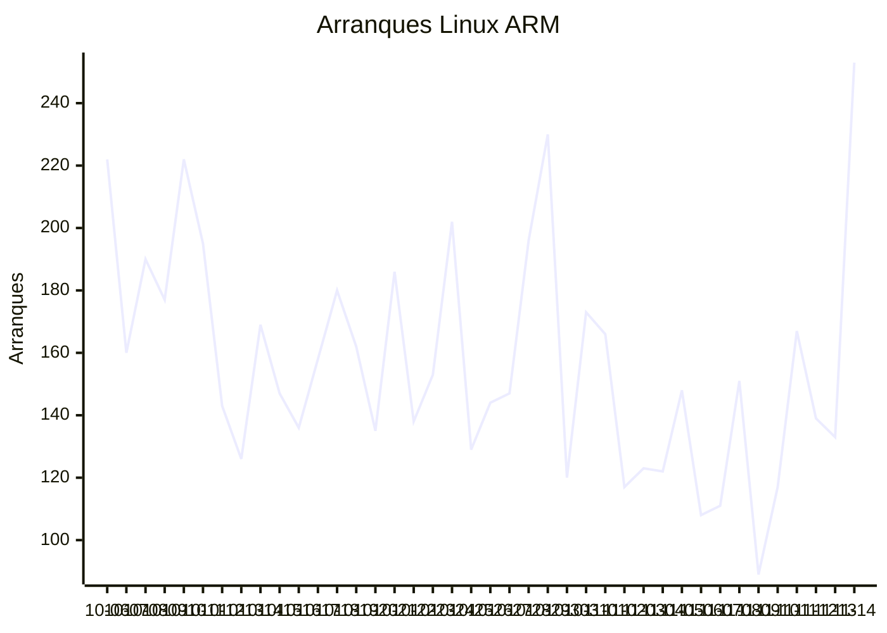
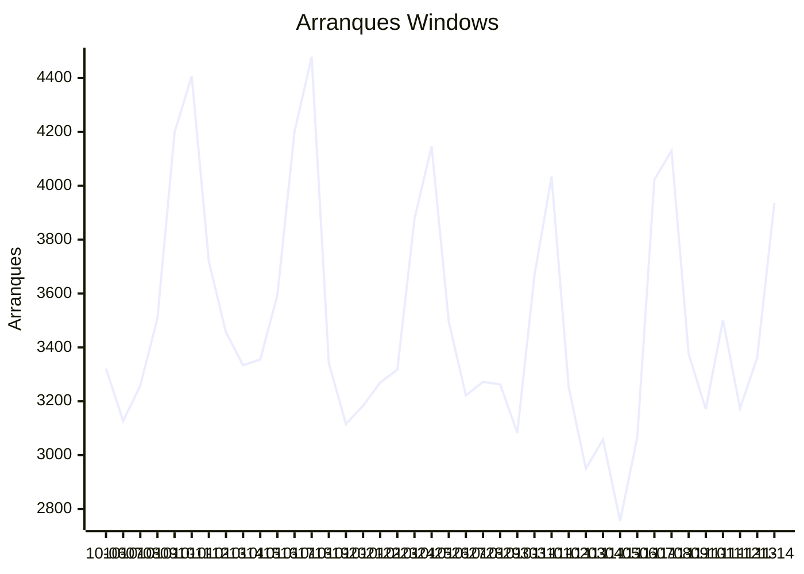
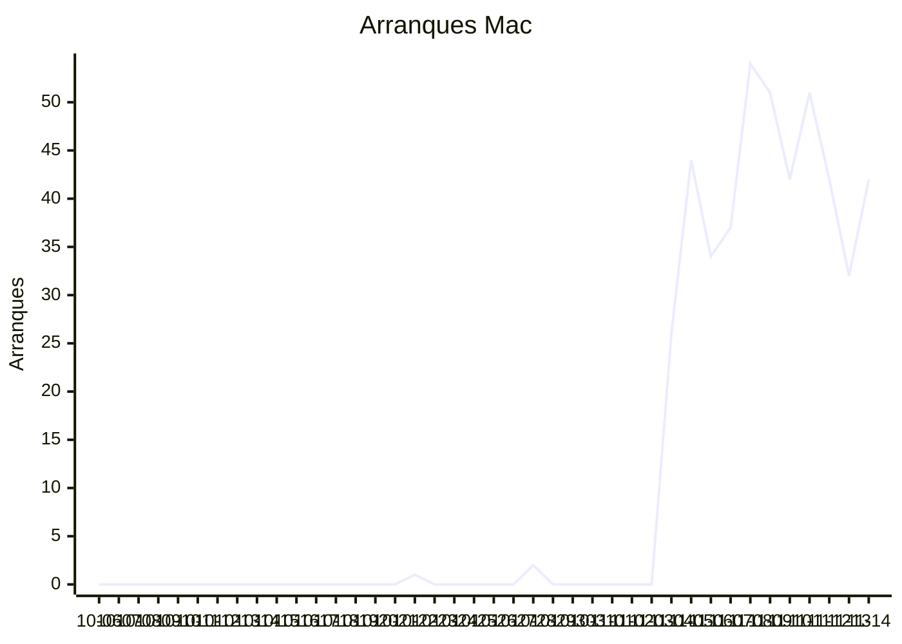
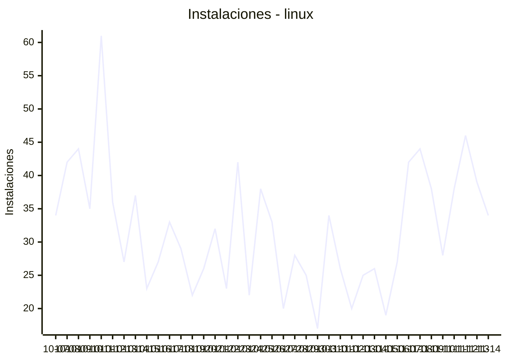
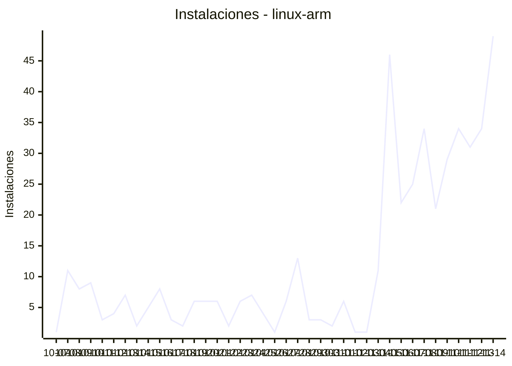
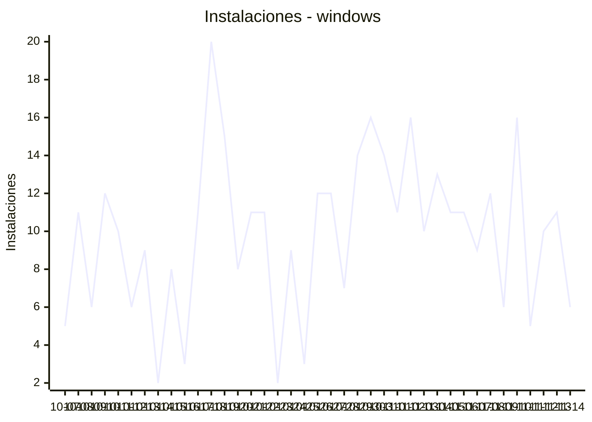
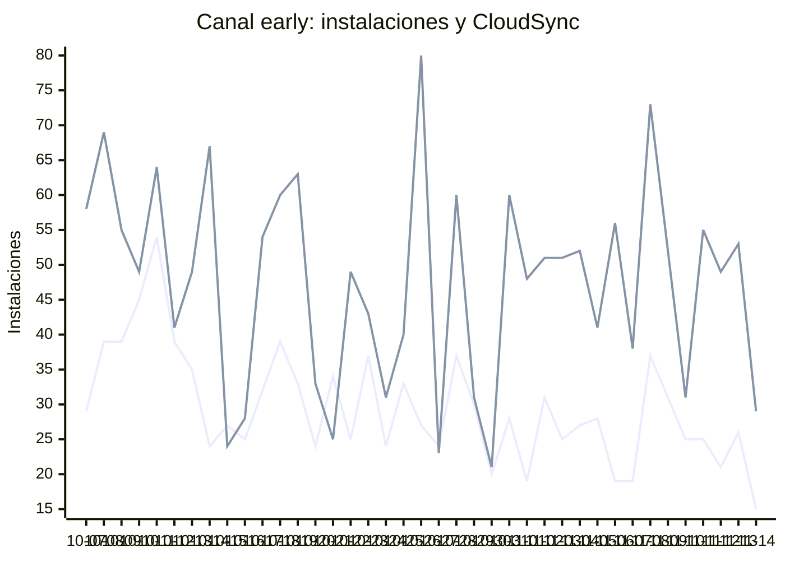

# Estadísticas de EmuDeck

Actualizado: 2026-11-15 23:34 UTC. Las gráficas no incluyen el día de hoy porque aún está incompleto.

## Arranques de la app (comprobaciones de actualización)

Cada arranque descarga el `latest*.yml` de su sistema. Cuenta arranques, no personas.

| Sistema | Ayer | Últimos 7 días |
|---|---|---|
| Linux x86 | 15485 | 93869 |
| Linux ARM | 253 | 1049 |
| Windows | 3936 | 24651 |
| Mac | 42 | 314 |

Instalaciones nuevas estimadas en Windows (7 días, `.exe` menos `.blockmap`): **2546**

## Instalaciones de EmuDeck (beacons)

Cada `setup` descarga `system-<sistema>.txt` y cada instalación de un emulador `<emulador>-<plataforma>.txt`. Los emuladores cuentan también las actualizaciones. Histórico completo desde el primer día.

| Sistema | Ayer | Últimos 7 días | Últimos 30 días | Total |
|---|---|---|---|---|
| linux | 34 | 267 | 903 | 1314 |
| linux-arm | 49 | 232 | 422 | 501 |
| windows | 6 | 66 | 315 | 400 |

### Por mes

| Mes | Linux | Linux ARM | Windows | Total |
|---|---|---|---|---|
| 2026-11 | 452 | 344 | 147 | 943 |
| 2026-10 | 790 | 128 | 237 | 1155 |

### Canal early (early + early-unstable)

Instalaciones de EmuDeck con el backend en una rama early, y cuántas de ellas instalan CloudSync.

| | Últimos 7 días | Últimos 30 días | Total |
|---|---|---|---|
| Instalaciones early | 180 | 820 | 1201 |
| Con CloudSync | 342 | 1380 | 1978 |
| % con CloudSync | | | 165% |

Línea de arriba: instalaciones early. Línea de abajo: de ellas, con CloudSync.

### Por emulador

| Emulador | Linux (total) | Linux ARM (total) | Windows (total) | Últimos 7 días | Últimos 30 días | Total |
|---|---|---|---|---|---|---|
| esde | 2913 | 505 | 823 | 920 | 3150 | 4241 |
| azahar | 3081 | 600 | 442 | 854 | 2994 | 4123 |
| ryujinx | 3027 | 592 | 445 | 866 | 2951 | 4064 |
| duckstation | 3337 | 545 | 175 | 826 | 2944 | 4057 |
| pcsx2 | 3506 | 38 | 473 | 703 | 2858 | 4017 |
| rpcs3 | 3190 | 564 | 178 | 828 | 2874 | 3932 |
| srm | 2881 | 485 | 547 | 874 | 2934 | 3913 |
| cemu | 3036 | 538 | 156 | 760 | 2690 | 3730 |
| xenia | 2835 | 445 | 383 | 736 | 2661 | 3663 |
| vita3k | 2753 | 481 | 120 | 684 | 2428 | 3354 |
| shadps4 | 2655 | 232 | 344 | 547 | 2313 | 3231 |
| cloudsync | 1316 | 56 | 674 | 354 | 1425 | 2046 |
| ppsspp | 1125 | 387 | 367 | 460 | 1374 | 1879 |
| dolphin | 1230 | 432 | 185 | 445 | 1328 | 1847 |
| ra | 1239 | 400 | 205 | 433 | 1333 | 1844 |
| xemu | 1045 | 331 | 141 | 360 | 1091 | 1517 |
| mgba | 1277 | 122 | 91 | 289 | 1071 | 1490 |
| melonds | 1018 | 333 | 126 | 345 | 1044 | 1477 |
| primehack | 951 | 351 | 142 | 360 | 1051 | 1444 |
| supermodel | 887 | 319 | 43 | 295 | 877 | 1249 |
| scummvm | 849 | 291 | 90 | 292 | 874 | 1230 |
| model2 | 870 | 333 | 13 | 290 | 853 | 1216 |
| bigpemu | 844 | 39 | 37 | 162 | 654 | 920 |
| armsx2 | 276 | 623 | 0 | 303 | 711 | 899 |
| flycast | 220 | 40 | 37 | 55 | 198 | 297 |
| rmg | 216 | 62 | 0 | 71 | 186 | 278 |
| mame | 125 | 13 | 47 | 46 | 127 | 185 |
| eden | 133 | 11 | 20 | 43 | 123 | 164 |
| pegasus | 41 | 3 | 28 | 14 | 52 | 72 |
| yuzu | 16 | 0 | 8 | 7 | 18 | 24 |
| ares | 17 | 3 | 0 | 5 | 15 | 20 |
| citron | 6 | 0 | 2 | 1 | 5 | 8 |
