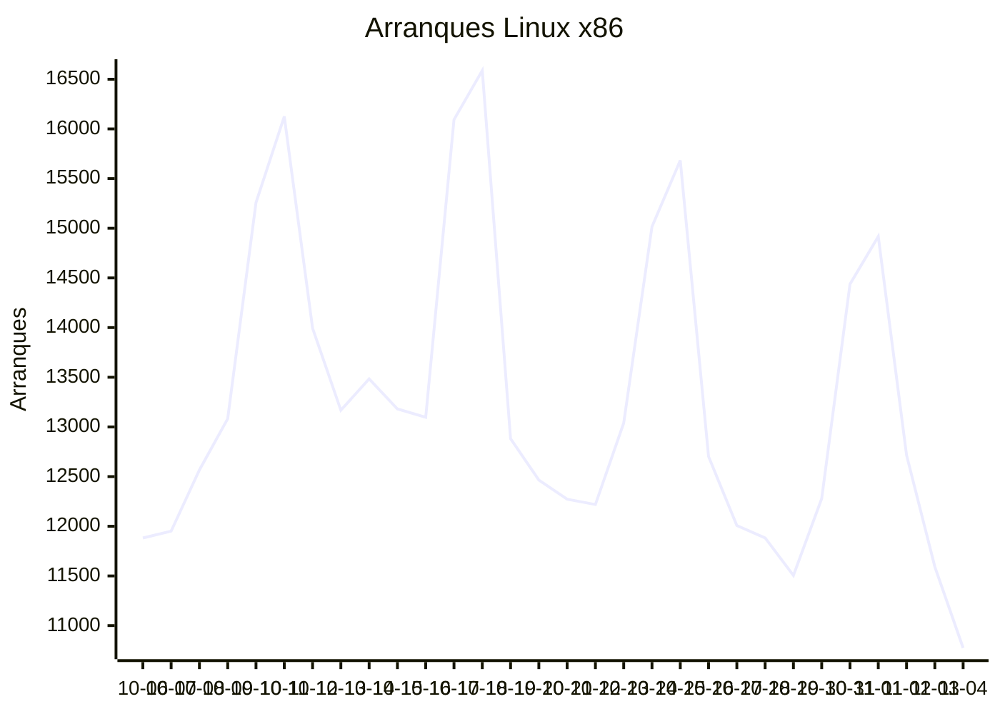
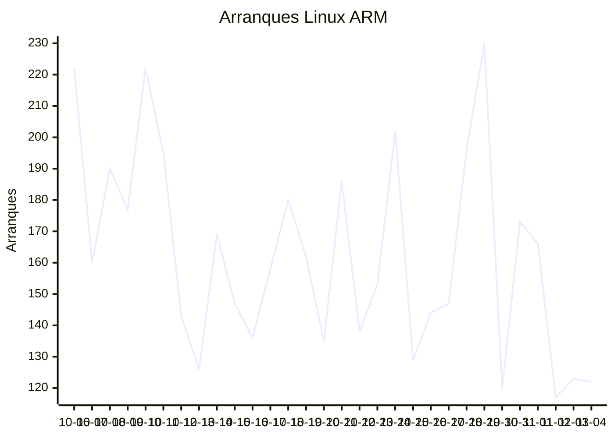
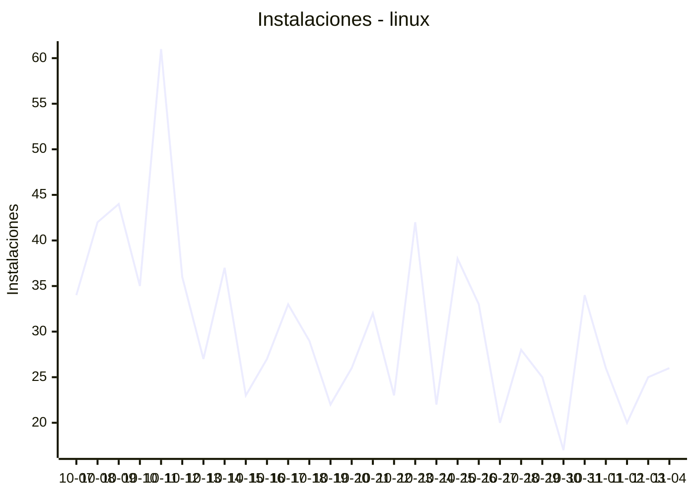
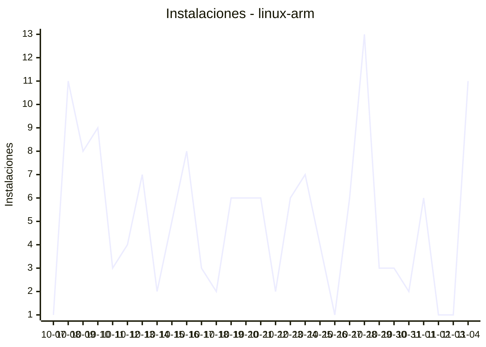
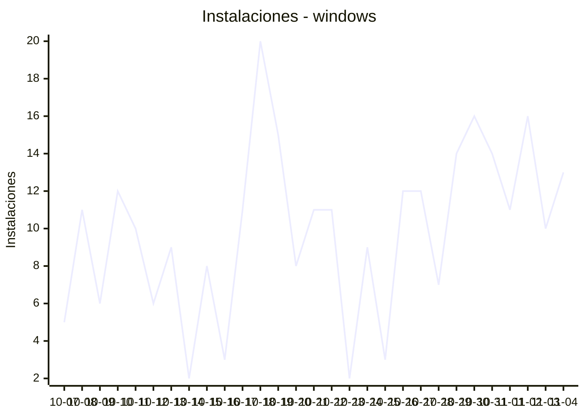
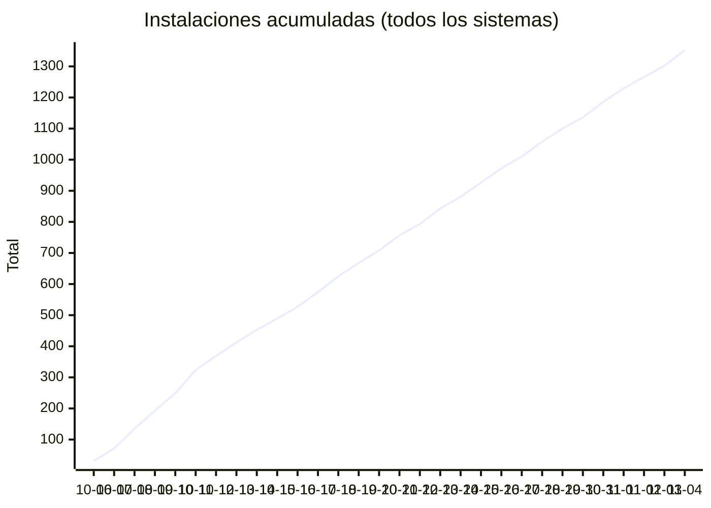
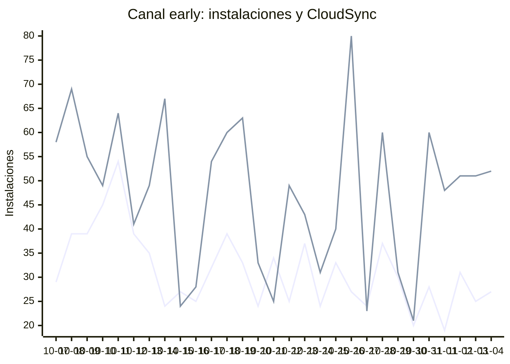

# Estadísticas de EmuDeck

Actualizado: 2026-11-05 04:35 UTC. Las gráficas no incluyen el día de hoy porque aún está incompleto.

## Arranques de la app (comprobaciones de actualización)

Cada arranque descarga el `latest*.yml` de su sistema. Cuenta arranques, no personas.

| Sistema | Ayer | Últimos 7 días |
|---|---|---|
| Linux x86 | 10775 | 88221 |
| Linux ARM | 122 | 1051 |
| Windows | 3058 | 23307 |
| Mac | 26 | 26 |

Instalaciones nuevas estimadas en Windows (7 días, `.exe` menos `.blockmap`): **2207**

## Instalaciones de EmuDeck (beacons)

Cada `setup` descarga `system-<sistema>.txt` y cada instalación de un emulador `<emulador>-<plataforma>.txt`. Los emuladores cuentan también las actualizaciones. Histórico completo desde el primer día.

| Sistema | Ayer | Últimos 7 días | Últimos 30 días | Total |
|---|---|---|---|---|
| linux | 26 | 173 | 887 | 912 |
| linux-arm | 11 | 27 | 147 | 168 |
| windows | 13 | 94 | 287 | 298 |

### Por mes

| Mes | Linux | Linux ARM | Windows | Total |
|---|---|---|---|---|
| 2026-11 | 97 | 19 | 50 | 166 |
| 2026-10 | 790 | 128 | 237 | 1155 |

### Canal early (early + early-unstable)

Instalaciones de EmuDeck con el backend en una rama early, y cuántas de ellas instalan CloudSync.

| | Últimos 7 días | Últimos 30 días | Total |
|---|---|---|---|
| Instalaciones early | 180 | 905 | 936 |
| Con CloudSync | 314 | 1379 | 1456 |
| % con CloudSync | | | 156% |

Línea de arriba: instalaciones early. Línea de abajo: de ellas, con CloudSync.

### Por emulador

| Emulador | Linux (total) | Linux ARM (total) | Windows (total) | Últimos 7 días | Últimos 30 días | Total |
|---|---|---|---|---|---|---|
| pcsx2 | 2554 | 25 | 349 | 630 | 2830 | 2928 |
| esde | 2103 | 218 | 577 | 712 | 2771 | 2898 |
| azahar | 2239 | 250 | 338 | 606 | 2716 | 2827 |
| duckstation | 2435 | 232 | 138 | 573 | 2694 | 2805 |
| ryujinx | 2169 | 242 | 324 | 565 | 2631 | 2735 |
| rpcs3 | 2321 | 229 | 135 | 563 | 2582 | 2685 |
| srm | 2022 | 194 | 368 | 550 | 2512 | 2584 |
| cemu | 2227 | 234 | 121 | 523 | 2488 | 2582 |
| xenia | 2070 | 187 | 293 | 541 | 2458 | 2550 |
| shadps4 | 1947 | 187 | 263 | 521 | 2313 | 2397 |
| vita3k | 2024 | 203 | 94 | 471 | 2227 | 2321 |
| cloudsync | 973 | 43 | 495 | 330 | 1432 | 1511 |
| ppsspp | 805 | 139 | 268 | 253 | 1160 | 1212 |
| ra | 886 | 149 | 157 | 241 | 1143 | 1192 |
| dolphin | 881 | 160 | 146 | 234 | 1135 | 1187 |
| mgba | 917 | 63 | 68 | 220 | 1014 | 1048 |
| xemu | 751 | 124 | 112 | 188 | 943 | 987 |
| melonds | 737 | 120 | 100 | 181 | 911 | 957 |
| primehack | 668 | 119 | 114 | 189 | 859 | 901 |
| supermodel | 637 | 133 | 31 | 157 | 765 | 801 |
| scummvm | 614 | 103 | 73 | 153 | 750 | 790 |
| model2 | 628 | 138 | 11 | 147 | 739 | 777 |
| bigpemu | 620 | 17 | 21 | 140 | 630 | 658 |
| armsx2 | 190 | 268 | 0 | 92 | 427 | 458 |
| flycast | 160 | 21 | 27 | 37 | 199 | 208 |
| rmg | 152 | 33 | 0 | 24 | 176 | 185 |
| mame | 88 | 6 | 25 | 26 | 112 | 119 |
| eden | 91 | 9 | 7 | 13 | 99 | 107 |
| pegasus | 25 | 1 | 21 | 17 | 45 | 47 |
| yuzu | 10 | 0 | 5 | 5 | 15 | 15 |
| ares | 10 | 2 | 0 | 2 | 12 | 12 |
| citron | 6 | 0 | 0 | 1 | 6 | 6 |
