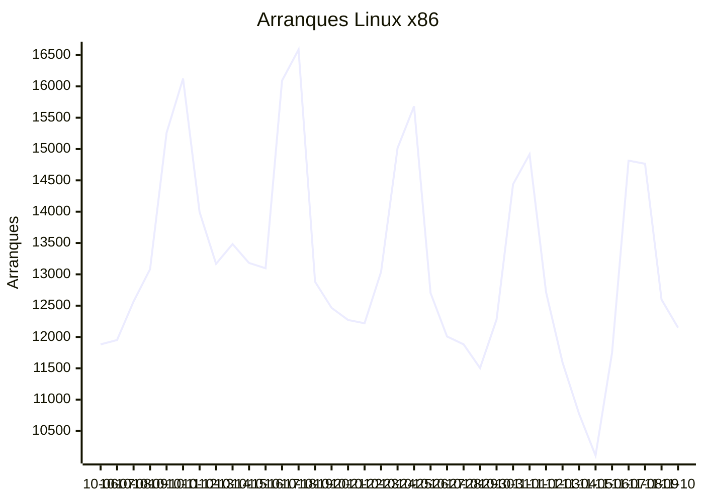
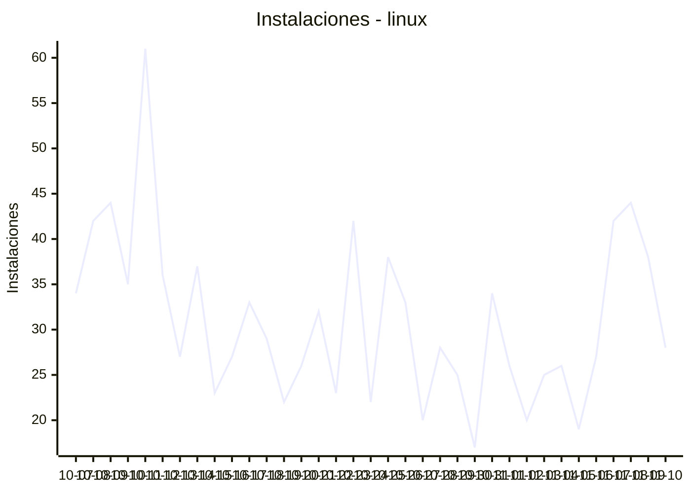
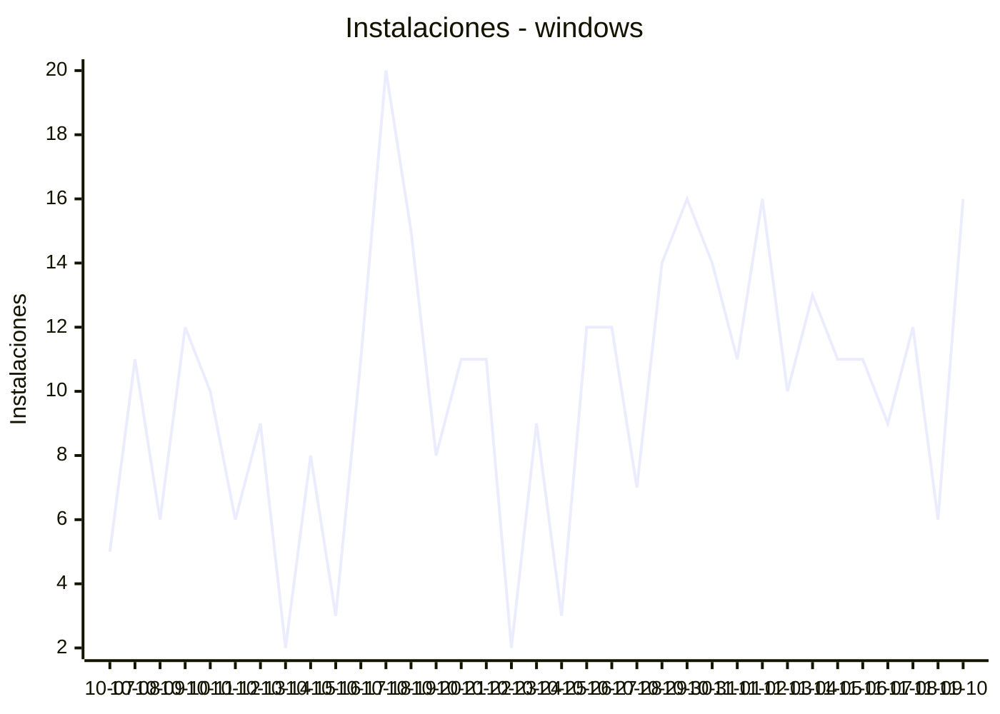
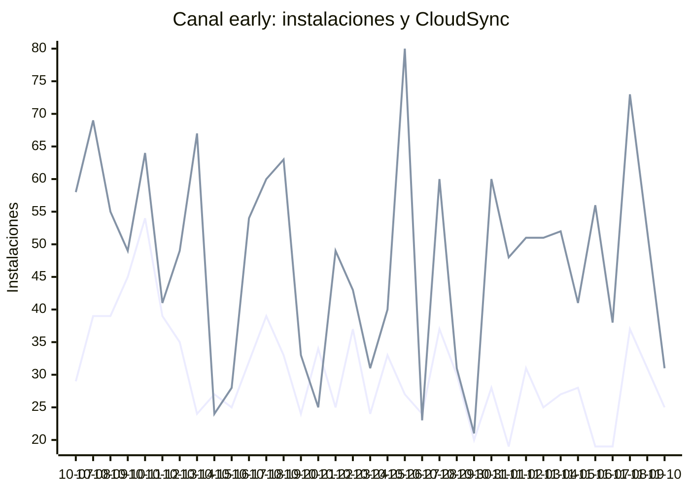

# Estadísticas de EmuDeck

Actualizado: 2026-11-11 21:35 UTC. Las gráficas no incluyen el día de hoy porque aún está incompleto.

## Arranques de la app (comprobaciones de actualización)

Cada arranque descarga el `latest*.yml` de su sistema. Cuenta arranques, no personas.

| Sistema | Ayer | Últimos 7 días |
|---|---|---|
| Linux x86 | 12149 | 86956 |
| Linux ARM | 117 | 846 |
| Windows | 3171 | 23579 |
| Mac | 42 | 288 |

Instalaciones nuevas estimadas en Windows (7 días, `.exe` menos `.blockmap`): **2371**

## Instalaciones de EmuDeck (beacons)

Cada `setup` descarga `system-<sistema>.txt` y cada instalación de un emulador `<emulador>-<plataforma>.txt`. Los emuladores cuentan también las actualizaciones. Histórico completo desde el primer día.

| Sistema | Ayer | Últimos 7 días | Últimos 30 días | Total |
|---|---|---|---|---|
| linux | 28 | 224 | 869 | 1138 |
| linux-arm | 29 | 188 | 292 | 360 |
| windows | 16 | 78 | 308 | 364 |

### Por mes

| Mes | Linux | Linux ARM | Windows | Total |
|---|---|---|---|---|
| 2026-11 | 295 | 196 | 115 | 606 |
| 2026-10 | 790 | 128 | 237 | 1155 |

### Canal early (early + early-unstable)

Instalaciones de EmuDeck con el backend en una rama early, y cuántas de ellas instalan CloudSync.

| | Últimos 7 días | Últimos 30 días | Total |
|---|---|---|---|
| Instalaciones early | 186 | 858 | 1109 |
| Con CloudSync | 343 | 1375 | 1780 |
| % con CloudSync | | | 161% |

Línea de arriba: instalaciones early. Línea de abajo: de ellas, con CloudSync.

### Por emulador

| Emulador | Linux (total) | Linux ARM (total) | Windows (total) | Últimos 7 días | Últimos 30 días | Total |
|---|---|---|---|---|---|---|
| esde | 2565 | 368 | 714 | 786 | 2954 | 3647 |
| azahar | 2719 | 432 | 398 | 760 | 2846 | 3549 |
| pcsx2 | 3091 | 33 | 423 | 666 | 2839 | 3547 |
| duckstation | 2944 | 405 | 162 | 746 | 2816 | 3511 |
| ryujinx | 2639 | 430 | 404 | 762 | 2777 | 3473 |
| rpcs3 | 2803 | 399 | 165 | 717 | 2723 | 3367 |
| srm | 2492 | 351 | 489 | 760 | 2722 | 3332 |
| cemu | 2675 | 394 | 145 | 666 | 2578 | 3214 |
| xenia | 2488 | 326 | 351 | 649 | 2565 | 3165 |
| vita3k | 2429 | 351 | 114 | 606 | 2331 | 2894 |
| shadps4 | 2328 | 218 | 321 | 518 | 2308 | 2867 |
| cloudsync | 1178 | 50 | 612 | 348 | 1417 | 1840 |
| ppsspp | 987 | 271 | 332 | 388 | 1244 | 1590 |
| ra | 1080 | 293 | 187 | 377 | 1219 | 1560 |
| dolphin | 1072 | 311 | 172 | 371 | 1212 | 1555 |
| mgba | 1130 | 89 | 84 | 264 | 1054 | 1303 |
| xemu | 908 | 241 | 134 | 308 | 1006 | 1283 |
| melonds | 893 | 243 | 117 | 301 | 973 | 1253 |
| primehack | 823 | 247 | 134 | 313 | 943 | 1204 |
| supermodel | 775 | 239 | 38 | 262 | 818 | 1052 |
| scummvm | 740 | 212 | 84 | 254 | 799 | 1036 |
| model2 | 763 | 255 | 13 | 259 | 791 | 1031 |
| bigpemu | 746 | 31 | 33 | 165 | 654 | 810 |
| armsx2 | 233 | 456 | 0 | 241 | 569 | 689 |
| flycast | 197 | 36 | 34 | 58 | 202 | 267 |
| rmg | 195 | 52 | 0 | 57 | 185 | 247 |
| mame | 112 | 13 | 38 | 47 | 118 | 163 |
| eden | 119 | 11 | 20 | 27 | 116 | 150 |
| pegasus | 35 | 3 | 26 | 14 | 55 | 64 |
| yuzu | 14 | 0 | 8 | 6 | 17 | 22 |
| ares | 14 | 2 | 0 | 4 | 14 | 16 |
| citron | 6 | 0 | 2 | 2 | 6 | 8 |
