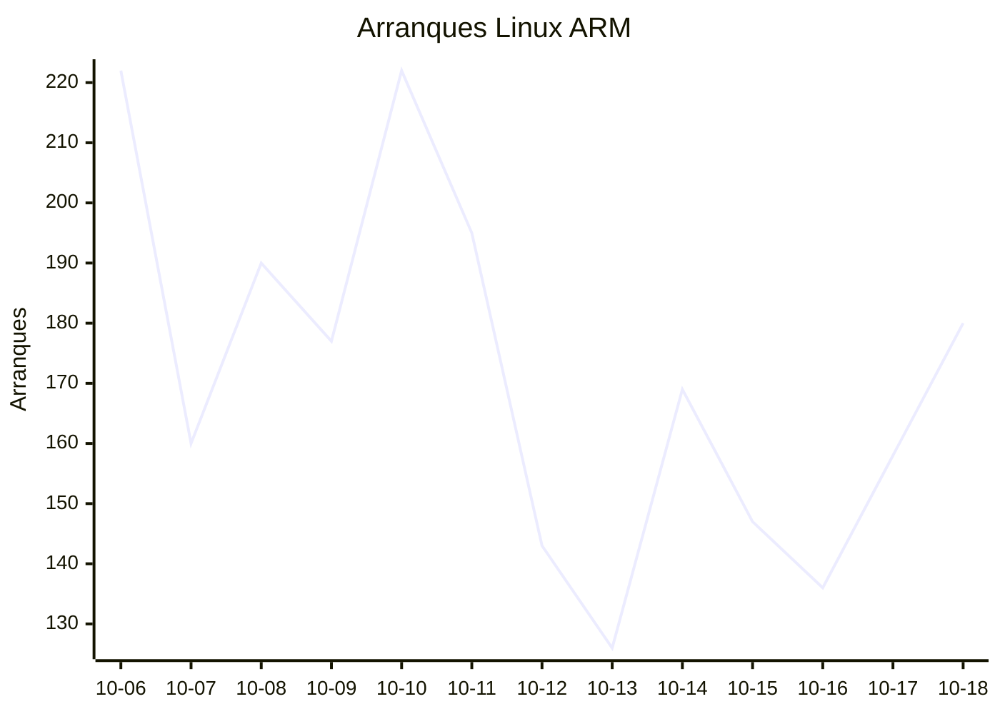
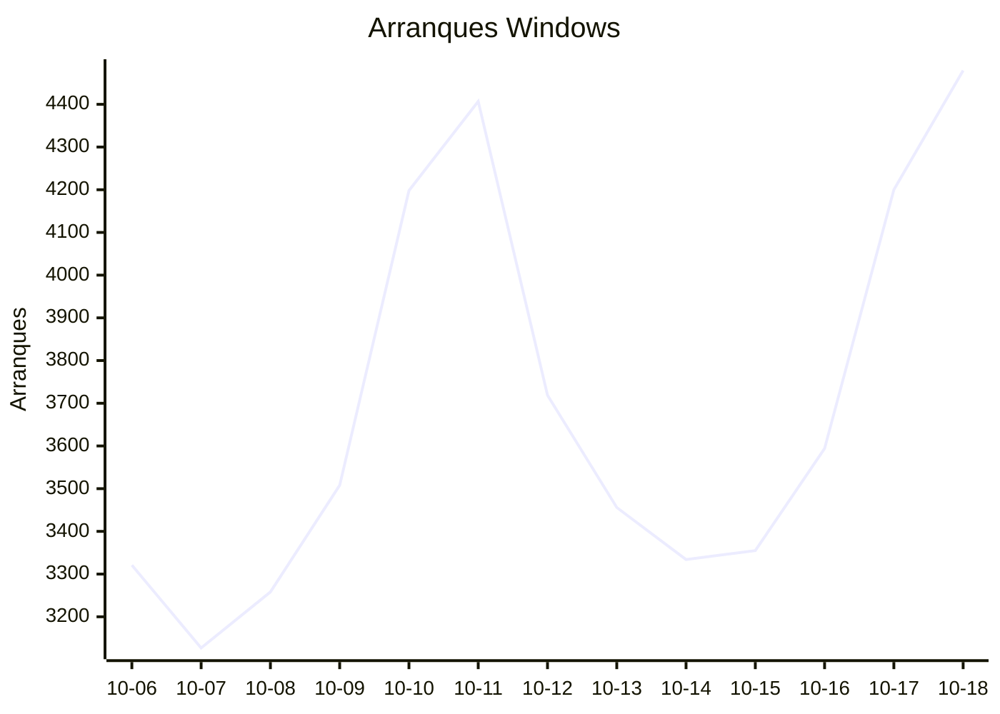
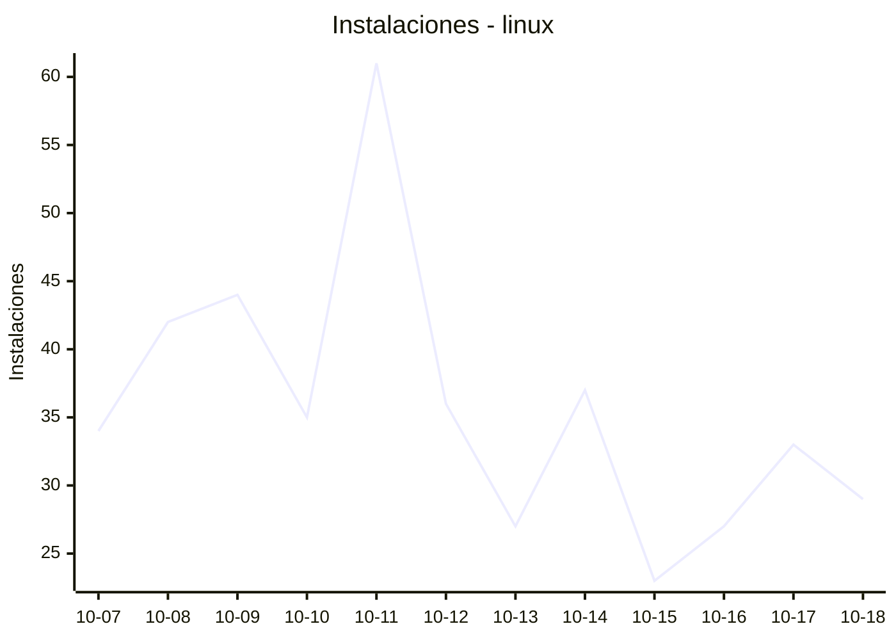
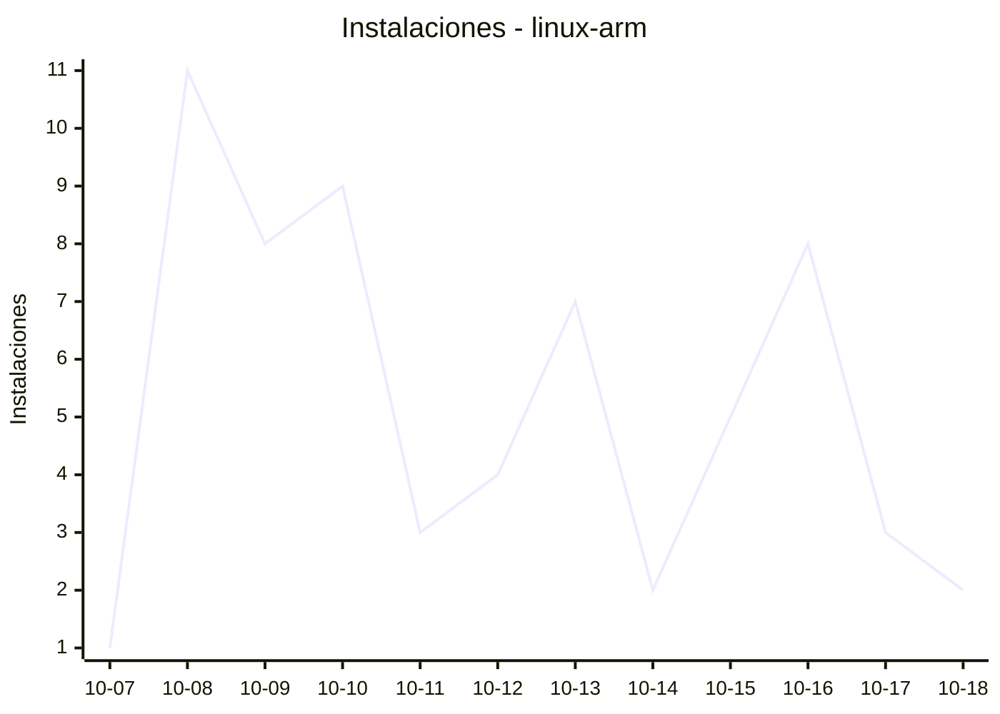
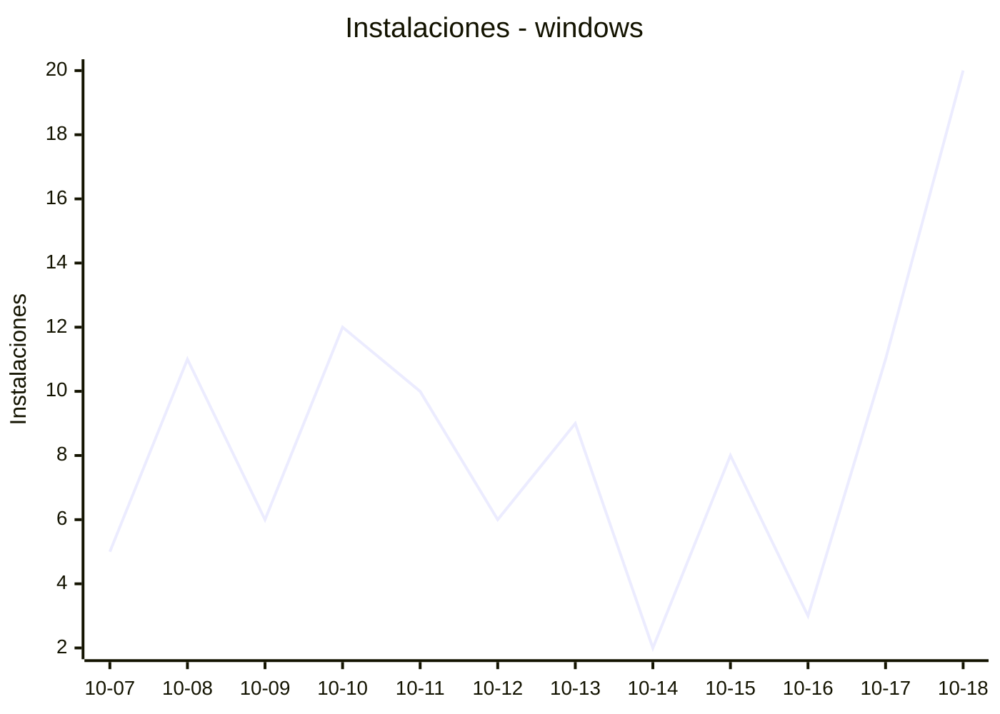
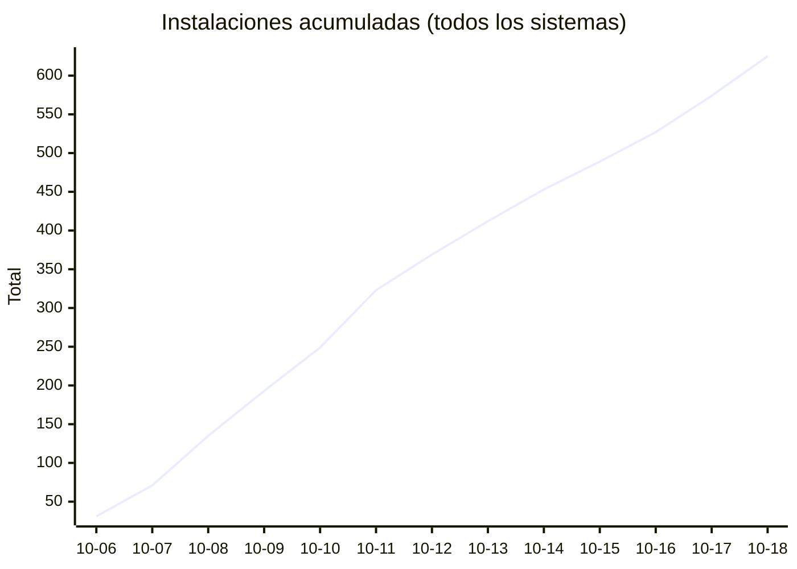
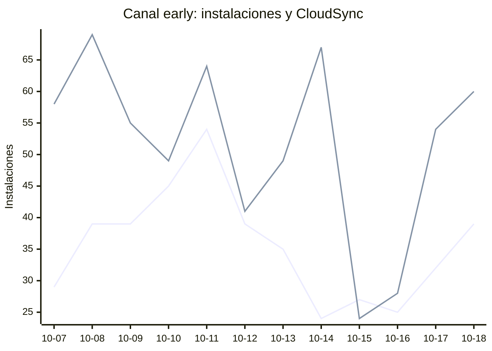

# Estadísticas de EmuDeck

Actualizado: 2026-10-19 23:38 UTC. Las gráficas no incluyen el día de hoy porque aún está incompleto.

## Arranques de la app (comprobaciones de actualización)

Cada arranque descarga el `latest*.yml` de su sistema. Cuenta arranques, no personas.

| Sistema | Ayer | Últimos 7 días |
|---|---|---|
| Linux x86 | 16587 | 99603 |
| Linux ARM | 180 | 1059 |
| Windows | 4479 | 26137 |
| Mac | 0 | 0 |

Instalaciones nuevas estimadas en Windows (7 días, `.exe` menos `.blockmap`): **2010**

## Instalaciones de EmuDeck (beacons)

Cada `setup` descarga `system-<sistema>.txt` y cada instalación de un emulador `<emulador>-<plataforma>.txt`. Los emuladores cuentan también las actualizaciones. Histórico completo desde el primer día.

| Sistema | Ayer | Últimos 7 días | Últimos 30 días | Total |
|---|---|---|---|---|
| linux | 29 | 212 | 428 | 471 |
| linux-arm | 2 | 31 | 63 | 72 |
| windows | 20 | 59 | 103 | 125 |

### Por mes

| Mes | Linux | Linux ARM | Windows | Total |
|---|---|---|---|---|
| 2026-10 | 428 | 63 | 103 | 594 |

### Canal early (early + early-unstable)

Instalaciones de EmuDeck con el backend en una rama early, y cuántas de ellas instalan CloudSync.

| | Últimos 7 días | Últimos 30 días | Total |
|---|---|---|---|
| Instalaciones early | 221 | 427 | 483 |
| Con CloudSync | 323 | 618 | 745 |
| % con CloudSync | | | 154% |

Línea de arriba: instalaciones early. Línea de abajo: de ellas, con CloudSync.

### Por emulador

| Emulador | Linux (total) | Linux ARM (total) | Windows (total) | Últimos 7 días | Últimos 30 días | Total |
|---|---|---|---|---|---|---|
| pcsx2 | 1257 | 19 | 152 | 701 | 1262 | 1428 |
| duckstation | 1219 | 90 | 53 | 667 | 1197 | 1362 |
| azahar | 1117 | 94 | 144 | 660 | 1191 | 1355 |
| esde | 1017 | 81 | 226 | 633 | 1138 | 1324 |
| ryujinx | 1080 | 94 | 146 | 648 | 1166 | 1320 |
| rpcs3 | 1133 | 91 | 53 | 642 | 1129 | 1277 |
| cemu | 1117 | 92 | 40 | 617 | 1104 | 1249 |
| xenia | 1015 | 80 | 116 | 599 | 1065 | 1211 |
| srm | 989 | 74 | 140 | 616 | 1076 | 1203 |
| shadps4 | 966 | 75 | 108 | 573 | 1012 | 1149 |
| vita3k | 1025 | 79 | 31 | 573 | 998 | 1135 |
| cloudsync | 522 | 20 | 228 | 329 | 640 | 770 |
| ppsspp | 425 | 61 | 105 | 264 | 522 | 591 |
| dolphin | 466 | 64 | 59 | 272 | 526 | 589 |
| ra | 459 | 64 | 63 | 262 | 521 | 586 |
| mgba | 446 | 36 | 33 | 265 | 462 | 515 |
| melonds | 400 | 50 | 42 | 234 | 438 | 492 |
| xemu | 394 | 53 | 41 | 224 | 434 | 488 |
| primehack | 346 | 49 | 42 | 197 | 387 | 437 |
| supermodel | 339 | 60 | 9 | 191 | 367 | 408 |
| model2 | 335 | 63 | 7 | 185 | 361 | 405 |
| scummvm | 331 | 44 | 23 | 180 | 354 | 398 |
| bigpemu | 312 | 4 | 8 | 157 | 278 | 324 |
| armsx2 | 94 | 98 | 0 | 89 | 165 | 192 |
| flycast | 87 | 13 | 10 | 49 | 102 | 110 |
| rmg | 86 | 22 | 0 | 54 | 99 | 108 |
| eden | 65 | 7 | 0 | 50 | 58 | 72 |
| mame | 53 | 2 | 10 | 20 | 58 | 65 |
| pegasus | 9 | 0 | 10 | 13 | 17 | 19 |
| yuzu | 6 | 0 | 0 | 2 | 6 | 6 |
| ares | 4 | 1 | 0 | 2 | 4 | 5 |
| citron | 4 | 0 | 0 | 3 | 4 | 4 |
