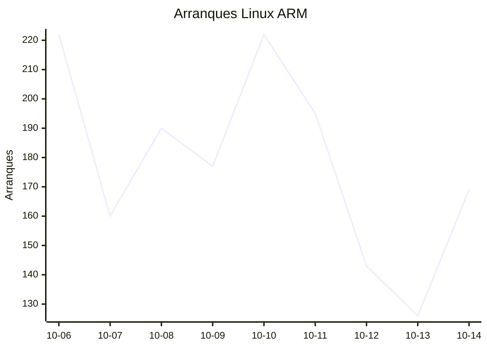
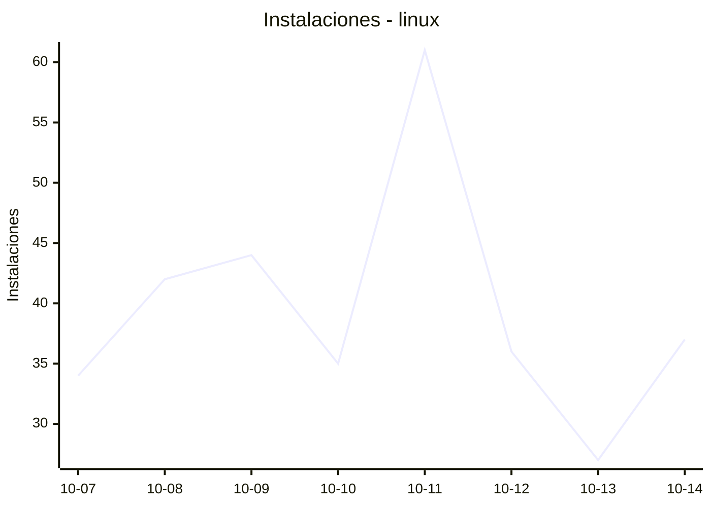
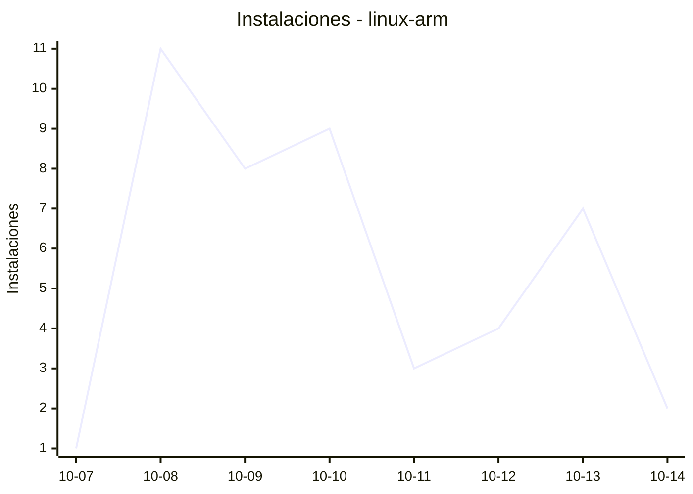
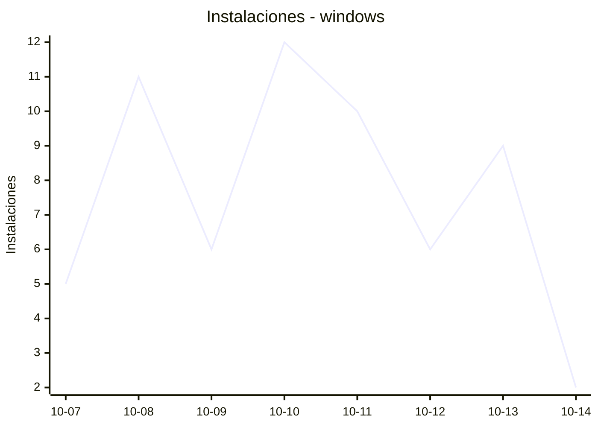
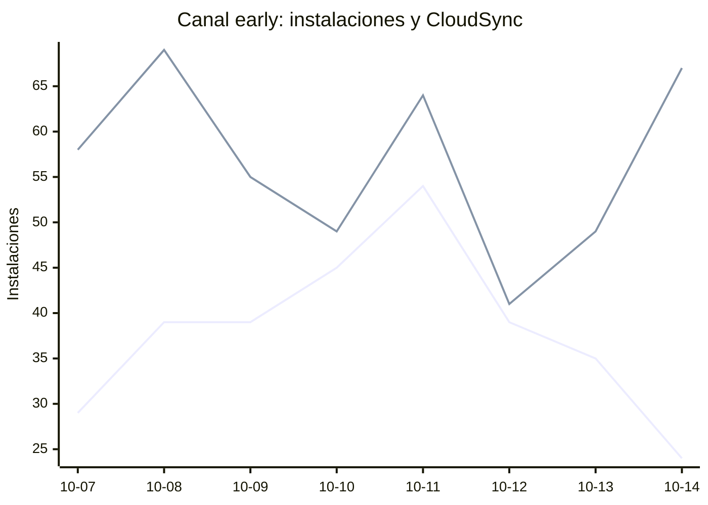

# Estadísticas de EmuDeck

Actualizado: 2026-10-15 23:35 UTC. Las gráficas no incluyen el día de hoy porque aún está incompleto.

## Arranques de la app (comprobaciones de actualización)

Cada arranque descarga el `latest*.yml` de su sistema. Cuenta arranques, no personas.

| Sistema | Ayer | Últimos 7 días |
|---|---|---|
| Linux x86 | 13483 | 97678 |
| Linux ARM | 169 | 1222 |
| Windows | 3334 | 25880 |
| Mac | 0 | 0 |

Instalaciones nuevas estimadas en Windows (7 días, `.exe` menos `.blockmap`): **1663**

## Instalaciones de EmuDeck (beacons)

Cada `setup` descarga `system-<sistema>.txt` y cada instalación de un emulador `<emulador>-<plataforma>.txt`. Los emuladores cuentan también las actualizaciones. Histórico completo desde el primer día.

| Sistema | Ayer | Últimos 7 días | Últimos 30 días | Total |
|---|---|---|---|---|
| linux | 37 | 282 | 316 | 360 |
| linux-arm | 2 | 44 | 45 | 53 |
| windows | 2 | 56 | 61 | 76 |

### Por mes

| Mes | Linux | Linux ARM | Windows | Total |
|---|---|---|---|---|
| 2026-10 | 316 | 45 | 61 | 422 |

### Canal early (early + early-unstable)

Instalaciones de EmuDeck con el backend en una rama early, y cuántas de ellas instalan CloudSync.

| | Últimos 7 días | Últimos 30 días | Total |
|---|---|---|---|
| Instalaciones early | 275 | 304 | 354 |
| Con CloudSync | 394 | 452 | 540 |
| % con CloudSync | | | 153% |

Línea de arriba: instalaciones early. Línea de abajo: de ellas, con CloudSync.

### Por emulador

| Emulador | Linux (total) | Linux ARM (total) | Windows (total) | Últimos 7 días | Últimos 30 días | Total |
|---|---|---|---|---|---|---|
| pcsx2 | 900 | 16 | 105 | 778 | 873 | 1021 |
| azahar | 809 | 71 | 99 | 739 | 827 | 979 |
| duckstation | 868 | 69 | 34 | 738 | 825 | 971 |
| esde | 737 | 61 | 153 | 709 | 793 | 951 |
| ryujinx | 769 | 73 | 101 | 704 | 788 | 943 |
| rpcs3 | 809 | 71 | 33 | 698 | 776 | 913 |
| cemu | 813 | 72 | 22 | 695 | 775 | 907 |
| xenia | 736 | 59 | 74 | 668 | 747 | 869 |
| srm | 707 | 52 | 74 | 628 | 704 | 833 |
| shadps4 | 693 | 58 | 63 | 603 | 684 | 814 |
| vita3k | 730 | 61 | 16 | 614 | 682 | 807 |
| cloudsync | 393 | 16 | 152 | 410 | 470 | 561 |
| dolphin | 351 | 51 | 42 | 350 | 384 | 444 |
| ppsspp | 317 | 47 | 73 | 348 | 379 | 437 |
| ra | 349 | 51 | 35 | 346 | 381 | 435 |
| mgba | 325 | 26 | 21 | 278 | 313 | 372 |
| melonds | 304 | 39 | 25 | 286 | 317 | 368 |
| xemu | 297 | 40 | 26 | 288 | 314 | 363 |
| primehack | 265 | 41 | 25 | 260 | 283 | 331 |
| supermodel | 263 | 47 | 8 | 256 | 277 | 318 |
| model2 | 257 | 50 | 4 | 251 | 273 | 311 |
| scummvm | 254 | 36 | 12 | 238 | 260 | 302 |
| bigpemu | 227 | 3 | 6 | 179 | 197 | 236 |
| armsx2 | 73 | 74 | 0 | 112 | 125 | 147 |
| flycast | 73 | 11 | 5 | 69 | 78 | 89 |
| rmg | 67 | 19 | 0 | 65 | 71 | 86 |
| mame | 44 | 2 | 9 | 47 | 49 | 55 |
| eden | 33 | 6 | 0 | 29 | 29 | 39 |
| pegasus | 9 | 0 | 7 | 7 | 8 | 16 |
| yuzu | 6 | 0 | 0 | 6 | 6 | 6 |
| ares | 3 | 1 | 0 | 3 | 4 | 4 |
| citron | 3 | 0 | 0 | 2 | 2 | 3 |
