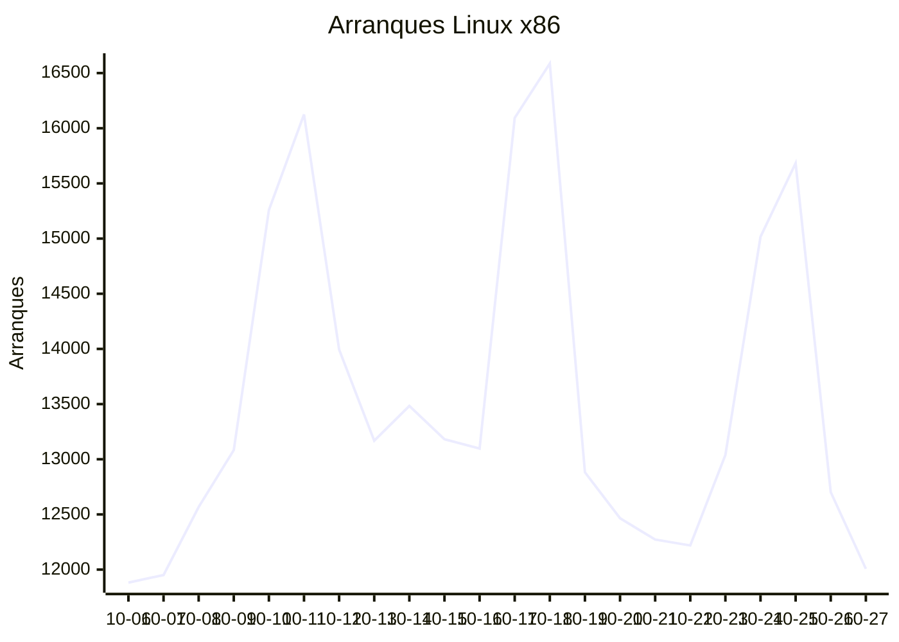
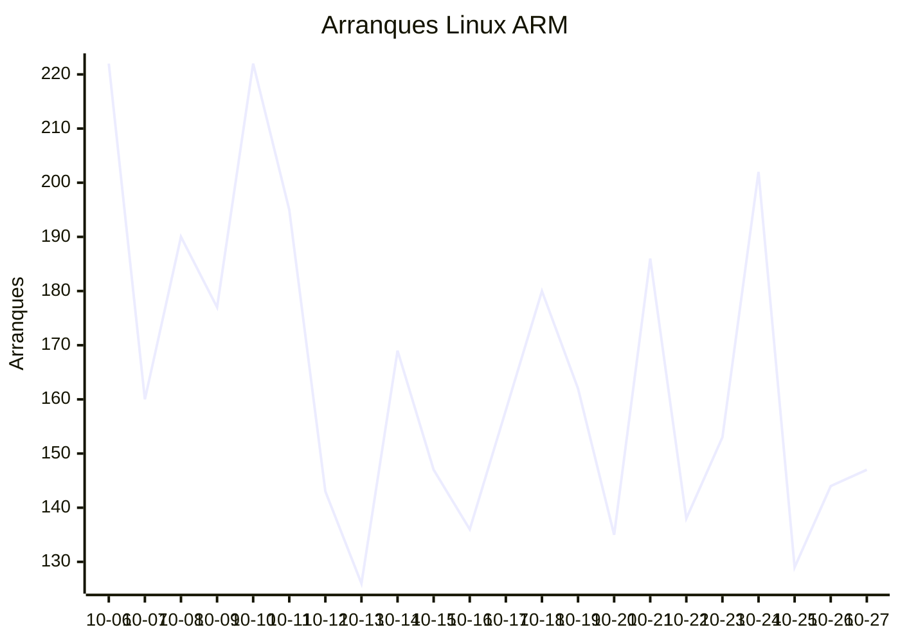
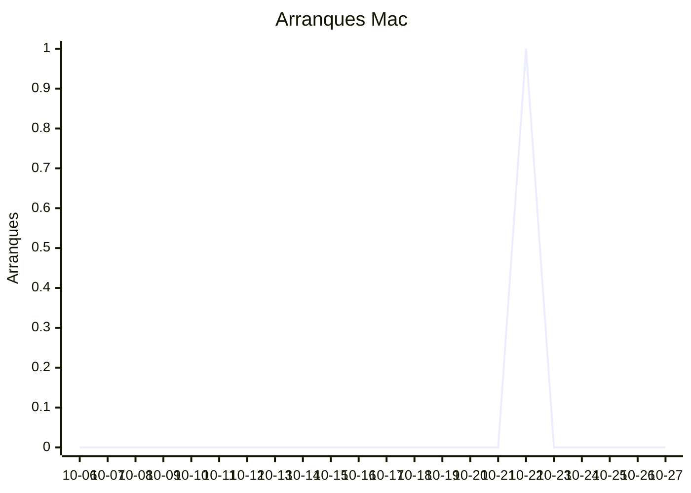
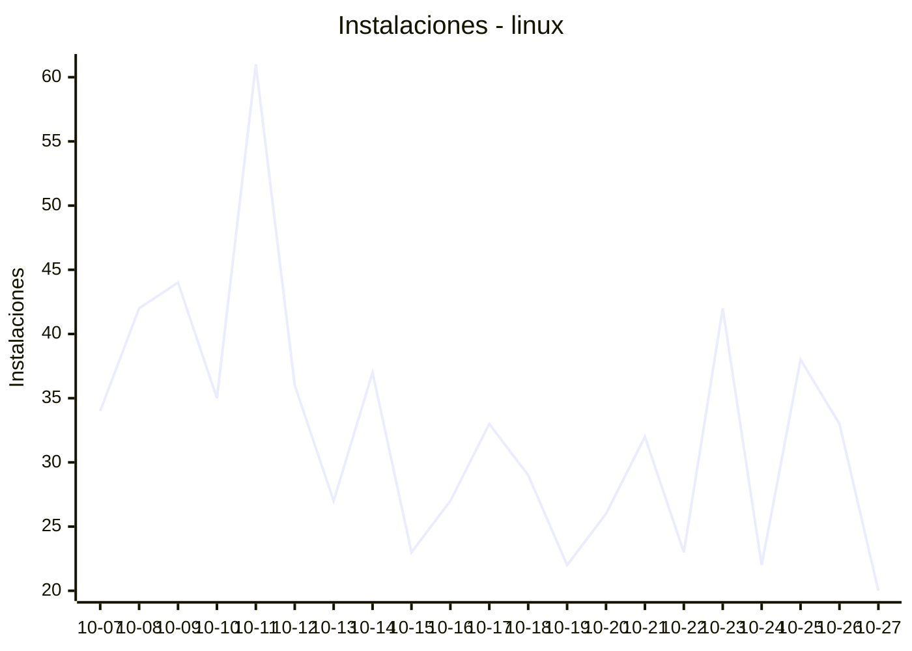
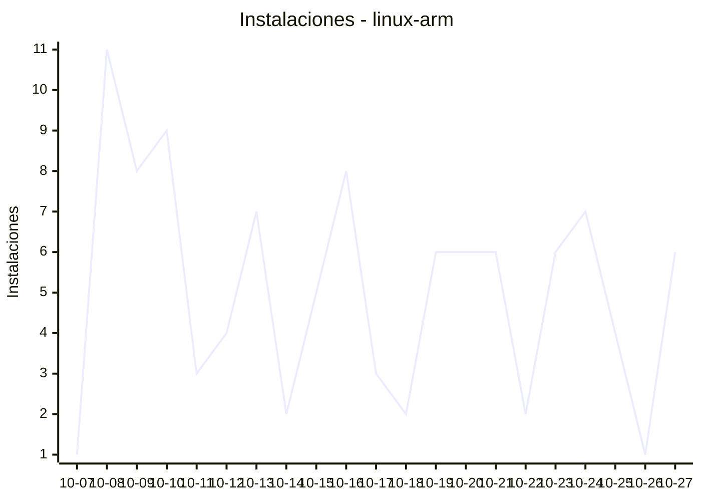
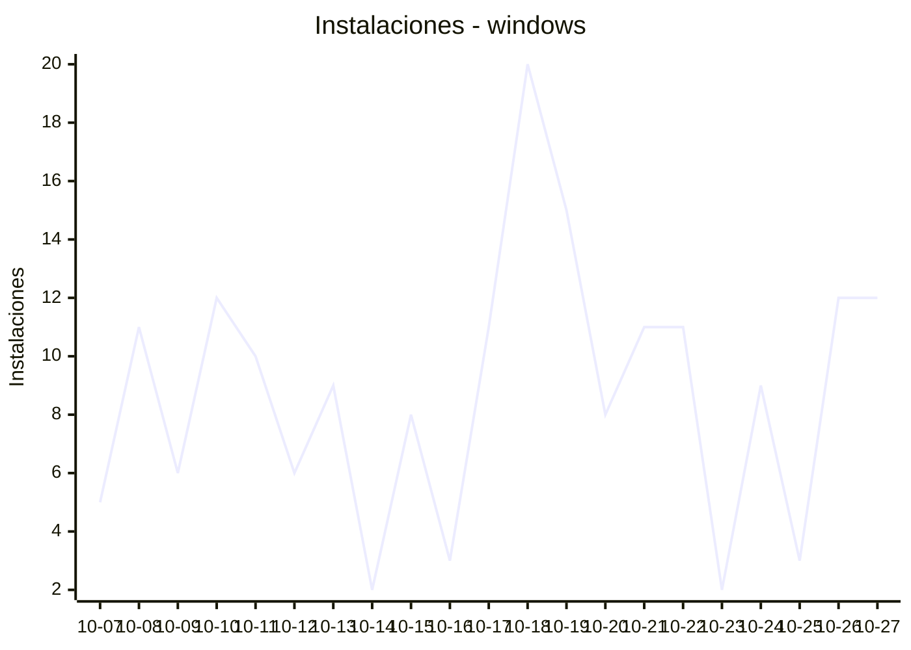
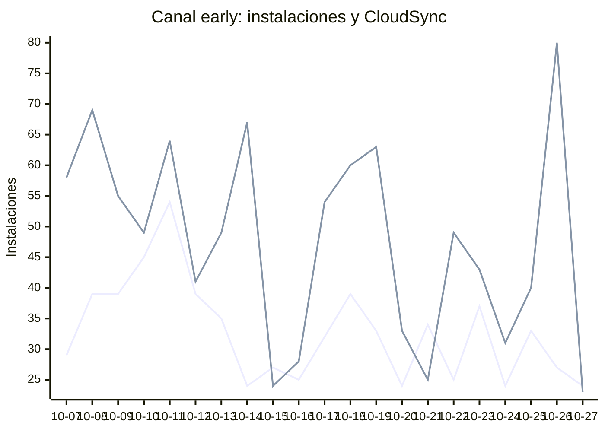

# Estadísticas de EmuDeck

Actualizado: 2026-10-28 10:11 UTC. Las gráficas no incluyen el día de hoy porque aún está incompleto.

## Arranques de la app (comprobaciones de actualización)

Cada arranque descarga el `latest*.yml` de su sistema. Cuenta arranques, no personas.

| Sistema | Ayer | Últimos 7 días |
|---|---|---|
| Linux x86 | 12007 | 92938 |
| Linux ARM | 147 | 1099 |
| Windows | 3222 | 24512 |
| Mac | 0 | 1 |

Instalaciones nuevas estimadas en Windows (7 días, `.exe` menos `.blockmap`): **2257**

## Instalaciones de EmuDeck (beacons)

Cada `setup` descarga `system-<sistema>.txt` y cada instalación de un emulador `<emulador>-<plataforma>.txt`. Los emuladores cuentan también las actualizaciones. Histórico completo desde el primer día.

| Sistema | Ayer | Últimos 7 días | Últimos 30 días | Total |
|---|---|---|---|---|
| linux | 20 | 210 | 686 | 715 |
| linux-arm | 6 | 32 | 107 | 117 |
| windows | 12 | 60 | 186 | 198 |

### Por mes

| Mes | Linux | Linux ARM | Windows | Total |
|---|---|---|---|---|
| 2026-10 | 686 | 107 | 186 | 979 |

### Canal early (early + early-unstable)

Instalaciones de EmuDeck con el backend en una rama early, y cuántas de ellas instalan CloudSync.

| | Últimos 7 días | Últimos 30 días | Total |
|---|---|---|---|
| Instalaciones early | 204 | 688 | 730 |
| Con CloudSync | 291 | 1005 | 1092 |
| % con CloudSync | | | 150% |

Línea de arriba: instalaciones early. Línea de abajo: de ellas, con CloudSync.

### Por emulador

| Emulador | Linux (total) | Linux ARM (total) | Windows (total) | Últimos 7 días | Últimos 30 días | Total |
|---|---|---|---|---|---|---|
| pcsx2 | 1973 | 22 | 232 | 698 | 2124 | 2227 |
| duckstation | 1888 | 160 | 98 | 680 | 2036 | 2146 |
| azahar | 1722 | 177 | 233 | 665 | 2016 | 2132 |
| esde | 1597 | 140 | 367 | 678 | 1980 | 2104 |
| ryujinx | 1683 | 168 | 235 | 669 | 1987 | 2086 |
| rpcs3 | 1778 | 161 | 96 | 655 | 1932 | 2035 |
| cemu | 1732 | 163 | 80 | 627 | 1876 | 1975 |
| srm | 1568 | 143 | 253 | 662 | 1886 | 1964 |
| xenia | 1604 | 129 | 199 | 617 | 1838 | 1932 |
| shadps4 | 1504 | 133 | 179 | 568 | 1715 | 1816 |
| vita3k | 1569 | 142 | 63 | 546 | 1678 | 1774 |
| cloudsync | 752 | 33 | 346 | 301 | 1042 | 1131 |
| ppsspp | 638 | 99 | 178 | 272 | 864 | 915 |
| dolphin | 693 | 114 | 100 | 266 | 852 | 907 |
| ra | 691 | 106 | 110 | 273 | 861 | 907 |
| mgba | 697 | 52 | 54 | 249 | 770 | 803 |
| xemu | 596 | 87 | 74 | 230 | 718 | 757 |
| melonds | 581 | 83 | 72 | 204 | 695 | 736 |
| primehack | 513 | 83 | 75 | 195 | 632 | 671 |
| supermodel | 501 | 94 | 18 | 170 | 580 | 613 |
| scummvm | 485 | 70 | 49 | 169 | 567 | 604 |
| model2 | 493 | 97 | 8 | 158 | 565 | 598 |
| bigpemu | 478 | 10 | 12 | 157 | 477 | 500 |
| armsx2 | 149 | 187 | 0 | 119 | 313 | 336 |
| flycast | 130 | 16 | 18 | 49 | 159 | 164 |
| rmg | 128 | 27 | 0 | 44 | 151 | 155 |
| eden | 82 | 9 | 3 | 16 | 84 | 94 |
| mame | 71 | 2 | 16 | 22 | 85 | 89 |
| pegasus | 18 | 0 | 12 | 11 | 28 | 30 |
| yuzu | 8 | 0 | 2 | 4 | 10 | 10 |
| ares | 8 | 1 | 0 | 4 | 9 | 9 |
| citron | 5 | 0 | 0 | 1 | 5 | 5 |
