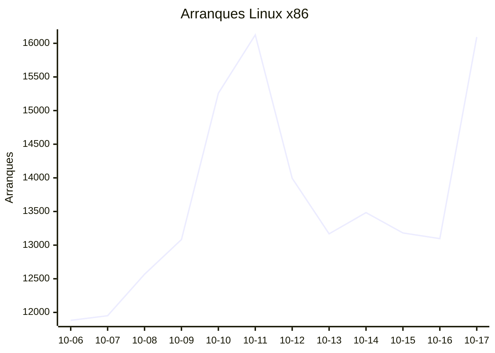
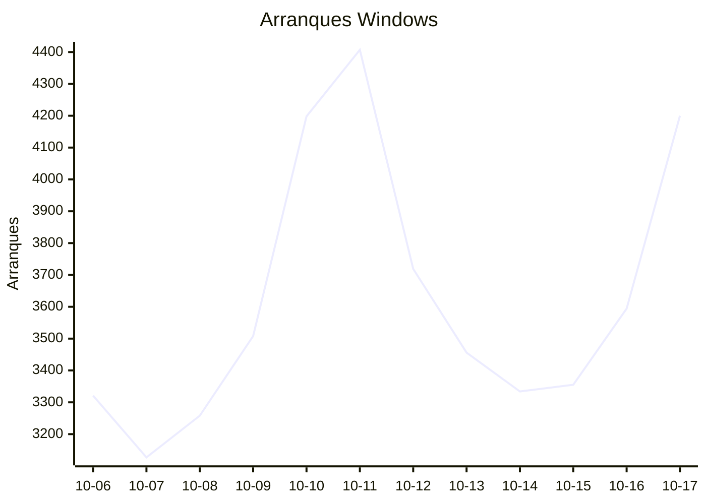
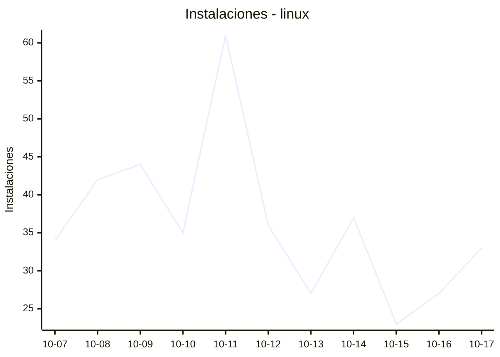
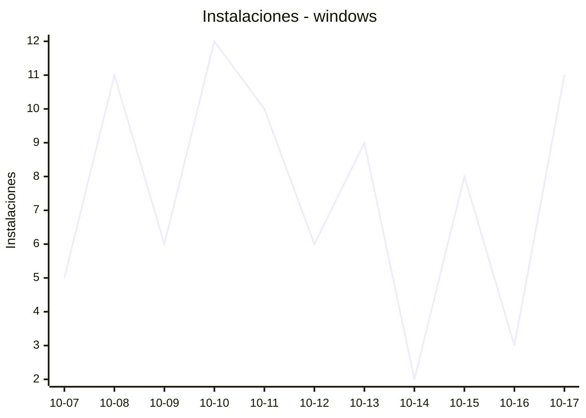
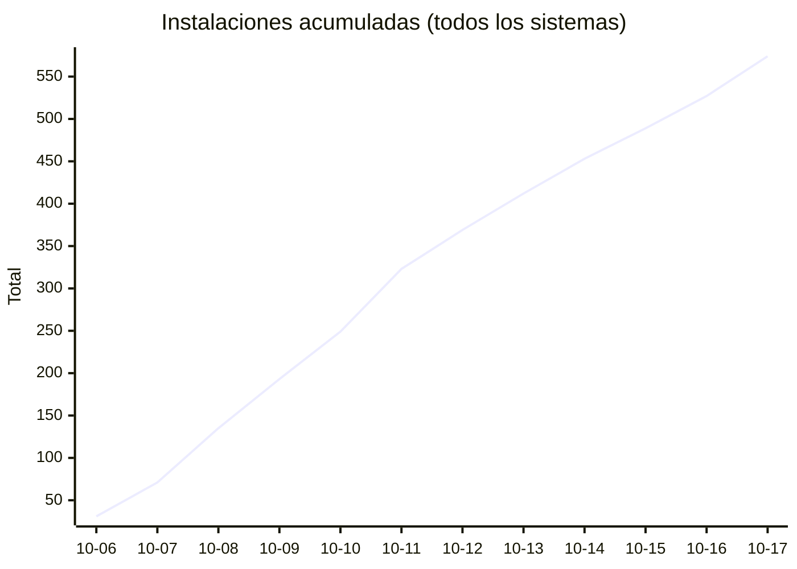
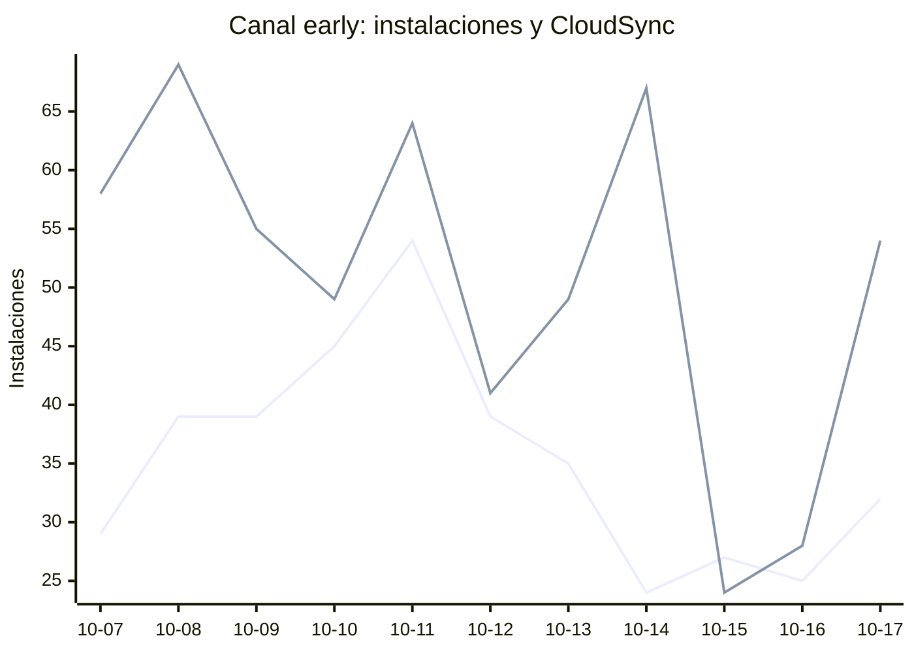

# Estadísticas de EmuDeck

Actualizado: 2026-10-18 12:43 UTC. Las gráficas no incluyen el día de hoy porque aún está incompleto.

## Arranques de la app (comprobaciones de actualización)

Cada arranque descarga el `latest*.yml` de su sistema. Cuenta arranques, no personas.

| Sistema | Ayer | Últimos 7 días |
|---|---|---|
| Linux x86 | 16093 | 99141 |
| Linux ARM | 158 | 1074 |
| Windows | 4200 | 26065 |
| Mac | 0 | 0 |

Instalaciones nuevas estimadas en Windows (7 días, `.exe` menos `.blockmap`): **1915**

## Instalaciones de EmuDeck (beacons)

Cada `setup` descarga `system-<sistema>.txt` y cada instalación de un emulador `<emulador>-<plataforma>.txt`. Los emuladores cuentan también las actualizaciones. Histórico completo desde el primer día.

| Sistema | Ayer | Últimos 7 días | Últimos 30 días | Total |
|---|---|---|---|---|
| linux | 33 | 244 | 399 | 435 |
| linux-arm | 3 | 32 | 61 | 65 |
| windows | 11 | 49 | 83 | 105 |

### Por mes

| Mes | Linux | Linux ARM | Windows | Total |
|---|---|---|---|---|
| 2026-10 | 399 | 61 | 83 | 543 |

### Canal early (early + early-unstable)

Instalaciones de EmuDeck con el backend en una rama early, y cuántas de ellas instalan CloudSync.

| | Últimos 7 días | Últimos 30 días | Total |
|---|---|---|---|
| Instalaciones early | 236 | 388 | 436 |
| Con CloudSync | 327 | 558 | 635 |
| % con CloudSync | | | 146% |

Línea de arriba: instalaciones early. Línea de abajo: de ellas, con CloudSync.

### Por emulador

| Emulador | Linux (total) | Linux ARM (total) | Windows (total) | Últimos 7 días | Últimos 30 días | Total |
|---|---|---|---|---|---|---|
| pcsx2 | 1123 | 18 | 131 | 703 | 1144 | 1272 |
| azahar | 1002 | 82 | 128 | 666 | 1088 | 1212 |
| duckstation | 1088 | 80 | 44 | 677 | 1093 | 1212 |
| ryujinx | 967 | 83 | 130 | 652 | 1064 | 1180 |
| esde | 912 | 71 | 193 | 618 | 1033 | 1176 |
| rpcs3 | 1014 | 81 | 42 | 643 | 1028 | 1137 |
| cemu | 1002 | 81 | 31 | 626 | 1012 | 1114 |
| xenia | 907 | 67 | 100 | 611 | 973 | 1074 |
| srm | 885 | 67 | 103 | 595 | 960 | 1055 |
| shadps4 | 867 | 67 | 94 | 579 | 920 | 1028 |
| vita3k | 914 | 71 | 25 | 578 | 910 | 1010 |
| cloudsync | 459 | 17 | 181 | 333 | 577 | 657 |
| dolphin | 426 | 58 | 51 | 296 | 485 | 535 |
| ppsspp | 390 | 54 | 90 | 292 | 479 | 534 |
| ra | 420 | 59 | 50 | 283 | 479 | 529 |
| mgba | 401 | 34 | 26 | 255 | 419 | 461 |
| melonds | 369 | 44 | 35 | 253 | 403 | 448 |
| xemu | 361 | 47 | 36 | 246 | 399 | 444 |
| primehack | 315 | 45 | 35 | 205 | 355 | 395 |
| supermodel | 312 | 53 | 9 | 212 | 342 | 374 |
| model2 | 308 | 56 | 5 | 205 | 338 | 369 |
| scummvm | 305 | 40 | 20 | 198 | 327 | 365 |
| bigpemu | 272 | 3 | 7 | 151 | 252 | 282 |
| armsx2 | 83 | 88 | 0 | 93 | 158 | 171 |
| flycast | 82 | 13 | 7 | 52 | 94 | 102 |
| rmg | 80 | 20 | 0 | 52 | 93 | 100 |
| eden | 54 | 7 | 0 | 45 | 49 | 61 |
| mame | 50 | 2 | 9 | 23 | 55 | 61 |
| pegasus | 9 | 0 | 10 | 13 | 16 | 19 |
| yuzu | 6 | 0 | 0 | 4 | 6 | 6 |
| ares | 3 | 1 | 0 | 2 | 4 | 4 |
| citron | 4 | 0 | 0 | 3 | 3 | 4 |
