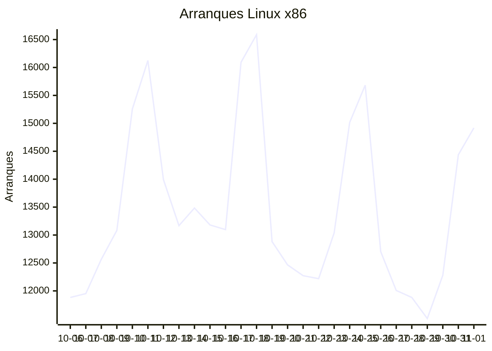
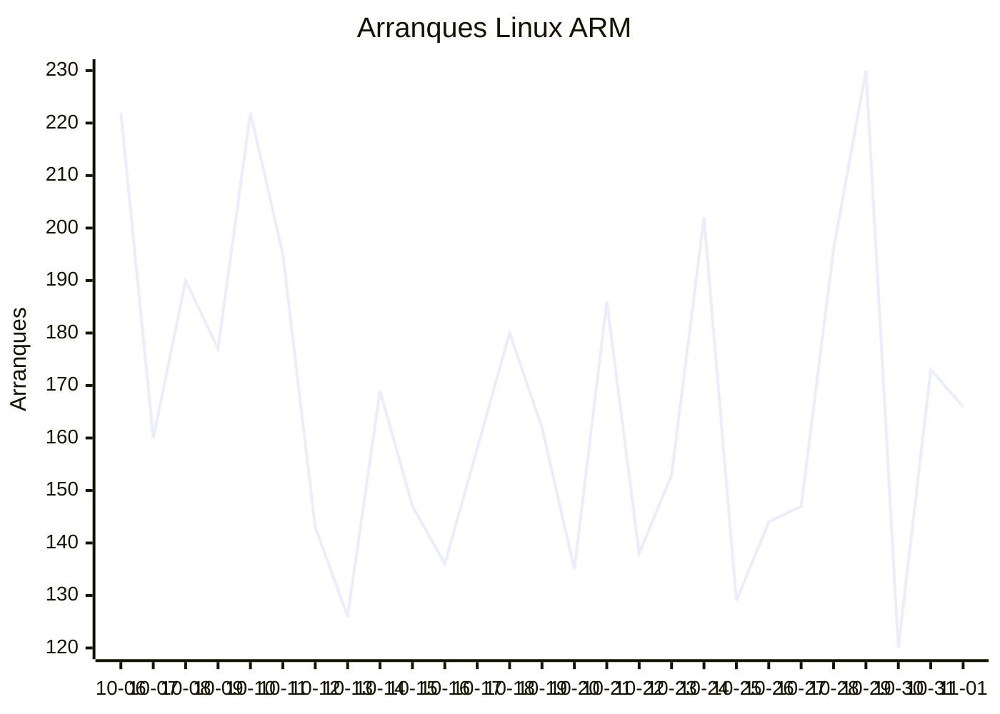
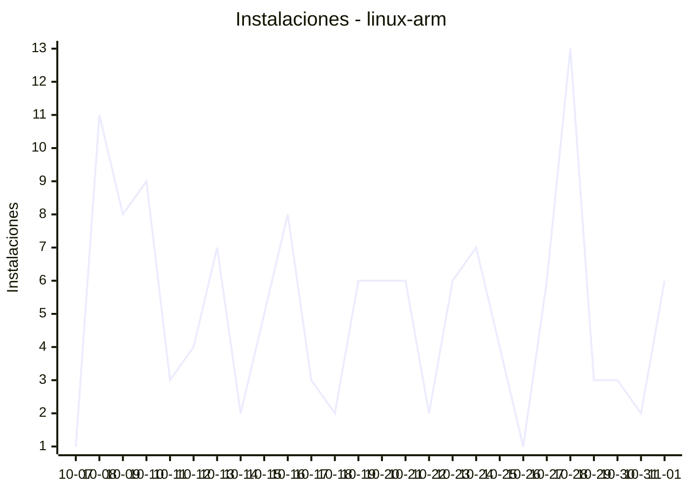
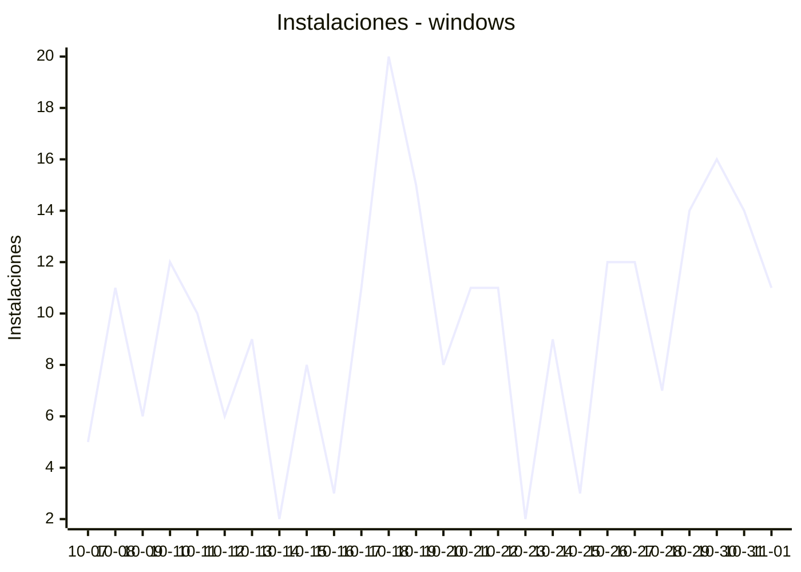
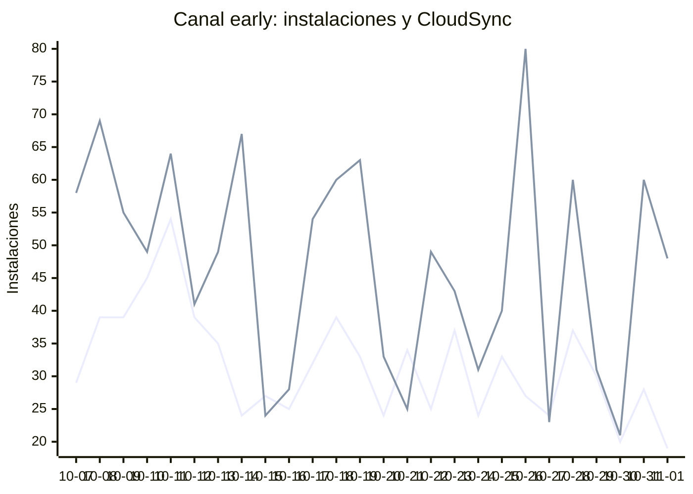

# Estadísticas de EmuDeck

Actualizado: 2026-11-02 05:10 UTC. Las gráficas no incluyen el día de hoy porque aún está incompleto.

## Arranques de la app (comprobaciones de actualización)

Cada arranque descarga el `latest*.yml` de su sistema. Cuenta arranques, no personas.

| Sistema | Ayer | Últimos 7 días |
|---|---|---|
| Linux x86 | 14917 | 89730 |
| Linux ARM | 166 | 1176 |
| Windows | 4034 | 24037 |
| Mac | 0 | 2 |

Instalaciones nuevas estimadas en Windows (7 días, `.exe` menos `.blockmap`): **2313**

## Instalaciones de EmuDeck (beacons)

Cada `setup` descarga `system-<sistema>.txt` y cada instalación de un emulador `<emulador>-<plataforma>.txt`. Los emuladores cuentan también las actualizaciones. Histórico completo desde el primer día.

| Sistema | Ayer | Últimos 7 días | Últimos 30 días | Total |
|---|---|---|---|---|
| linux | 26 | 183 | 816 | 844 |
| linux-arm | 6 | 34 | 134 | 138 |
| windows | 11 | 86 | 248 | 262 |

### Por mes

| Mes | Linux | Linux ARM | Windows | Total |
|---|---|---|---|---|
| 2026-11 | 26 | 6 | 11 | 43 |
| 2026-10 | 790 | 128 | 237 | 1155 |

### Canal early (early + early-unstable)

Instalaciones de EmuDeck con el backend en una rama early, y cuántas de ellas instalan CloudSync.

| | Últimos 7 días | Últimos 30 días | Total |
|---|---|---|---|
| Instalaciones early | 185 | 822 | 857 |
| Con CloudSync | 323 | 1225 | 1310 |
| % con CloudSync | | | 153% |

Línea de arriba: instalaciones early. Línea de abajo: de ellas, con CloudSync.

### Por emulador

| Emulador | Linux (total) | Linux ARM (total) | Windows (total) | Últimos 7 días | Últimos 30 días | Total |
|---|---|---|---|---|---|---|
| pcsx2 | 2345 | 24 | 301 | 628 | 2572 | 2670 |
| esde | 1937 | 193 | 497 | 711 | 2501 | 2627 |
| azahar | 2044 | 219 | 302 | 618 | 2471 | 2565 |
| duckstation | 2239 | 200 | 117 | 594 | 2462 | 2556 |
| ryujinx | 1990 | 208 | 281 | 573 | 2401 | 2479 |
| rpcs3 | 2128 | 200 | 114 | 586 | 2359 | 2442 |
| cemu | 2052 | 204 | 105 | 552 | 2280 | 2361 |
| srm | 1854 | 173 | 312 | 534 | 2278 | 2339 |
| xenia | 1917 | 164 | 257 | 580 | 2265 | 2338 |
| shadps4 | 1792 | 172 | 231 | 546 | 2114 | 2195 |
| vita3k | 1866 | 177 | 79 | 500 | 2047 | 2122 |
| cloudsync | 897 | 41 | 423 | 338 | 1274 | 1361 |
| ppsspp | 749 | 117 | 233 | 272 | 1057 | 1099 |
| dolphin | 820 | 136 | 125 | 261 | 1042 | 1081 |
| ra | 816 | 126 | 130 | 243 | 1033 | 1072 |
| mgba | 841 | 62 | 64 | 222 | 937 | 967 |
| xemu | 701 | 105 | 96 | 207 | 868 | 902 |
| melonds | 684 | 100 | 88 | 189 | 838 | 872 |
| primehack | 613 | 99 | 93 | 188 | 774 | 805 |
| supermodel | 586 | 114 | 26 | 160 | 698 | 726 |
| scummvm | 566 | 86 | 62 | 159 | 686 | 714 |
| model2 | 579 | 118 | 9 | 152 | 678 | 706 |
| bigpemu | 564 | 16 | 19 | 136 | 580 | 599 |
| armsx2 | 172 | 233 | 0 | 111 | 394 | 405 |
| flycast | 150 | 21 | 22 | 39 | 188 | 193 |
| rmg | 143 | 31 | 0 | 28 | 170 | 174 |
| mame | 80 | 6 | 21 | 23 | 103 | 107 |
| eden | 86 | 9 | 7 | 20 | 94 | 102 |
| pegasus | 22 | 1 | 20 | 14 | 39 | 43 |
| ares | 10 | 2 | 0 | 4 | 12 | 12 |
| yuzu | 9 | 0 | 3 | 2 | 12 | 12 |
| citron | 5 | 0 | 0 | 1 | 5 | 5 |
