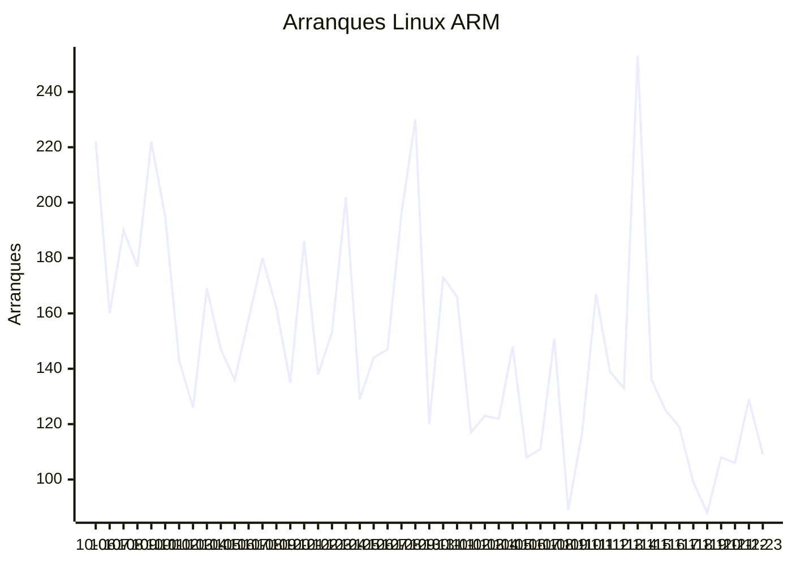
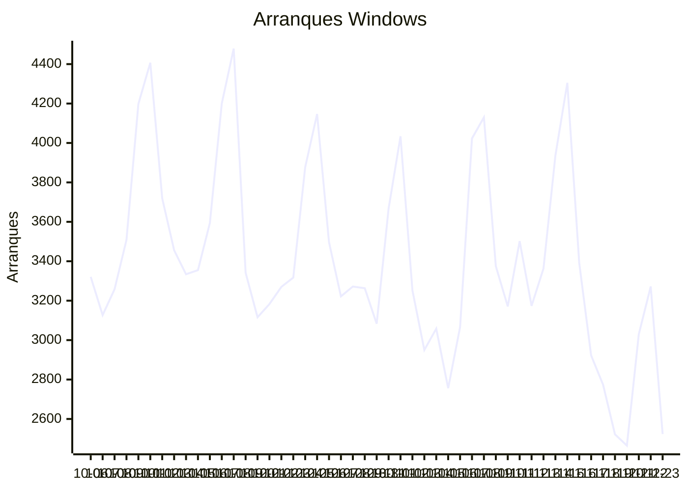
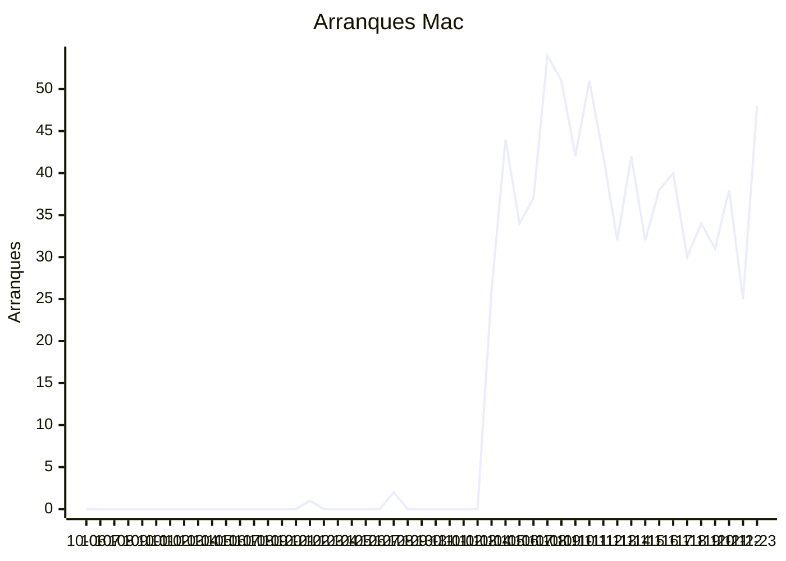
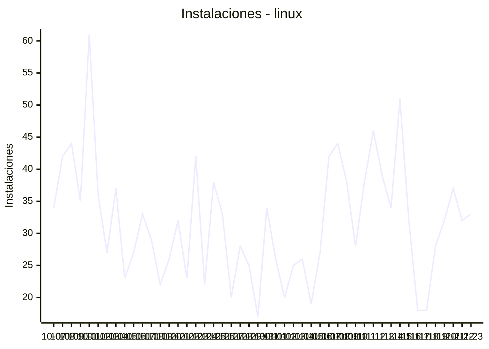
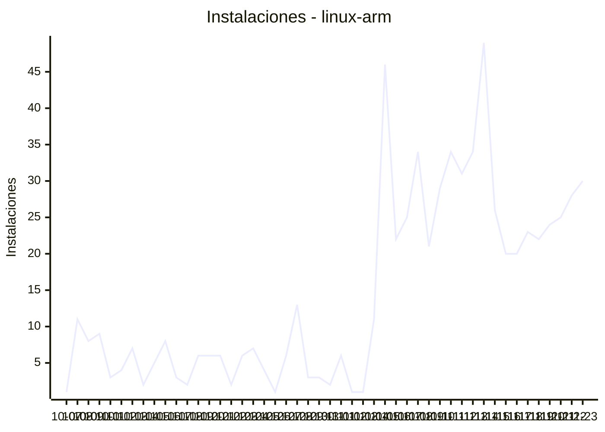
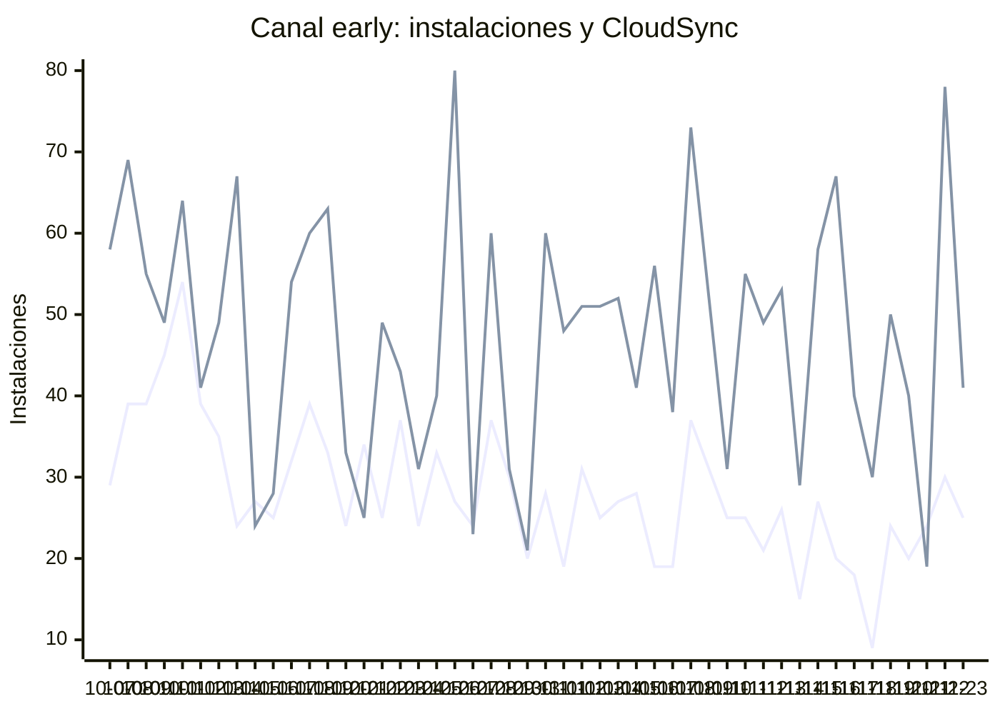

# Estadísticas de EmuDeck

Actualizado: 2026-11-24 23:07 UTC. Las gráficas no incluyen el día de hoy porque aún está incompleto.

## Arranques de la app (comprobaciones de actualización)

Cada arranque descarga el `latest*.yml` de su sistema. Cuenta arranques, no personas.

| Sistema | Ayer | Últimos 7 días |
|---|---|---|
| Linux x86 | 10879 | 81919 |
| Linux ARM | 109 | 758 |
| Windows | 2523 | 19508 |
| Mac | 48 | 246 |

Instalaciones nuevas estimadas en Windows (7 días, `.exe` menos `.blockmap`): **2031**

## Instalaciones de EmuDeck (beacons)

Cada `setup` descarga `system-<sistema>.txt` y cada instalación de un emulador `<emulador>-<plataforma>.txt`. Los emuladores cuentan también las actualizaciones. Histórico completo desde el primer día.

| Sistema | Ayer | Últimos 7 días | Últimos 30 días | Total |
|---|---|---|---|---|
| linux | 33 | 198 | 928 | 1566 |
| linux-arm | 30 | 172 | 594 | 714 |
| windows | 8 | 62 | 307 | 487 |

### Por mes

| Mes | Linux | Linux ARM | Windows | Total |
|---|---|---|---|---|
| 2026-11 | 733 | 562 | 229 | 1524 |
| 2026-10 | 790 | 128 | 237 | 1155 |

### Canal early (early + early-unstable)

Instalaciones de EmuDeck con el backend en una rama early, y cuántas de ellas instalan CloudSync.

| | Últimos 7 días | Últimos 30 días | Total |
|---|---|---|---|
| Instalaciones early | 150 | 744 | 1390 |
| Con CloudSync | 298 | 1417 | 2390 |
| % con CloudSync | | | 172% |

Línea de arriba: instalaciones early. Línea de abajo: de ellas, con CloudSync.

### Por emulador

| Emulador | Linux (total) | Linux ARM (total) | Windows (total) | Últimos 7 días | Últimos 30 días | Total |
|---|---|---|---|---|---|---|
| esde | 3524 | 725 | 1010 | 772 | 3368 | 5259 |
| azahar | 3712 | 854 | 534 | 736 | 3175 | 5100 |
| ryujinx | 3665 | 852 | 519 | 745 | 3156 | 5036 |
| duckstation | 4004 | 783 | 210 | 717 | 3078 | 4997 |
| rpcs3 | 3842 | 803 | 209 | 713 | 3036 | 4854 |
| srm | 3507 | 679 | 661 | 703 | 3077 | 4847 |
| pcsx2 | 4208 | 42 | 569 | 602 | 2829 | 4819 |
| cemu | 3640 | 755 | 192 | 643 | 2809 | 4587 |
| xenia | 3408 | 645 | 461 | 645 | 2789 | 4514 |
| vita3k | 3313 | 684 | 139 | 595 | 2538 | 4136 |
| shadps4 | 3175 | 259 | 408 | 466 | 2239 | 3842 |
| cloudsync | 1565 | 81 | 839 | 312 | 1474 | 2485 |
| ppsspp | 1332 | 564 | 451 | 364 | 1526 | 2347 |
| dolphin | 1460 | 626 | 220 | 360 | 1503 | 2306 |
| ra | 1467 | 590 | 249 | 361 | 1488 | 2306 |
| xemu | 1230 | 488 | 164 | 281 | 1198 | 1882 |
| melonds | 1199 | 495 | 151 | 289 | 1173 | 1845 |
| mgba | 1560 | 174 | 108 | 258 | 1108 | 1842 |
| primehack | 1126 | 511 | 165 | 284 | 1190 | 1802 |
| supermodel | 1047 | 467 | 51 | 250 | 1007 | 1565 |
| scummvm | 1007 | 435 | 107 | 252 | 999 | 1549 |
| model2 | 1029 | 486 | 14 | 246 | 982 | 1529 |
| armsx2 | 332 | 874 | 0 | 246 | 903 | 1206 |
| bigpemu | 1006 | 57 | 49 | 142 | 643 | 1112 |
| flycast | 262 | 66 | 44 | 57 | 219 | 372 |
| rmg | 262 | 102 | 0 | 54 | 210 | 364 |
| mame | 144 | 23 | 67 | 41 | 150 | 234 |
| eden | 165 | 11 | 22 | 31 | 117 | 198 |
| pegasus | 54 | 3 | 31 | 13 | 62 | 88 |
| yuzu | 18 | 0 | 8 | 2 | 16 | 26 |
| ares | 22 | 3 | 0 | 3 | 18 | 25 |
| citron | 6 | 2 | 3 | 0 | 6 | 11 |
