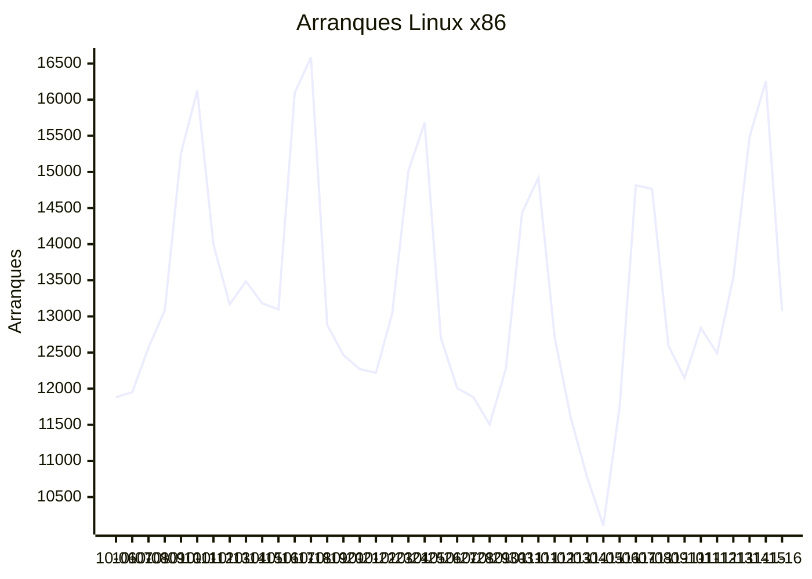
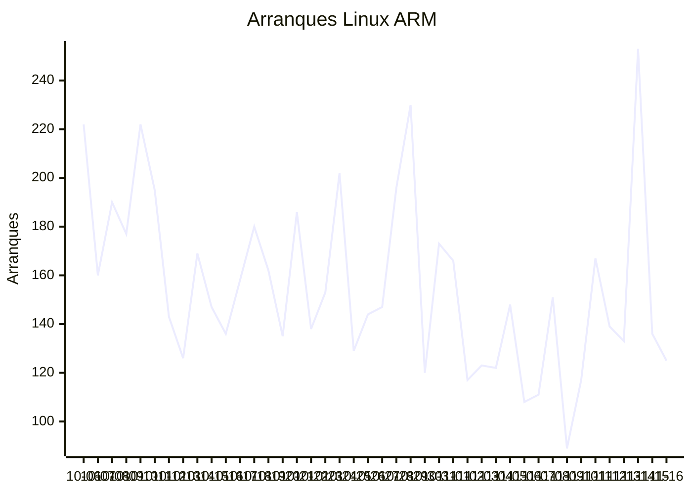
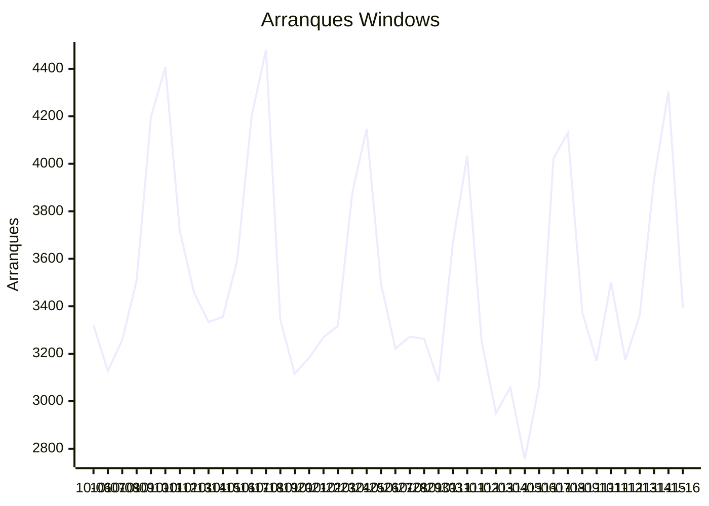
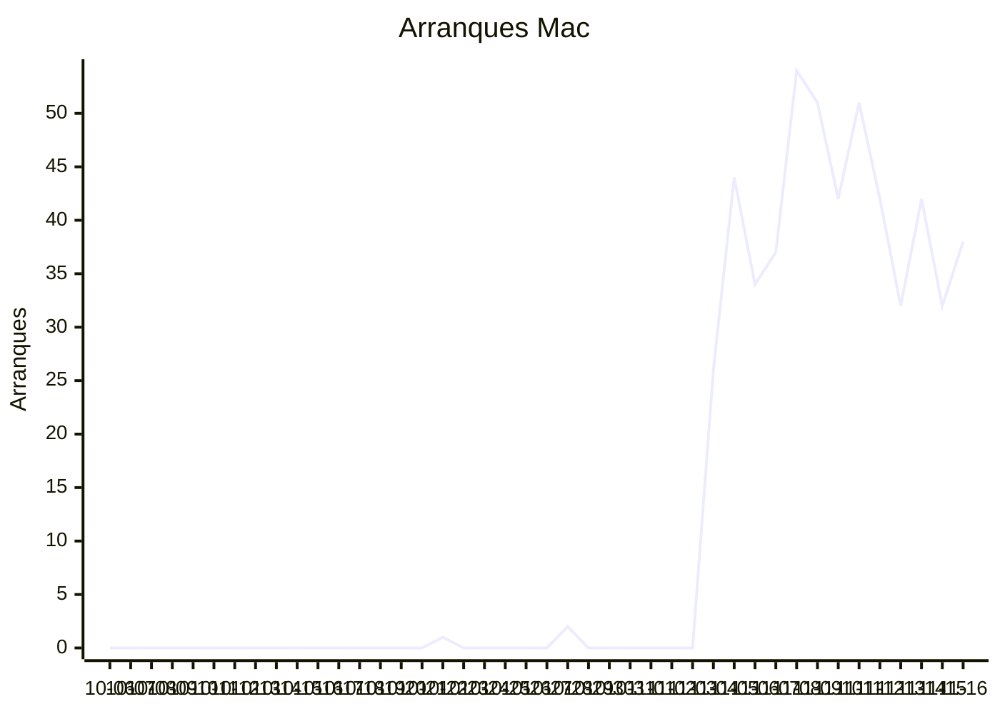
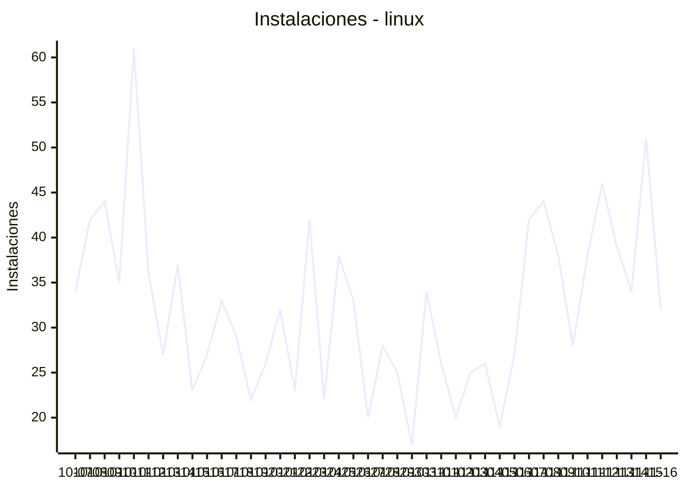
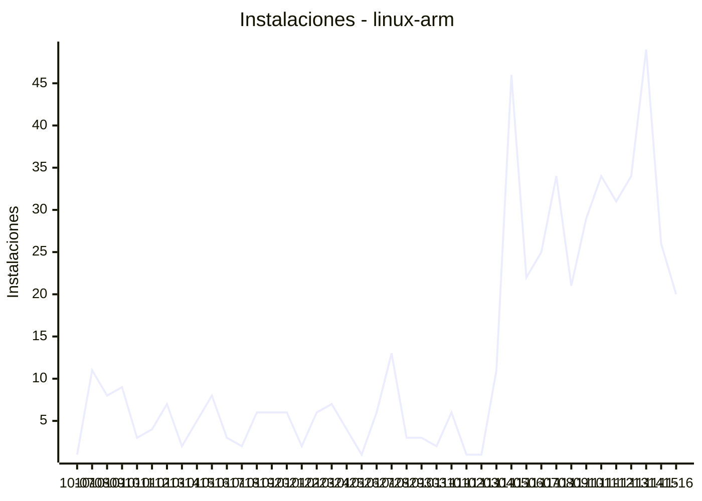
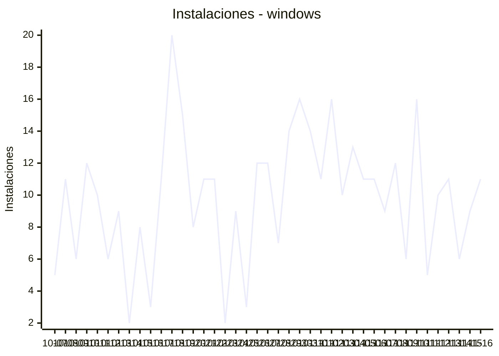
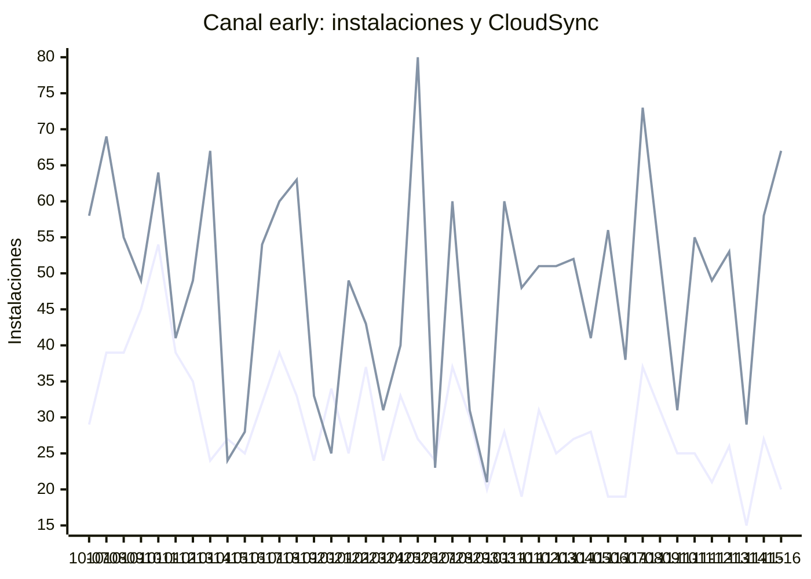

# Estadísticas de EmuDeck

Actualizado: 2026-11-17 15:35 UTC. Las gráficas no incluyen el día de hoy porque aún está incompleto.

## Arranques de la app (comprobaciones de actualización)

Cada arranque descarga el `latest*.yml` de su sistema. Cuenta arranques, no personas.

| Sistema | Ayer | Últimos 7 días |
|---|---|---|
| Linux x86 | 13077 | 95838 |
| Linux ARM | 125 | 1070 |
| Windows | 3391 | 24842 |
| Mac | 38 | 279 |

Instalaciones nuevas estimadas en Windows (7 días, `.exe` menos `.blockmap`): **2475**

## Instalaciones de EmuDeck (beacons)

Cada `setup` descarga `system-<sistema>.txt` y cada instalación de un emulador `<emulador>-<plataforma>.txt`. Los emuladores cuentan también las actualizaciones. Histórico completo desde el primer día.

| Sistema | Ayer | Últimos 7 días | Últimos 30 días | Total |
|---|---|---|---|---|
| linux | 32 | 268 | 926 | 1360 |
| linux-arm | 20 | 223 | 457 | 533 |
| windows | 11 | 68 | 321 | 412 |

### Por mes

| Mes | Linux | Linux ARM | Windows | Total |
|---|---|---|---|---|
| 2026-11 | 535 | 390 | 167 | 1092 |
| 2026-10 | 790 | 128 | 237 | 1155 |

### Canal early (early + early-unstable)

Instalaciones de EmuDeck con el backend en una rama early, y cuántas de ellas instalan CloudSync.

| | Últimos 7 días | Últimos 30 días | Total |
|---|---|---|---|
| Instalaciones early | 159 | 810 | 1233 |
| Con CloudSync | 342 | 1423 | 2075 |
| % con CloudSync | | | 168% |

Línea de arriba: instalaciones early. Línea de abajo: de ellas, con CloudSync.

### Por emulador

| Emulador | Linux (total) | Linux ARM (total) | Windows (total) | Últimos 7 días | Últimos 30 días | Total |
|---|---|---|---|---|---|---|
| esde | 3039 | 549 | 852 | 951 | 3253 | 4440 |
| azahar | 3212 | 644 | 459 | 912 | 3098 | 4315 |
| ryujinx | 3153 | 629 | 463 | 941 | 3062 | 4245 |
| duckstation | 3473 | 587 | 183 | 862 | 3023 | 4243 |
| pcsx2 | 3650 | 39 | 486 | 740 | 2911 | 4175 |
| srm | 3019 | 522 | 573 | 916 | 3039 | 4114 |
| rpcs3 | 3313 | 599 | 183 | 867 | 2951 | 4095 |
| cemu | 3161 | 572 | 165 | 812 | 2778 | 3898 |
| xenia | 2945 | 475 | 398 | 783 | 2744 | 3818 |
| vita3k | 2864 | 514 | 123 | 723 | 2487 | 3501 |
| shadps4 | 2749 | 237 | 352 | 567 | 2321 | 3338 |
| cloudsync | 1380 | 60 | 714 | 365 | 1481 | 2154 |
| ppsspp | 1159 | 415 | 381 | 466 | 1428 | 1955 |
| dolphin | 1273 | 462 | 195 | 467 | 1397 | 1930 |
| ra | 1280 | 429 | 215 | 446 | 1395 | 1924 |
| xemu | 1077 | 357 | 146 | 369 | 1142 | 1580 |
| mgba | 1337 | 134 | 94 | 302 | 1100 | 1565 |
| melonds | 1052 | 359 | 132 | 367 | 1098 | 1543 |
| primehack | 979 | 374 | 144 | 368 | 1106 | 1497 |
| supermodel | 913 | 343 | 45 | 312 | 927 | 1301 |
| scummvm | 874 | 315 | 93 | 310 | 920 | 1282 |
| model2 | 897 | 359 | 14 | 304 | 899 | 1270 |
| bigpemu | 874 | 43 | 40 | 165 | 671 | 957 |
| armsx2 | 286 | 663 | 0 | 314 | 766 | 949 |
| flycast | 232 | 46 | 38 | 65 | 212 | 316 |
| rmg | 230 | 70 | 0 | 72 | 197 | 300 |
| mame | 127 | 17 | 50 | 40 | 132 | 194 |
| eden | 138 | 11 | 20 | 40 | 109 | 169 |
| pegasus | 44 | 3 | 29 | 17 | 56 | 76 |
| yuzu | 17 | 0 | 8 | 5 | 18 | 25 |
| ares | 20 | 3 | 0 | 7 | 18 | 23 |
| citron | 6 | 2 | 2 | 3 | 7 | 10 |
