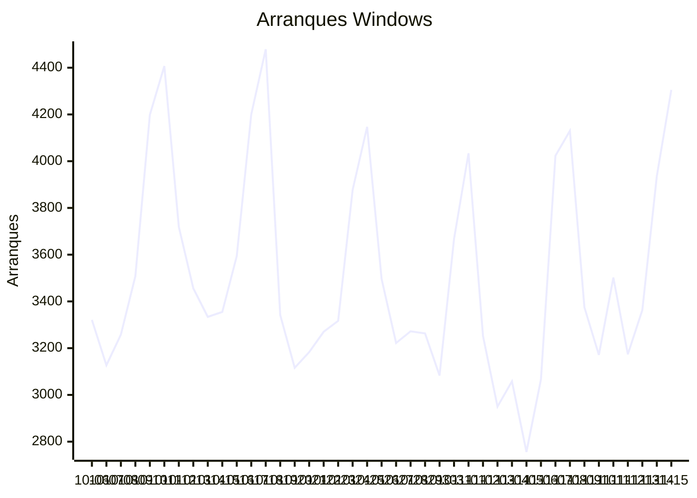
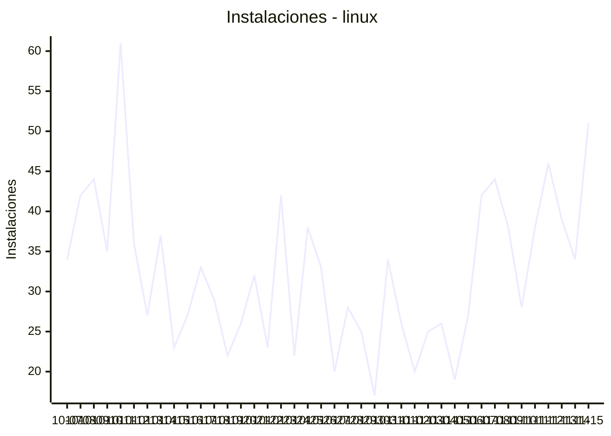
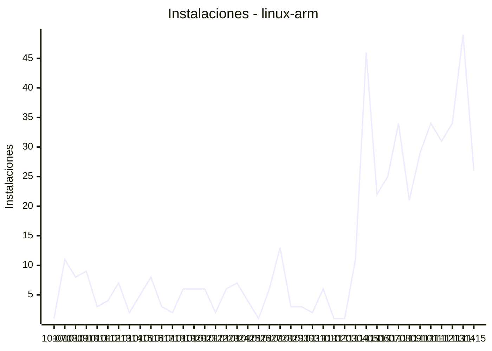
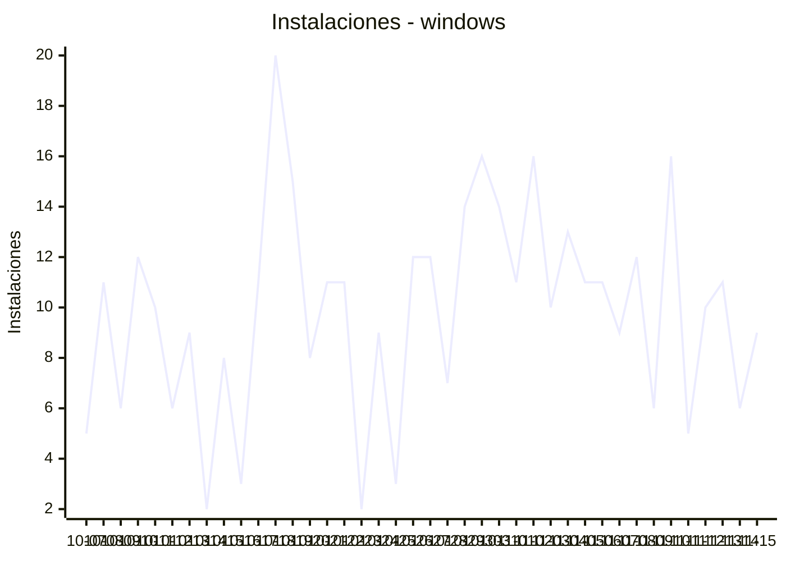
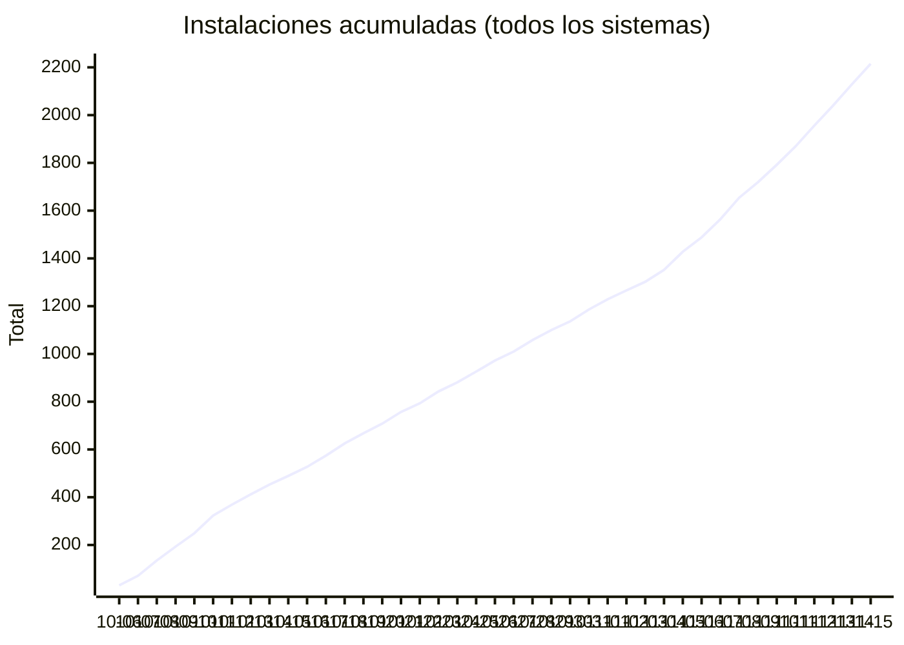
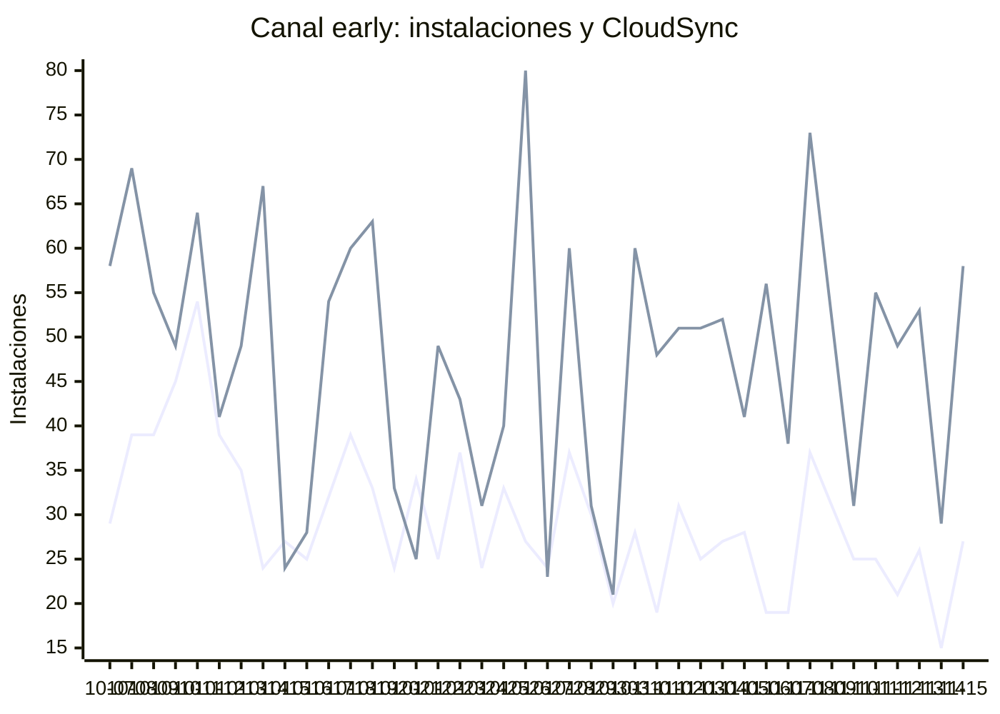

# Estadísticas de EmuDeck

Actualizado: 2026-11-16 18:11 UTC. Las gráficas no incluyen el día de hoy porque aún está incompleto.

## Arranques de la app (comprobaciones de actualización)

Cada arranque descarga el `latest*.yml` de su sistema. Cuenta arranques, no personas.

| Sistema | Ayer | Últimos 7 días |
|---|---|---|
| Linux x86 | 16254 | 95358 |
| Linux ARM | 136 | 1034 |
| Windows | 4305 | 24826 |
| Mac | 32 | 292 |

Instalaciones nuevas estimadas en Windows (7 días, `.exe` menos `.blockmap`): **2483**

## Instalaciones de EmuDeck (beacons)

Cada `setup` descarga `system-<sistema>.txt` y cada instalación de un emulador `<emulador>-<plataforma>.txt`. Los emuladores cuentan también las actualizaciones. Histórico completo desde el primer día.

| Sistema | Ayer | Últimos 7 días | Últimos 30 días | Total |
|---|---|---|---|---|
| linux | 51 | 274 | 927 | 1341 |
| linux-arm | 26 | 224 | 440 | 513 |
| windows | 9 | 63 | 321 | 409 |

### Por mes

| Mes | Linux | Linux ARM | Windows | Total |
|---|---|---|---|---|
| 2026-11 | 503 | 370 | 156 | 1029 |
| 2026-10 | 790 | 128 | 237 | 1155 |

### Canal early (early + early-unstable)

Instalaciones de EmuDeck con el backend en una rama early, y cuántas de ellas instalan CloudSync.

| | Últimos 7 días | Últimos 30 días | Total |
|---|---|---|---|
| Instalaciones early | 170 | 822 | 1218 |
| Con CloudSync | 327 | 1410 | 2031 |
| % con CloudSync | | | 167% |

Línea de arriba: instalaciones early. Línea de abajo: de ellas, con CloudSync.

### Por emulador

| Emulador | Linux (total) | Linux ARM (total) | Windows (total) | Últimos 7 días | Últimos 30 días | Total |
|---|---|---|---|---|---|---|
| esde | 2978 | 524 | 835 | 915 | 3223 | 4337 |
| azahar | 3150 | 620 | 454 | 876 | 3066 | 4224 |
| ryujinx | 3098 | 608 | 454 | 913 | 3043 | 4160 |
| duckstation | 3411 | 564 | 178 | 832 | 3008 | 4153 |
| pcsx2 | 3580 | 39 | 482 | 724 | 2918 | 4101 |
| rpcs3 | 3254 | 580 | 181 | 848 | 2948 | 4015 |
| srm | 2948 | 506 | 559 | 897 | 3004 | 4013 |
| cemu | 3106 | 553 | 161 | 777 | 2761 | 3820 |
| xenia | 2894 | 458 | 392 | 759 | 2725 | 3744 |
| vita3k | 2815 | 495 | 122 | 695 | 2480 | 3432 |
| shadps4 | 2705 | 233 | 349 | 563 | 2348 | 3287 |
| cloudsync | 1347 | 58 | 705 | 339 | 1457 | 2110 |
| ppsspp | 1148 | 397 | 377 | 458 | 1410 | 1922 |
| dolphin | 1260 | 443 | 190 | 450 | 1370 | 1893 |
| ra | 1266 | 410 | 209 | 440 | 1374 | 1885 |
| xemu | 1068 | 340 | 143 | 364 | 1124 | 1551 |
| mgba | 1308 | 129 | 92 | 285 | 1089 | 1529 |
| melonds | 1043 | 342 | 130 | 355 | 1079 | 1515 |
| primehack | 968 | 361 | 143 | 367 | 1093 | 1472 |
| supermodel | 904 | 329 | 44 | 302 | 910 | 1277 |
| scummvm | 866 | 299 | 91 | 302 | 908 | 1256 |
| model2 | 887 | 345 | 14 | 297 | 881 | 1246 |
| bigpemu | 856 | 39 | 39 | 163 | 676 | 934 |
| armsx2 | 281 | 641 | 0 | 304 | 744 | 922 |
| flycast | 228 | 42 | 38 | 55 | 202 | 308 |
| rmg | 224 | 65 | 0 | 61 | 186 | 289 |
| mame | 126 | 16 | 49 | 40 | 128 | 191 |
| eden | 134 | 11 | 20 | 42 | 122 | 165 |
| pegasus | 41 | 3 | 28 | 16 | 56 | 72 |
| yuzu | 16 | 0 | 8 | 7 | 18 | 24 |
| ares | 18 | 3 | 0 | 6 | 16 | 21 |
| citron | 6 | 2 | 2 | 1 | 5 | 10 |
