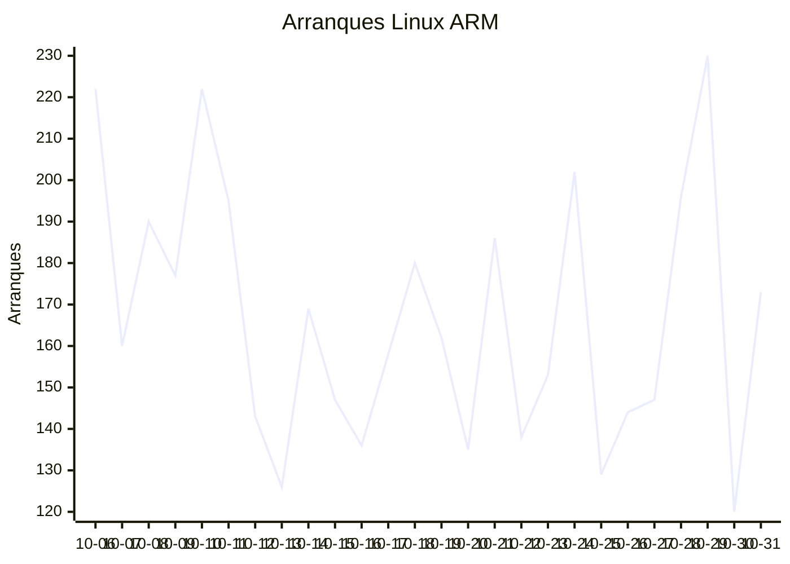
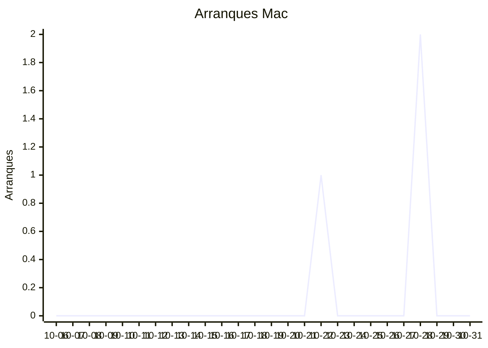
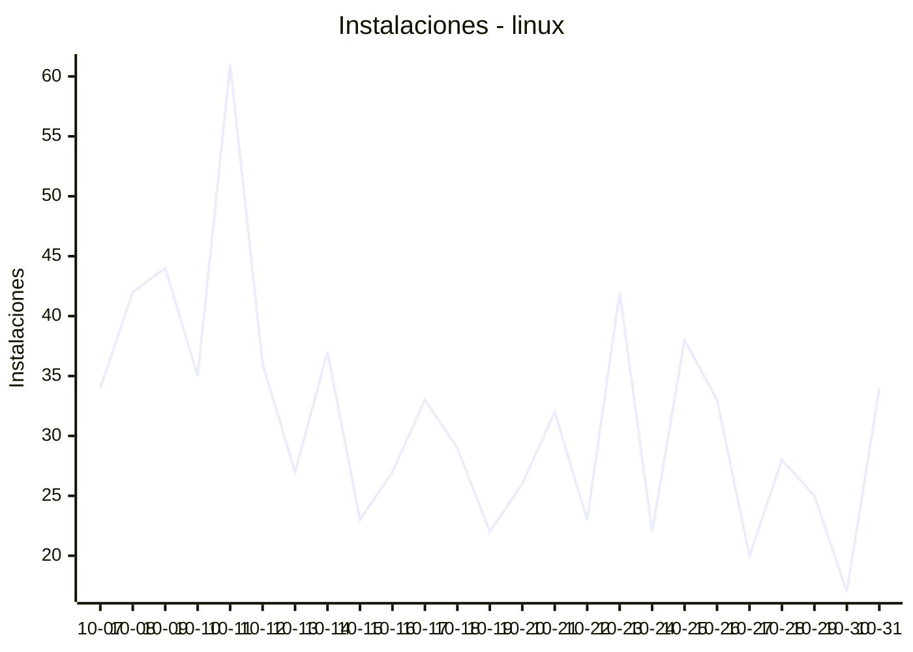
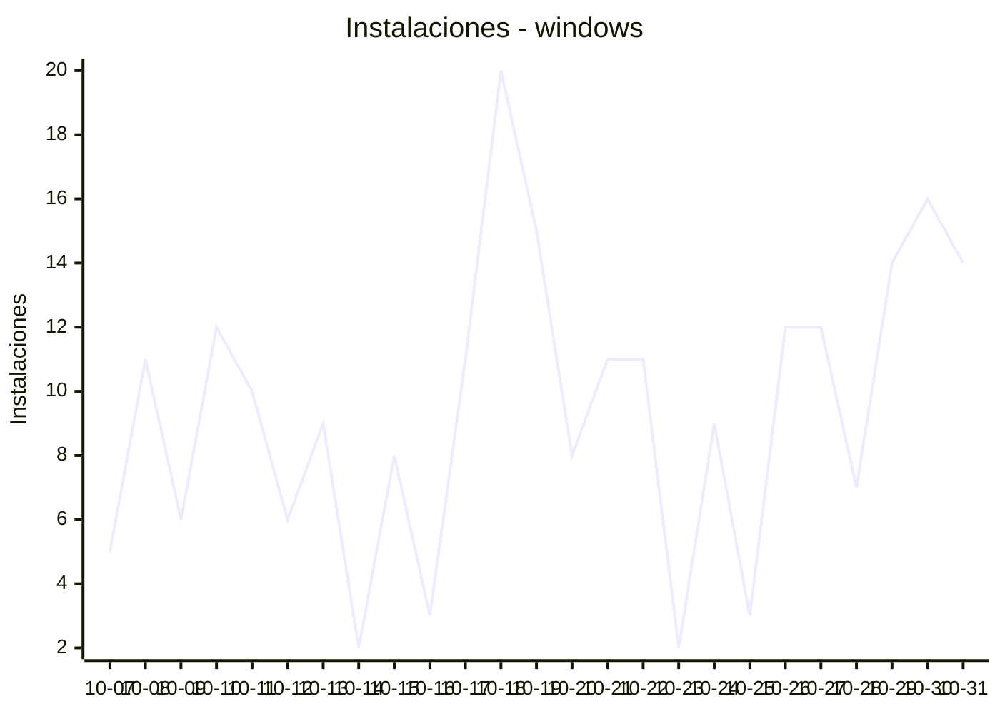
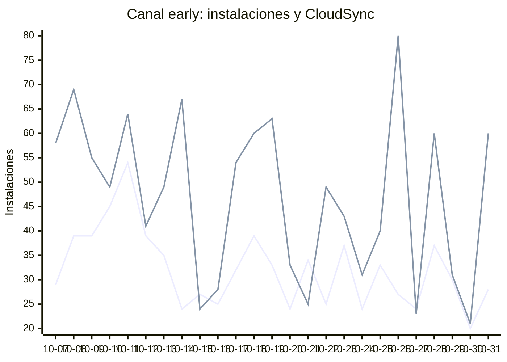

# Estadísticas de EmuDeck

Actualizado: 2026-11-01 00:53 UTC. Las gráficas no incluyen el día de hoy porque aún está incompleto.

## Arranques de la app (comprobaciones de actualización)

Cada arranque descarga el `latest*.yml` de su sistema. Cuenta arranques, no personas.

| Sistema | Ayer | Últimos 7 días |
|---|---|---|
| Linux x86 | 14437 | 90496 |
| Linux ARM | 173 | 1139 |
| Windows | 3667 | 24150 |
| Mac | 0 | 2 |

Instalaciones nuevas estimadas en Windows (7 días, `.exe` menos `.blockmap`): **2326**

## Instalaciones de EmuDeck (beacons)

Cada `setup` descarga `system-<sistema>.txt` y cada instalación de un emulador `<emulador>-<plataforma>.txt`. Los emuladores cuentan también las actualizaciones. Histórico completo desde el primer día.

| Sistema | Ayer | Últimos 7 días | Últimos 30 días | Total |
|---|---|---|---|---|
| linux | 34 | 195 | 790 | 812 |
| linux-arm | 2 | 32 | 128 | 131 |
| windows | 14 | 78 | 237 | 244 |

### Por mes

| Mes | Linux | Linux ARM | Windows | Total |
|---|---|---|---|---|
| 2026-10 | 790 | 128 | 237 | 1155 |

### Canal early (early + early-unstable)

Instalaciones de EmuDeck con el backend en una rama early, y cuántas de ellas instalan CloudSync.

| | Últimos 7 días | Últimos 30 días | Total |
|---|---|---|---|
| Instalaciones early | 199 | 803 | 826 |
| Con CloudSync | 315 | 1177 | 1243 |
| % con CloudSync | | | 150% |

Línea de arriba: instalaciones early. Línea de abajo: de ellas, con CloudSync.

### Por emulador

| Emulador | Linux (total) | Linux ARM (total) | Windows (total) | Últimos 7 días | Últimos 30 días | Total |
|---|---|---|---|---|---|---|
| pcsx2 | 2258 | 23 | 278 | 656 | 2484 | 2559 |
| esde | 1863 | 180 | 461 | 719 | 2409 | 2504 |
| azahar | 1972 | 206 | 284 | 639 | 2386 | 2462 |
| duckstation | 2151 | 185 | 112 | 619 | 2374 | 2448 |
| ryujinx | 1926 | 195 | 266 | 604 | 2319 | 2387 |
| rpcs3 | 2044 | 186 | 108 | 612 | 2268 | 2338 |
| cemu | 1972 | 191 | 97 | 572 | 2196 | 2260 |
| srm | 1790 | 165 | 298 | 580 | 2205 | 2253 |
| xenia | 1840 | 151 | 241 | 598 | 2171 | 2232 |
| shadps4 | 1721 | 162 | 216 | 566 | 2034 | 2099 |
| vita3k | 1798 | 165 | 74 | 519 | 1973 | 2037 |
| cloudsync | 857 | 40 | 397 | 330 | 1226 | 1294 |
| ppsspp | 722 | 111 | 218 | 274 | 1019 | 1051 |
| dolphin | 788 | 129 | 119 | 267 | 1006 | 1036 |
| ra | 782 | 119 | 124 | 249 | 996 | 1025 |
| mgba | 807 | 57 | 61 | 235 | 904 | 925 |
| xemu | 676 | 98 | 90 | 214 | 838 | 864 |
| melonds | 661 | 94 | 83 | 193 | 810 | 838 |
| primehack | 591 | 93 | 87 | 191 | 746 | 771 |
| supermodel | 563 | 107 | 24 | 161 | 673 | 694 |
| scummvm | 547 | 80 | 58 | 161 | 661 | 685 |
| model2 | 556 | 111 | 8 | 153 | 654 | 675 |
| bigpemu | 547 | 11 | 16 | 134 | 556 | 574 |
| armsx2 | 166 | 218 | 0 | 108 | 375 | 384 |
| flycast | 146 | 18 | 21 | 36 | 180 | 185 |
| rmg | 138 | 28 | 0 | 28 | 162 | 166 |
| eden | 86 | 9 | 7 | 22 | 94 | 102 |
| mame | 76 | 3 | 19 | 16 | 94 | 98 |
| pegasus | 21 | 1 | 17 | 14 | 37 | 39 |
| yuzu | 9 | 0 | 3 | 2 | 12 | 12 |
| ares | 10 | 1 | 0 | 4 | 11 | 11 |
| citron | 5 | 0 | 0 | 1 | 5 | 5 |
