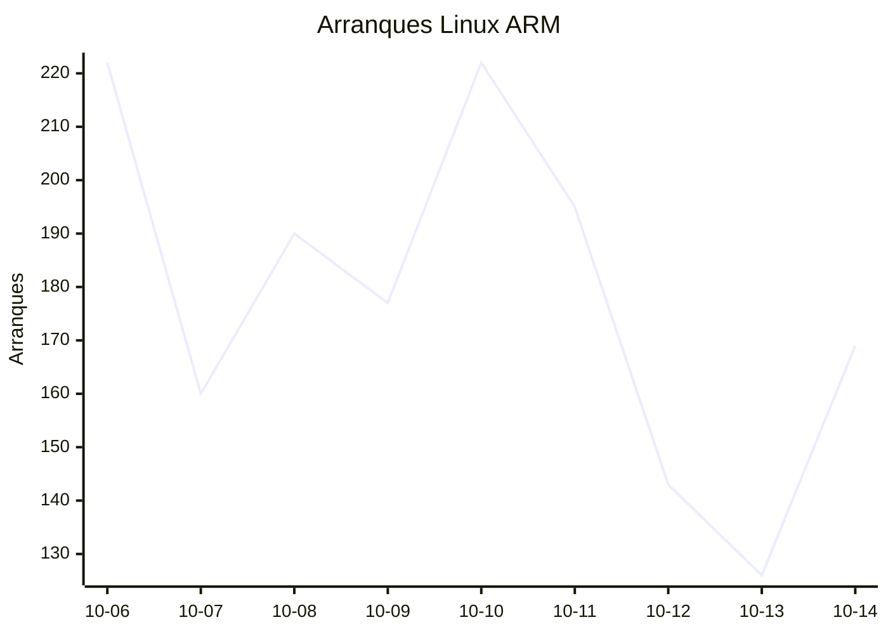
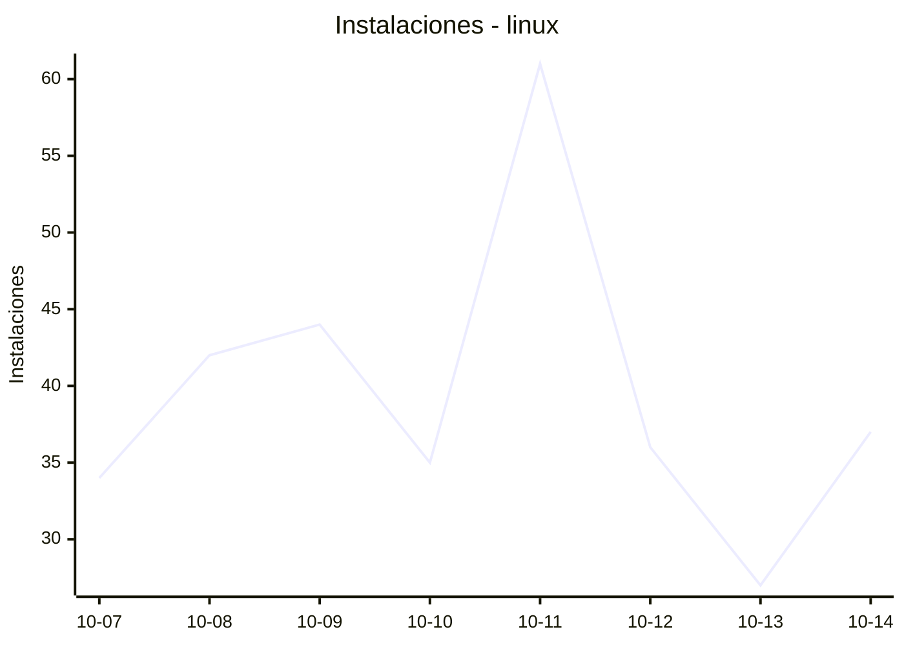
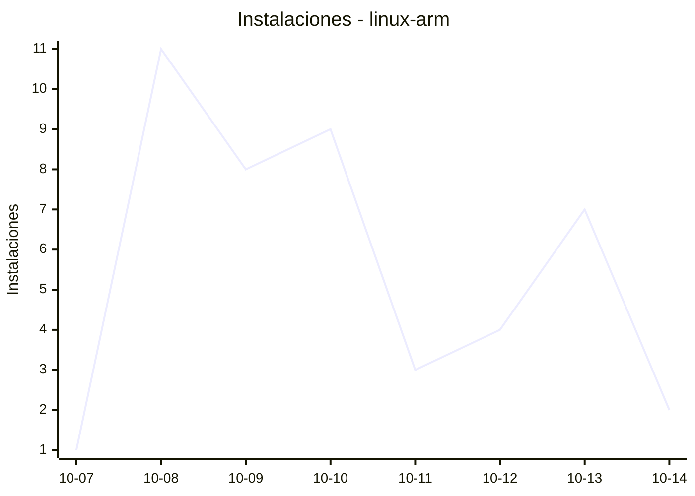
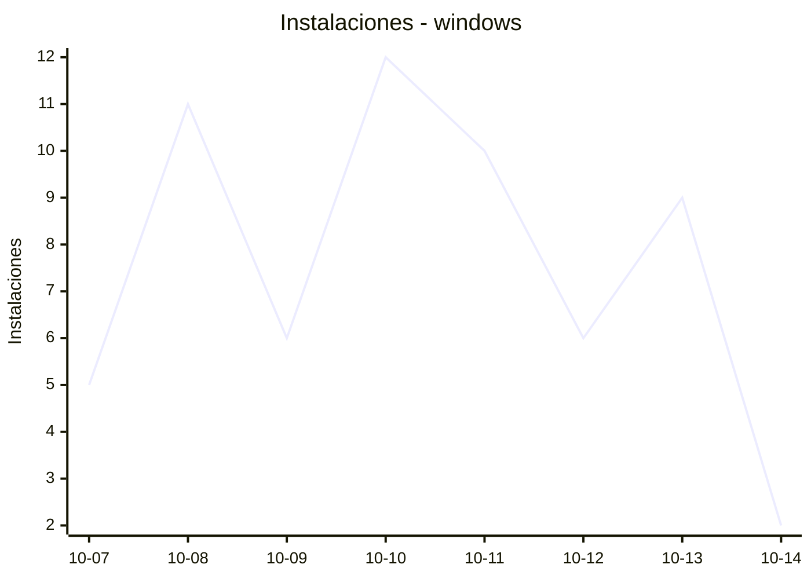
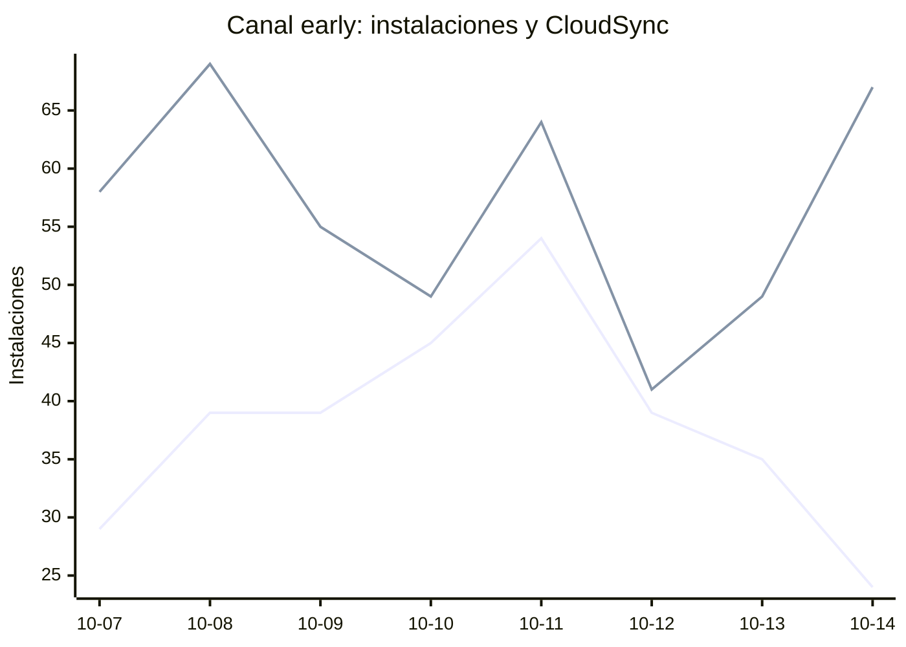

# Estadísticas de EmuDeck

Actualizado: 2026-10-15 21:14 UTC. Las gráficas no incluyen el día de hoy porque aún está incompleto.

## Arranques de la app (comprobaciones de actualización)

Cada arranque descarga el `latest*.yml` de su sistema. Cuenta arranques, no personas.

| Sistema | Ayer | Últimos 7 días |
|---|---|---|
| Linux x86 | 13483 | 97678 |
| Linux ARM | 169 | 1222 |
| Windows | 3334 | 25880 |
| Mac | 0 | 0 |

Instalaciones nuevas estimadas en Windows (7 días, `.exe` menos `.blockmap`): **1663**

## Instalaciones de EmuDeck (beacons)

Cada `setup` descarga `system-<sistema>.txt` y cada instalación de un emulador `<emulador>-<plataforma>.txt`. Los emuladores cuentan también las actualizaciones. Histórico completo desde el primer día.

| Sistema | Ayer | Últimos 7 días | Últimos 30 días | Total |
|---|---|---|---|---|
| linux | 37 | 282 | 316 | 359 |
| linux-arm | 2 | 44 | 45 | 50 |
| windows | 2 | 56 | 61 | 73 |

### Por mes

| Mes | Linux | Linux ARM | Windows | Total |
|---|---|---|---|---|
| 2026-10 | 316 | 45 | 61 | 422 |

### Canal early (early + early-unstable)

Instalaciones de EmuDeck con el backend en una rama early, y cuántas de ellas instalan CloudSync.

| | Últimos 7 días | Últimos 30 días | Total |
|---|---|---|---|
| Instalaciones early | 275 | 304 | 347 |
| Con CloudSync | 394 | 452 | 537 |
| % con CloudSync | | | 155% |

Línea de arriba: instalaciones early. Línea de abajo: de ellas, con CloudSync.

### Por emulador

| Emulador | Linux (total) | Linux ARM (total) | Windows (total) | Últimos 7 días | Últimos 30 días | Total |
|---|---|---|---|---|---|---|
| pcsx2 | 891 | 15 | 104 | 778 | 873 | 1010 |
| azahar | 803 | 67 | 98 | 739 | 827 | 968 |
| duckstation | 859 | 65 | 34 | 738 | 825 | 958 |
| esde | 729 | 60 | 152 | 709 | 793 | 941 |
| ryujinx | 761 | 69 | 100 | 704 | 788 | 930 |
| rpcs3 | 803 | 67 | 33 | 698 | 776 | 903 |
| cemu | 808 | 68 | 22 | 695 | 775 | 898 |
| xenia | 731 | 56 | 73 | 668 | 747 | 860 |
| srm | 699 | 49 | 71 | 628 | 704 | 819 |
| shadps4 | 689 | 57 | 62 | 603 | 684 | 808 |
| vita3k | 722 | 57 | 16 | 614 | 682 | 795 |
| cloudsync | 391 | 16 | 151 | 410 | 470 | 558 |
| dolphin | 350 | 48 | 42 | 350 | 384 | 440 |
| ppsspp | 316 | 44 | 72 | 348 | 379 | 432 |
| ra | 348 | 48 | 33 | 346 | 381 | 429 |
| melonds | 303 | 36 | 25 | 286 | 317 | 364 |
| mgba | 320 | 23 | 21 | 278 | 313 | 364 |
| xemu | 296 | 37 | 26 | 288 | 314 | 359 |
| primehack | 264 | 38 | 25 | 260 | 283 | 327 |
| supermodel | 262 | 44 | 8 | 256 | 277 | 314 |
| model2 | 256 | 47 | 4 | 251 | 273 | 307 |
| scummvm | 253 | 33 | 12 | 238 | 260 | 298 |
| bigpemu | 224 | 3 | 6 | 179 | 197 | 233 |
| armsx2 | 73 | 70 | 0 | 112 | 125 | 143 |
| flycast | 73 | 10 | 5 | 69 | 78 | 88 |
| rmg | 67 | 17 | 0 | 65 | 71 | 84 |
| mame | 44 | 2 | 9 | 47 | 49 | 55 |
| eden | 33 | 6 | 0 | 29 | 29 | 39 |
| pegasus | 9 | 0 | 6 | 7 | 8 | 15 |
| yuzu | 6 | 0 | 0 | 6 | 6 | 6 |
| ares | 3 | 1 | 0 | 3 | 4 | 4 |
| citron | 3 | 0 | 0 | 2 | 2 | 3 |
