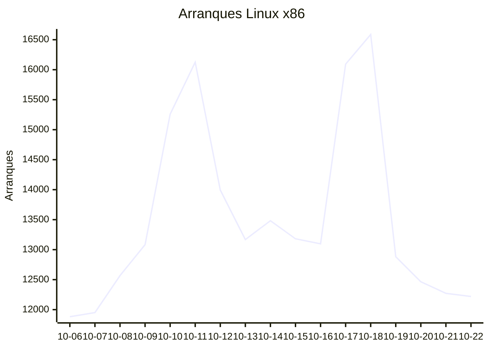
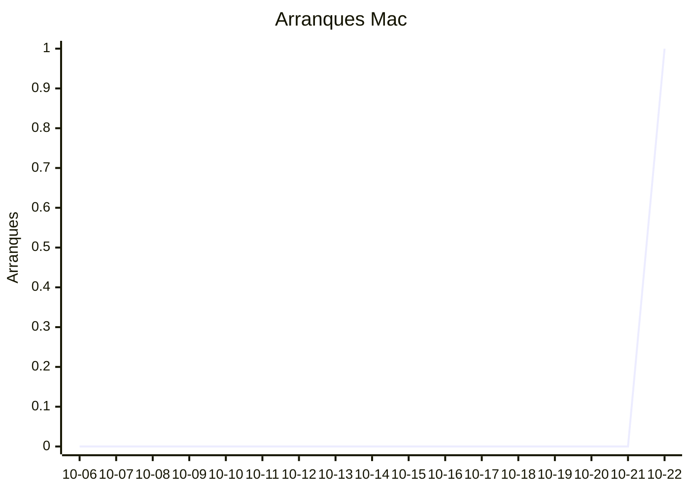
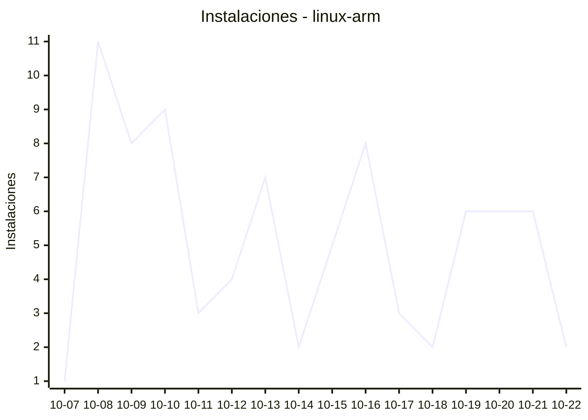
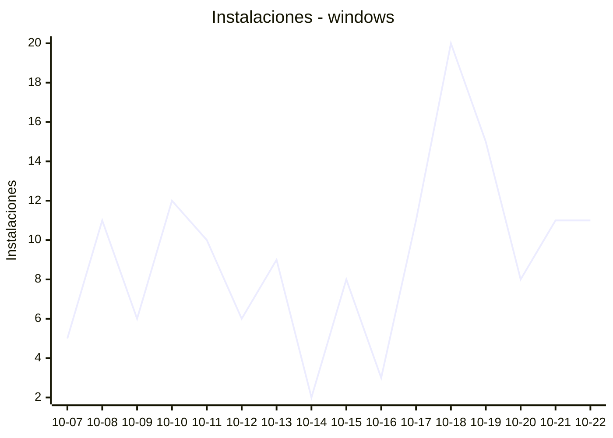
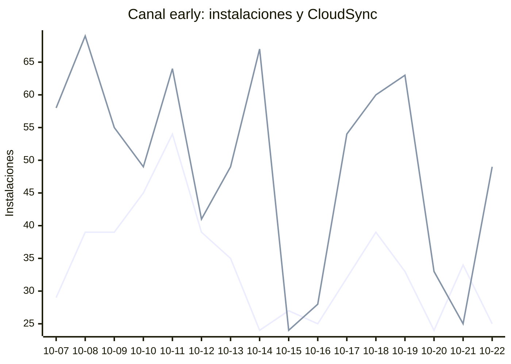

# Estadísticas de EmuDeck

Actualizado: 2026-10-23 21:13 UTC. Las gráficas no incluyen el día de hoy porque aún está incompleto.

## Arranques de la app (comprobaciones de actualización)

Cada arranque descarga el `latest*.yml` de su sistema. Cuenta arranques, no personas.

| Sistema | Ayer | Últimos 7 días |
|---|---|---|
| Linux x86 | 12219 | 95615 |
| Linux ARM | 138 | 1095 |
| Windows | 3270 | 25184 |
| Mac | 1 | 1 |

Instalaciones nuevas estimadas en Windows (7 días, `.exe` menos `.blockmap`): **2120**

## Instalaciones de EmuDeck (beacons)

Cada `setup` descarga `system-<sistema>.txt` y cada instalación de un emulador `<emulador>-<plataforma>.txt`. Los emuladores cuentan también las actualizaciones. Histórico completo desde el primer día.

| Sistema | Ayer | Últimos 7 días | Últimos 30 días | Total |
|---|---|---|---|---|
| linux | 23 | 192 | 531 | 587 |
| linux-arm | 2 | 33 | 83 | 90 |
| windows | 11 | 79 | 148 | 157 |

### Por mes

| Mes | Linux | Linux ARM | Windows | Total |
|---|---|---|---|---|
| 2026-10 | 531 | 83 | 148 | 762 |

### Canal early (early + early-unstable)

Instalaciones de EmuDeck con el backend en una rama early, y cuántas de ellas instalan CloudSync.

| | Últimos 7 días | Últimos 30 días | Total |
|---|---|---|---|
| Instalaciones early | 212 | 543 | 597 |
| Con CloudSync | 312 | 788 | 889 |
| % con CloudSync | | | 149% |

Línea de arriba: instalaciones early. Línea de abajo: de ellas, con CloudSync.

### Por emulador

| Emulador | Linux (total) | Linux ARM (total) | Windows (total) | Últimos 7 días | Últimos 30 días | Total |
|---|---|---|---|---|---|---|
| pcsx2 | 1571 | 20 | 184 | 664 | 1612 | 1775 |
| duckstation | 1514 | 120 | 75 | 643 | 1542 | 1709 |
| azahar | 1390 | 129 | 181 | 629 | 1534 | 1700 |
| ryujinx | 1350 | 127 | 183 | 617 | 1494 | 1660 |
| esde | 1267 | 99 | 285 | 624 | 1484 | 1651 |
| rpcs3 | 1416 | 118 | 75 | 603 | 1450 | 1609 |
| cemu | 1399 | 124 | 59 | 579 | 1424 | 1582 |
| srm | 1249 | 109 | 188 | 635 | 1421 | 1546 |
| xenia | 1282 | 103 | 149 | 573 | 1384 | 1534 |
| shadps4 | 1202 | 102 | 132 | 540 | 1291 | 1436 |
| vita3k | 1266 | 107 | 49 | 533 | 1278 | 1422 |
| cloudsync | 624 | 25 | 273 | 320 | 815 | 922 |
| ra | 562 | 80 | 92 | 259 | 666 | 734 |
| ppsspp | 520 | 76 | 136 | 254 | 660 | 732 |
| dolphin | 567 | 82 | 81 | 243 | 658 | 730 |
| mgba | 559 | 46 | 43 | 241 | 592 | 648 |
| xemu | 487 | 68 | 58 | 208 | 546 | 613 |
| melonds | 488 | 65 | 59 | 206 | 547 | 612 |
| primehack | 421 | 63 | 59 | 179 | 486 | 543 |
| supermodel | 415 | 78 | 13 | 156 | 454 | 506 |
| model2 | 410 | 81 | 7 | 156 | 447 | 498 |
| scummvm | 403 | 57 | 36 | 163 | 442 | 496 |
| bigpemu | 395 | 7 | 10 | 147 | 365 | 412 |
| armsx2 | 120 | 133 | 0 | 90 | 228 | 253 |
| flycast | 116 | 14 | 15 | 40 | 124 | 145 |
| rmg | 108 | 26 | 0 | 41 | 123 | 134 |
| eden | 73 | 7 | 0 | 40 | 71 | 80 |
| mame | 64 | 2 | 14 | 18 | 69 | 80 |
| pegasus | 11 | 0 | 12 | 6 | 20 | 23 |
| yuzu | 7 | 0 | 0 | 0 | 6 | 7 |
| ares | 5 | 1 | 0 | 2 | 6 | 6 |
| citron | 4 | 0 | 0 | 1 | 4 | 4 |
