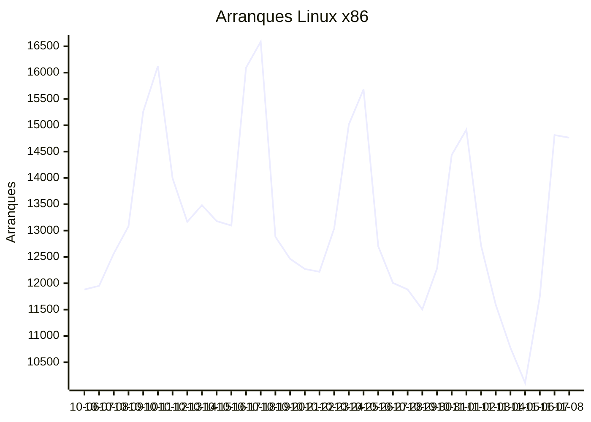
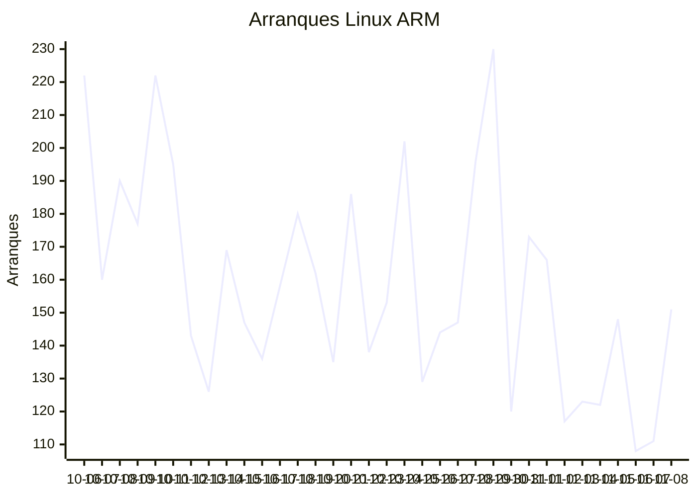
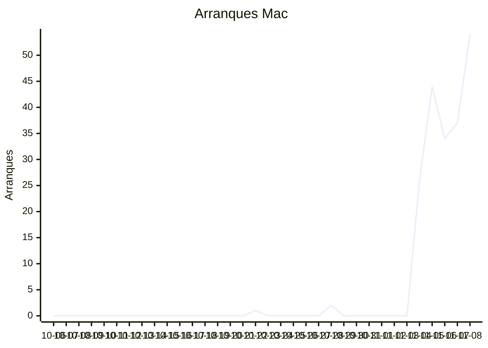
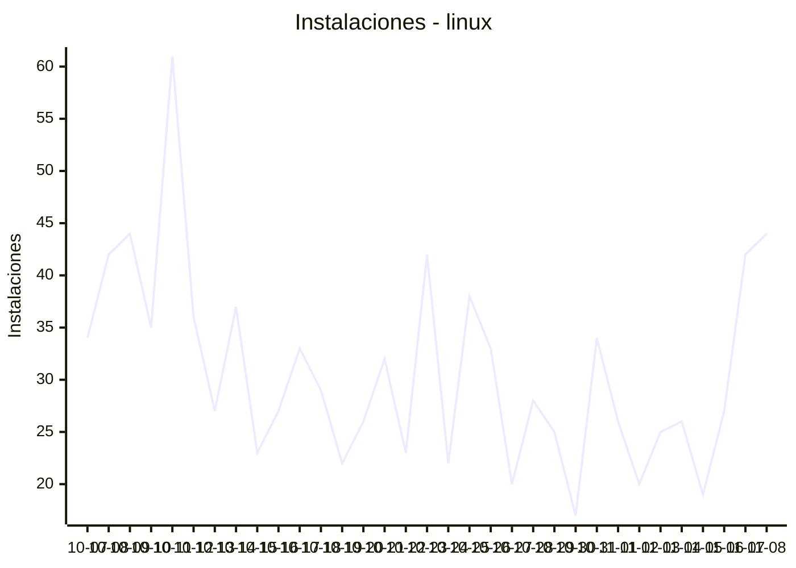
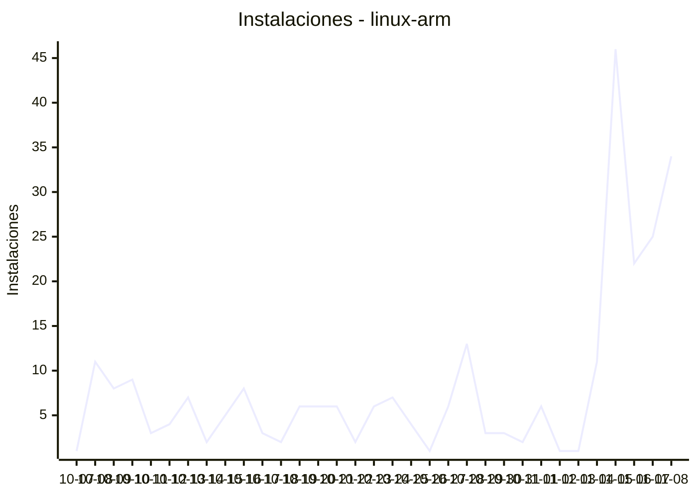
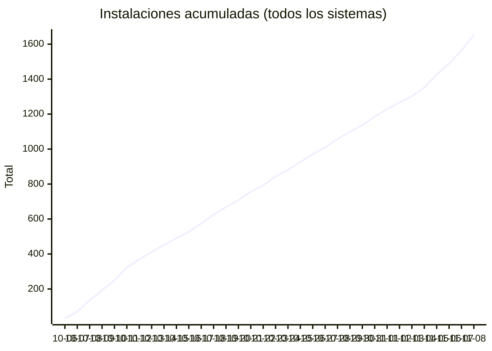
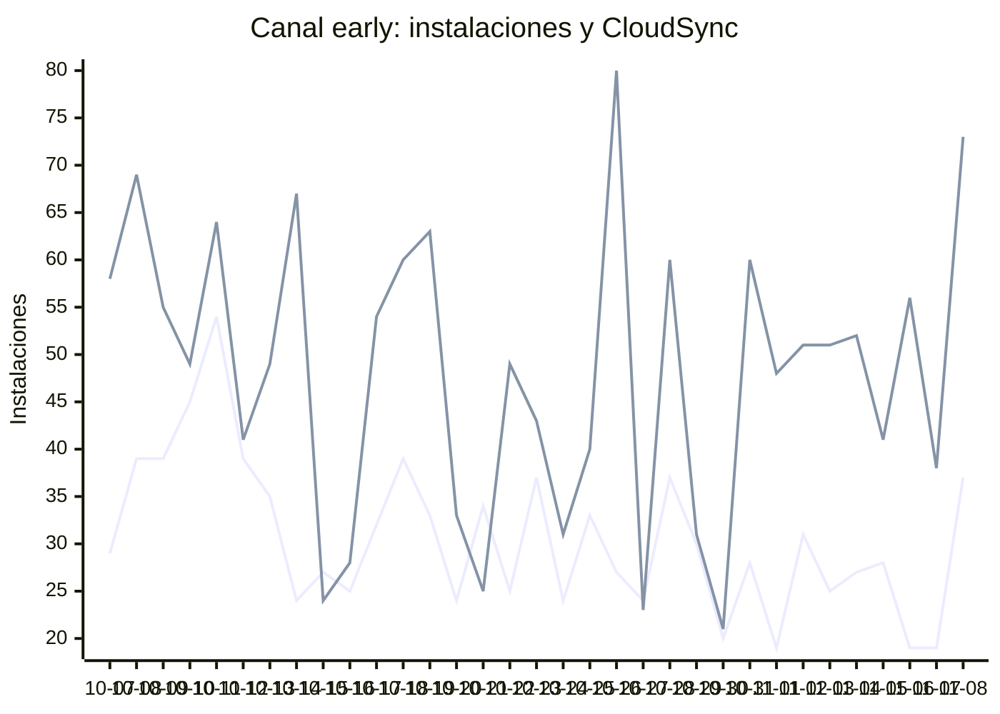

# Estadísticas de EmuDeck

Actualizado: 2026-11-09 21:35 UTC. Las gráficas no incluyen el día de hoy porque aún está incompleto.

## Arranques de la app (comprobaciones de actualización)

Cada arranque descarga el `latest*.yml` de su sistema. Cuenta arranques, no personas.

| Sistema | Ayer | Últimos 7 días |
|---|---|---|
| Linux x86 | 14765 | 86518 |
| Linux ARM | 151 | 880 |
| Windows | 4130 | 23235 |
| Mac | 54 | 195 |

Instalaciones nuevas estimadas en Windows (7 días, `.exe` menos `.blockmap`): **2334**

## Instalaciones de EmuDeck (beacons)

Cada `setup` descarga `system-<sistema>.txt` y cada instalación de un emulador `<emulador>-<plataforma>.txt`. Los emuladores cuentan también las actualizaciones. Histórico completo desde el primer día.

| Sistema | Ayer | Últimos 7 días | Últimos 30 días | Total |
|---|---|---|---|---|
| linux | 44 | 203 | 899 | 1076 |
| linux-arm | 34 | 140 | 254 | 297 |
| windows | 12 | 82 | 308 | 343 |

### Por mes

| Mes | Linux | Linux ARM | Windows | Total |
|---|---|---|---|---|
| 2026-11 | 229 | 146 | 93 | 468 |
| 2026-10 | 790 | 128 | 237 | 1155 |

### Canal early (early + early-unstable)

Instalaciones de EmuDeck con el backend en una rama early, y cuántas de ellas instalan CloudSync.

| | Últimos 7 días | Últimos 30 días | Total |
|---|---|---|---|
| Instalaciones early | 186 | 901 | 1062 |
| Con CloudSync | 362 | 1405 | 1703 |
| % con CloudSync | | | 160% |

Línea de arriba: instalaciones early. Línea de abajo: de ellas, con CloudSync.

### Por emulador

| Emulador | Linux (total) | Linux ARM (total) | Windows (total) | Últimos 7 días | Últimos 30 días | Total |
|---|---|---|---|---|---|---|
| esde | 2433 | 315 | 675 | 734 | 2947 | 3423 |
| pcsx2 | 2952 | 30 | 402 | 648 | 2904 | 3384 |
| azahar | 2598 | 370 | 376 | 702 | 2872 | 3344 |
| duckstation | 2818 | 346 | 158 | 691 | 2859 | 3322 |
| ryujinx | 2512 | 355 | 380 | 684 | 2786 | 3247 |
| rpcs3 | 2678 | 335 | 161 | 659 | 2749 | 3174 |
| srm | 2372 | 299 | 454 | 691 | 2707 | 3125 |
| cemu | 2561 | 336 | 139 | 611 | 2615 | 3036 |
| xenia | 2382 | 272 | 333 | 581 | 2587 | 2987 |
| shadps4 | 2225 | 208 | 301 | 491 | 2365 | 2734 |
| vita3k | 2326 | 296 | 110 | 550 | 2364 | 2732 |
| cloudsync | 1118 | 47 | 594 | 367 | 1449 | 1759 |
| ppsspp | 932 | 227 | 311 | 333 | 1255 | 1470 |
| ra | 1027 | 242 | 183 | 343 | 1229 | 1452 |
| dolphin | 1014 | 261 | 167 | 326 | 1227 | 1442 |
| mgba | 1078 | 79 | 79 | 247 | 1075 | 1236 |
| xemu | 863 | 201 | 128 | 260 | 1019 | 1192 |
| melonds | 846 | 198 | 114 | 257 | 982 | 1158 |
| primehack | 780 | 204 | 131 | 279 | 940 | 1115 |
| supermodel | 734 | 203 | 37 | 229 | 830 | 974 |
| scummvm | 702 | 174 | 81 | 219 | 810 | 957 |
| model2 | 724 | 214 | 12 | 221 | 800 | 950 |
| bigpemu | 719 | 30 | 26 | 159 | 680 | 775 |
| armsx2 | 227 | 391 | 0 | 192 | 538 | 618 |
| flycast | 189 | 28 | 29 | 49 | 209 | 246 |
| rmg | 179 | 43 | 0 | 43 | 181 | 222 |
| mame | 106 | 12 | 33 | 38 | 117 | 151 |
| eden | 99 | 11 | 14 | 20 | 112 | 124 |
| pegasus | 32 | 2 | 23 | 15 | 51 | 57 |
| yuzu | 13 | 0 | 6 | 5 | 16 | 19 |
| ares | 13 | 2 | 0 | 2 | 12 | 15 |
| citron | 6 | 0 | 1 | 2 | 7 | 7 |
