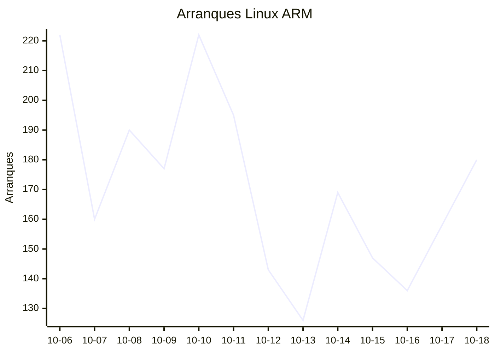
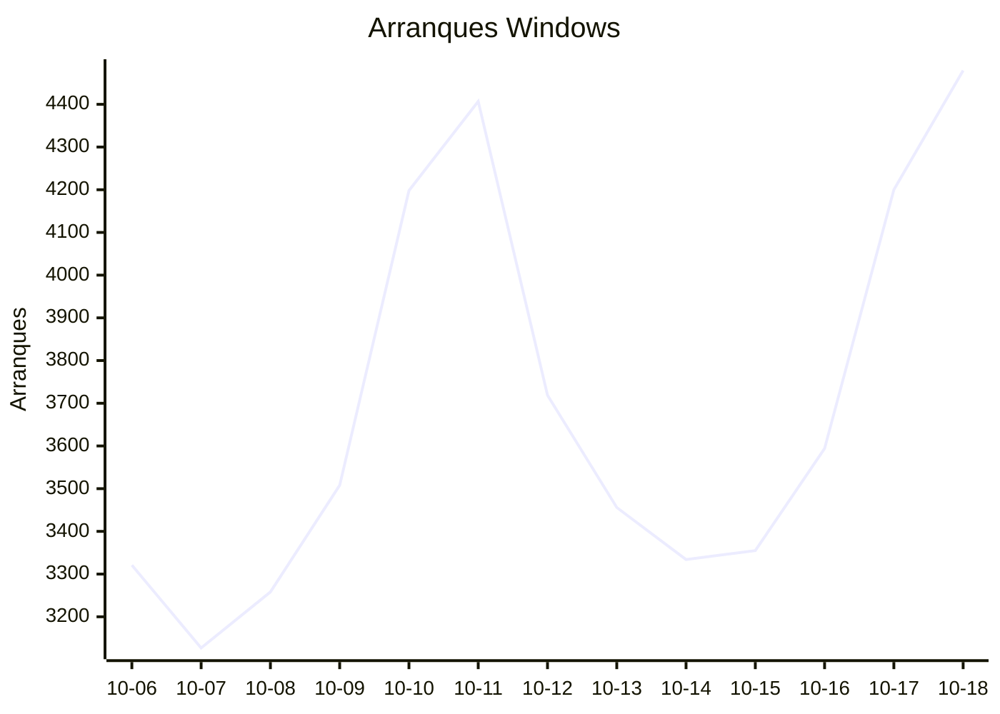
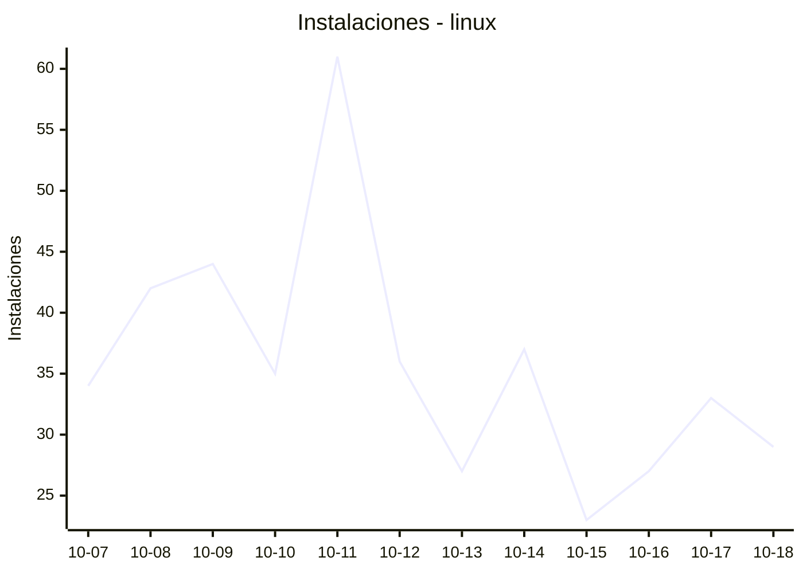
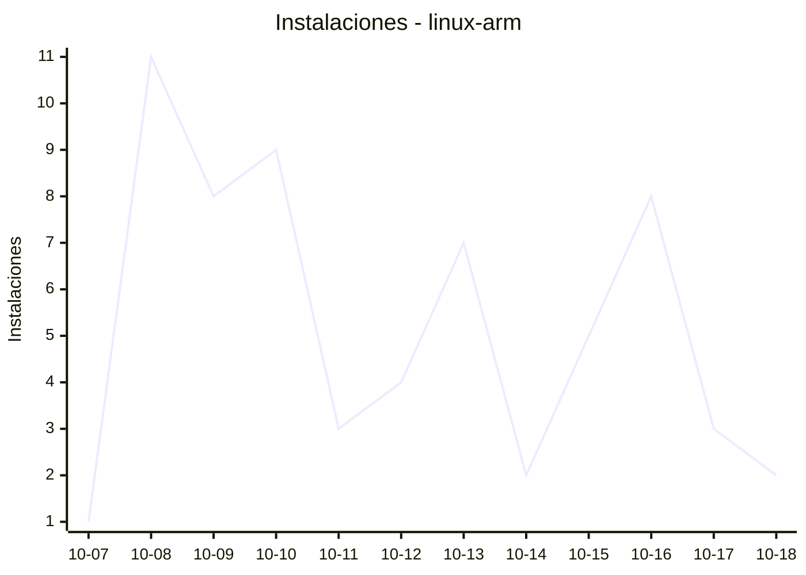
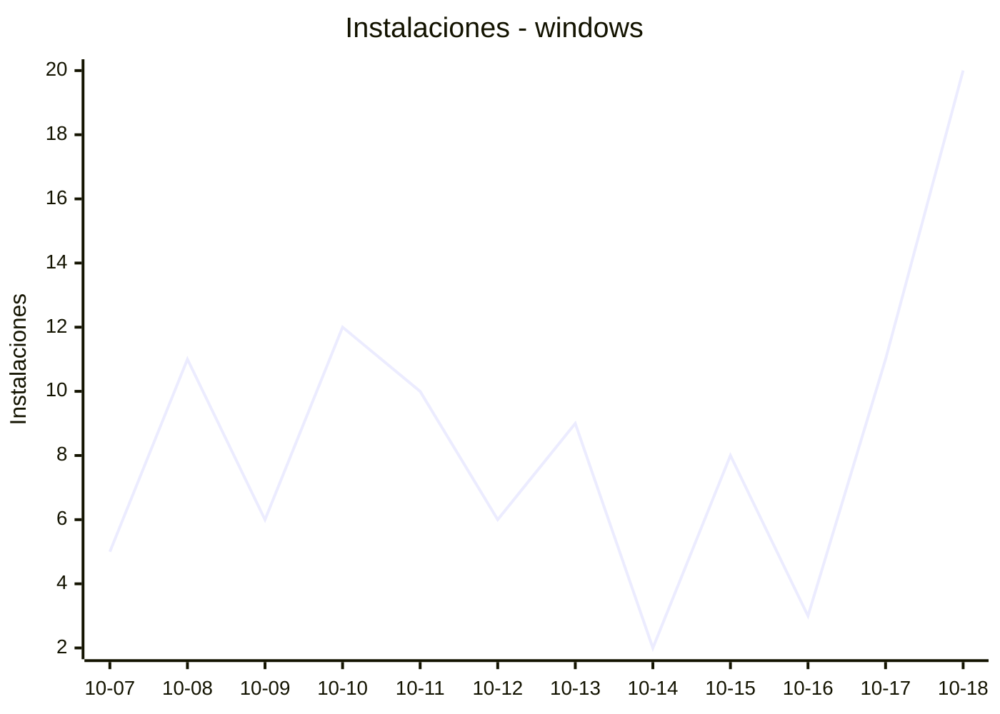
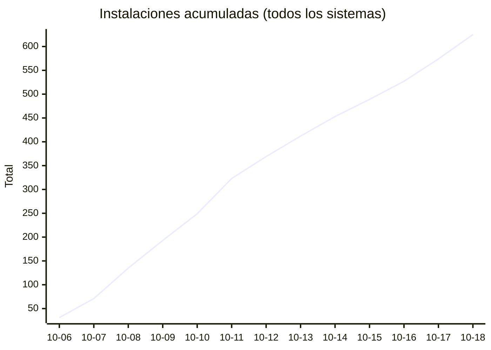
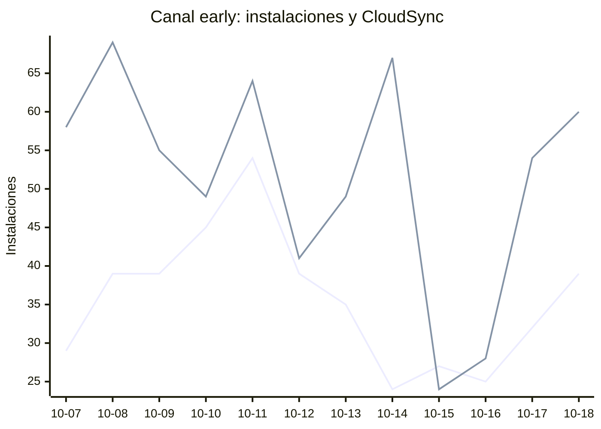

# Estadísticas de EmuDeck

Actualizado: 2026-10-19 14:41 UTC. Las gráficas no incluyen el día de hoy porque aún está incompleto.

## Arranques de la app (comprobaciones de actualización)

Cada arranque descarga el `latest*.yml` de su sistema. Cuenta arranques, no personas.

| Sistema | Ayer | Últimos 7 días |
|---|---|---|
| Linux x86 | 16587 | 99603 |
| Linux ARM | 180 | 1059 |
| Windows | 4479 | 26137 |
| Mac | 0 | 0 |

Instalaciones nuevas estimadas en Windows (7 días, `.exe` menos `.blockmap`): **2010**

## Instalaciones de EmuDeck (beacons)

Cada `setup` descarga `system-<sistema>.txt` y cada instalación de un emulador `<emulador>-<plataforma>.txt`. Los emuladores cuentan también las actualizaciones. Histórico completo desde el primer día.

| Sistema | Ayer | Últimos 7 días | Últimos 30 días | Total |
|---|---|---|---|---|
| linux | 29 | 212 | 428 | 464 |
| linux-arm | 2 | 31 | 63 | 69 |
| windows | 20 | 59 | 103 | 121 |

### Por mes

| Mes | Linux | Linux ARM | Windows | Total |
|---|---|---|---|---|
| 2026-10 | 428 | 63 | 103 | 594 |

### Canal early (early + early-unstable)

Instalaciones de EmuDeck con el backend en una rama early, y cuántas de ellas instalan CloudSync.

| | Últimos 7 días | Últimos 30 días | Total |
|---|---|---|---|
| Instalaciones early | 221 | 427 | 472 |
| Con CloudSync | 323 | 618 | 727 |
| % con CloudSync | | | 154% |

Línea de arriba: instalaciones early. Línea de abajo: de ellas, con CloudSync.

### Por emulador

| Emulador | Linux (total) | Linux ARM (total) | Windows (total) | Últimos 7 días | Últimos 30 días | Total |
|---|---|---|---|---|---|---|
| pcsx2 | 1227 | 19 | 149 | 701 | 1262 | 1395 |
| duckstation | 1187 | 87 | 51 | 667 | 1197 | 1325 |
| azahar | 1089 | 89 | 140 | 660 | 1191 | 1318 |
| esde | 992 | 77 | 221 | 633 | 1138 | 1290 |
| ryujinx | 1049 | 90 | 139 | 648 | 1166 | 1278 |
| rpcs3 | 1104 | 88 | 50 | 642 | 1129 | 1242 |
| cemu | 1089 | 89 | 38 | 617 | 1104 | 1216 |
| srm | 967 | 71 | 134 | 616 | 1076 | 1172 |
| xenia | 989 | 74 | 109 | 599 | 1065 | 1172 |
| shadps4 | 942 | 71 | 104 | 573 | 1012 | 1117 |
| vita3k | 998 | 77 | 28 | 573 | 998 | 1103 |
| cloudsync | 518 | 18 | 215 | 329 | 640 | 751 |
| dolphin | 459 | 62 | 58 | 272 | 526 | 579 |
| ppsspp | 418 | 58 | 101 | 264 | 522 | 577 |
| ra | 449 | 62 | 58 | 262 | 521 | 569 |
| mgba | 433 | 34 | 32 | 265 | 462 | 499 |
| melonds | 394 | 48 | 40 | 234 | 438 | 482 |
| xemu | 387 | 51 | 39 | 224 | 434 | 477 |
| primehack | 339 | 48 | 39 | 197 | 387 | 426 |
| supermodel | 332 | 57 | 9 | 191 | 367 | 398 |
| model2 | 328 | 60 | 7 | 185 | 361 | 395 |
| scummvm | 324 | 43 | 21 | 180 | 354 | 388 |
| bigpemu | 300 | 4 | 8 | 157 | 278 | 312 |
| armsx2 | 91 | 94 | 0 | 89 | 165 | 185 |
| flycast | 87 | 13 | 10 | 49 | 102 | 110 |
| rmg | 85 | 21 | 0 | 54 | 99 | 106 |
| eden | 65 | 7 | 0 | 50 | 58 | 72 |
| mame | 53 | 2 | 10 | 20 | 58 | 65 |
| pegasus | 9 | 0 | 10 | 13 | 17 | 19 |
| yuzu | 6 | 0 | 0 | 2 | 6 | 6 |
| ares | 4 | 1 | 0 | 2 | 4 | 5 |
| citron | 4 | 0 | 0 | 3 | 4 | 4 |
