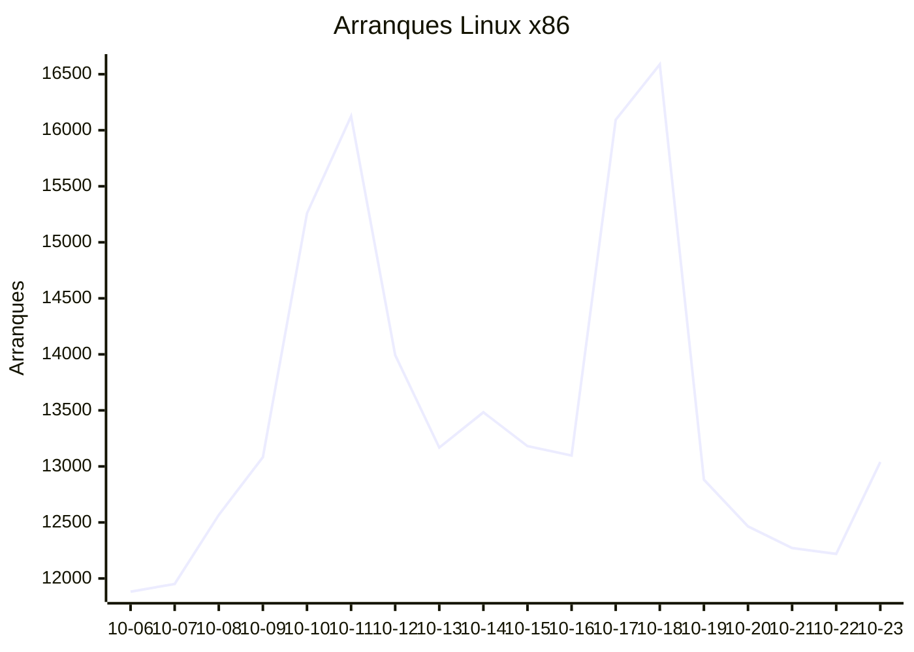
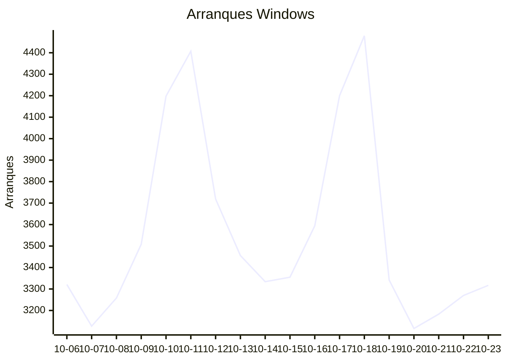
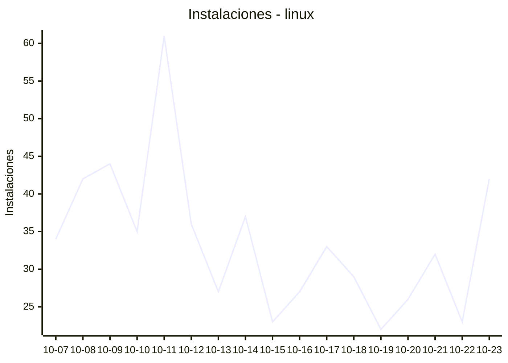
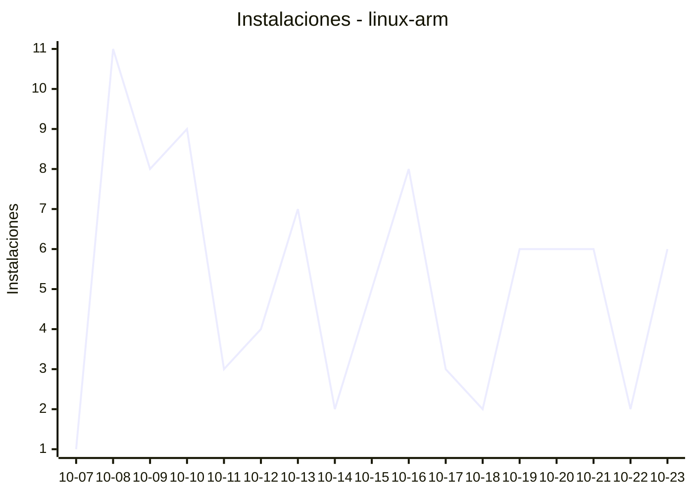
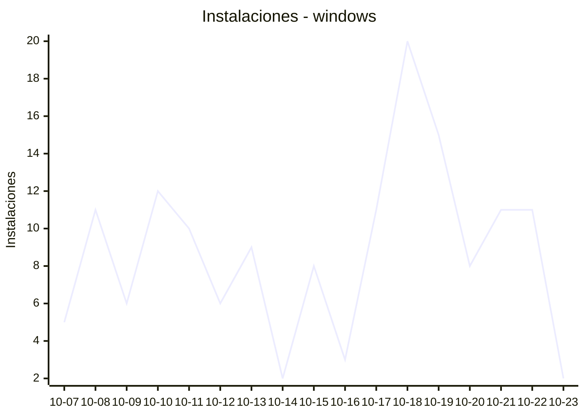
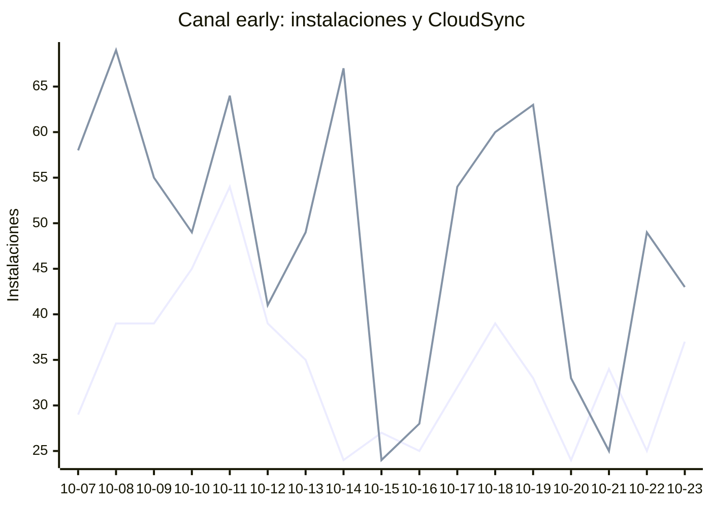

# Estadísticas de EmuDeck

Actualizado: 2026-10-24 19:09 UTC. Las gráficas no incluyen el día de hoy porque aún está incompleto.

## Arranques de la app (comprobaciones de actualización)

Cada arranque descarga el `latest*.yml` de su sistema. Cuenta arranques, no personas.

| Sistema | Ayer | Últimos 7 días |
|---|---|---|
| Linux x86 | 13039 | 95557 |
| Linux ARM | 153 | 1112 |
| Windows | 3317 | 24907 |
| Mac | 0 | 1 |

Instalaciones nuevas estimadas en Windows (7 días, `.exe` menos `.blockmap`): **2061**

## Instalaciones de EmuDeck (beacons)

Cada `setup` descarga `system-<sistema>.txt` y cada instalación de un emulador `<emulador>-<plataforma>.txt`. Los emuladores cuentan también las actualizaciones. Histórico completo desde el primer día.

| Sistema | Ayer | Últimos 7 días | Últimos 30 días | Total |
|---|---|---|---|---|
| linux | 42 | 207 | 573 | 612 |
| linux-arm | 6 | 31 | 89 | 99 |
| windows | 2 | 78 | 150 | 162 |

### Por mes

| Mes | Linux | Linux ARM | Windows | Total |
|---|---|---|---|---|
| 2026-10 | 573 | 89 | 150 | 812 |

### Canal early (early + early-unstable)

Instalaciones de EmuDeck con el backend en una rama early, y cuántas de ellas instalan CloudSync.

| | Últimos 7 días | Últimos 30 días | Total |
|---|---|---|---|
| Instalaciones early | 224 | 580 | 619 |
| Con CloudSync | 327 | 831 | 912 |
| % con CloudSync | | | 147% |

Línea de arriba: instalaciones early. Línea de abajo: de ellas, con CloudSync.

### Por emulador

| Emulador | Linux (total) | Linux ARM (total) | Windows (total) | Últimos 7 días | Últimos 30 días | Total |
|---|---|---|---|---|---|---|
| pcsx2 | 1660 | 22 | 190 | 690 | 1716 | 1872 |
| duckstation | 1590 | 131 | 81 | 677 | 1654 | 1802 |
| azahar | 1466 | 144 | 186 | 659 | 1642 | 1796 |
| ryujinx | 1417 | 143 | 192 | 654 | 1609 | 1752 |
| esde | 1341 | 108 | 301 | 643 | 1570 | 1750 |
| rpcs3 | 1490 | 131 | 76 | 638 | 1556 | 1697 |
| cemu | 1466 | 134 | 60 | 625 | 1532 | 1660 |
| srm | 1313 | 123 | 205 | 653 | 1515 | 1641 |
| xenia | 1344 | 108 | 161 | 606 | 1486 | 1613 |
| shadps4 | 1263 | 109 | 136 | 567 | 1387 | 1508 |
| vita3k | 1324 | 118 | 50 | 560 | 1372 | 1492 |
| cloudsync | 645 | 25 | 278 | 339 | 862 | 948 |
| ppsspp | 543 | 83 | 142 | 271 | 709 | 768 |
| ra | 587 | 87 | 93 | 275 | 717 | 767 |
| dolphin | 589 | 90 | 83 | 261 | 709 | 762 |
| mgba | 581 | 49 | 46 | 249 | 629 | 676 |
| xemu | 508 | 74 | 60 | 227 | 595 | 642 |
| melonds | 508 | 70 | 60 | 222 | 593 | 638 |
| primehack | 442 | 68 | 62 | 200 | 527 | 572 |
| supermodel | 432 | 81 | 15 | 175 | 494 | 528 |
| model2 | 426 | 84 | 7 | 171 | 486 | 517 |
| scummvm | 419 | 59 | 37 | 181 | 480 | 515 |
| bigpemu | 415 | 10 | 11 | 169 | 395 | 436 |
| armsx2 | 127 | 146 | 0 | 99 | 245 | 273 |
| flycast | 118 | 14 | 16 | 50 | 140 | 148 |
| rmg | 110 | 26 | 0 | 42 | 130 | 136 |
| mame | 64 | 2 | 15 | 23 | 76 | 81 |
| eden | 73 | 7 | 0 | 38 | 72 | 80 |
| pegasus | 13 | 0 | 12 | 7 | 21 | 25 |
| yuzu | 7 | 0 | 1 | 1 | 7 | 8 |
| ares | 6 | 1 | 0 | 3 | 7 | 7 |
| citron | 4 | 0 | 0 | 1 | 4 | 4 |
