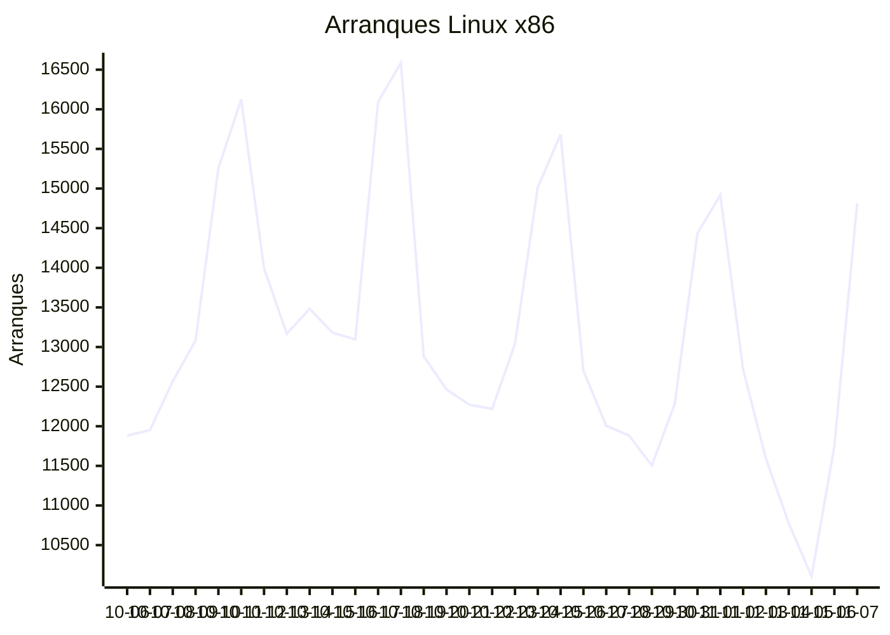
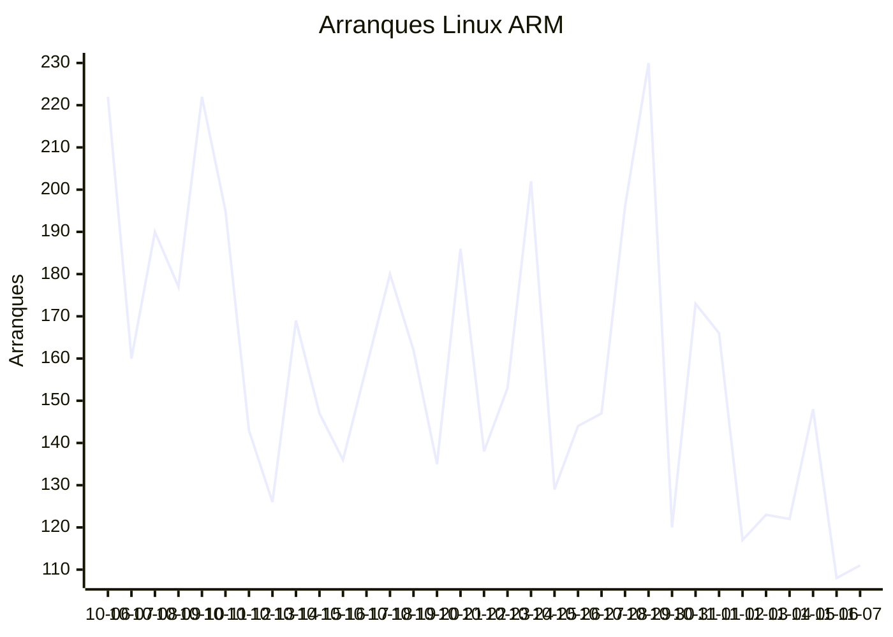
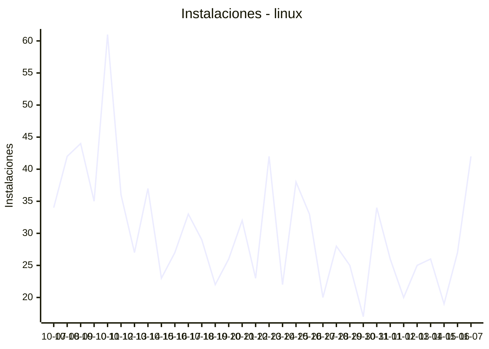
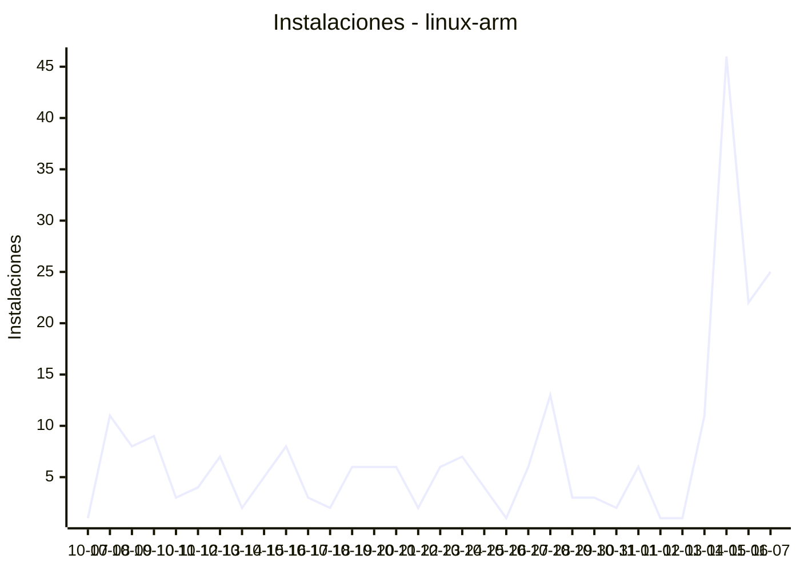
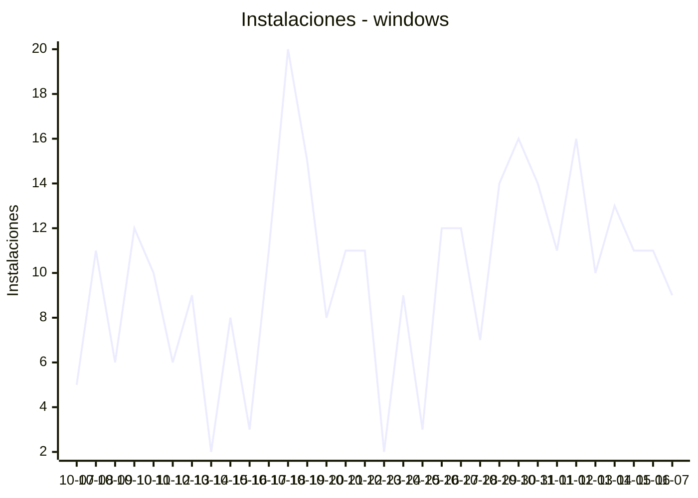
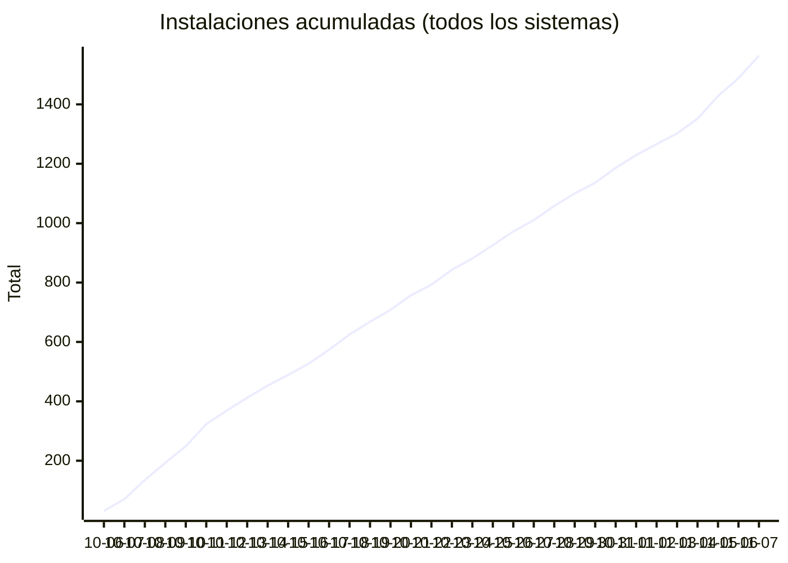
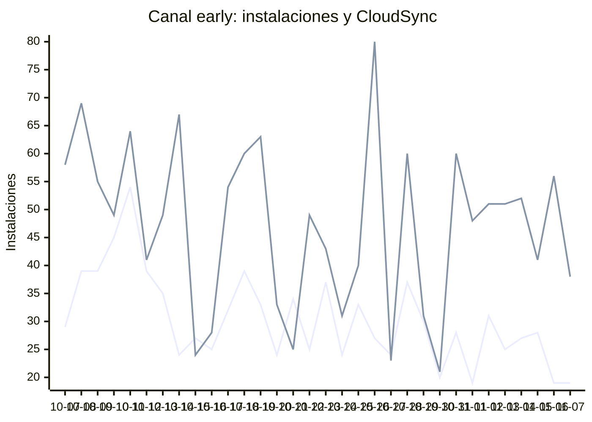

# Estadísticas de EmuDeck

Actualizado: 2026-11-08 20:34 UTC. Las gráficas no incluyen el día de hoy porque aún está incompleto.

## Arranques de la app (comprobaciones de actualización)

Cada arranque descarga el `latest*.yml` de su sistema. Cuenta arranques, no personas.

| Sistema | Ayer | Últimos 7 días |
|---|---|---|
| Linux x86 | 14815 | 86670 |
| Linux ARM | 111 | 895 |
| Windows | 4023 | 23139 |
| Mac | 37 | 141 |

Instalaciones nuevas estimadas en Windows (7 días, `.exe` menos `.blockmap`): **2239**

## Instalaciones de EmuDeck (beacons)

Cada `setup` descarga `system-<sistema>.txt` y cada instalación de un emulador `<emulador>-<plataforma>.txt`. Los emuladores cuentan también las actualizaciones. Histórico completo desde el primer día.

| Sistema | Ayer | Últimos 7 días | Últimos 30 días | Total |
|---|---|---|---|---|
| linux | 42 | 185 | 899 | 1033 |
| linux-arm | 25 | 112 | 228 | 271 |
| windows | 9 | 81 | 302 | 335 |

### Por mes

| Mes | Linux | Linux ARM | Windows | Total |
|---|---|---|---|---|
| 2026-11 | 185 | 112 | 81 | 378 |
| 2026-10 | 790 | 128 | 237 | 1155 |

### Canal early (early + early-unstable)

Instalaciones de EmuDeck con el backend en una rama early, y cuántas de ellas instalan CloudSync.

| | Últimos 7 días | Últimos 30 días | Total |
|---|---|---|---|
| Instalaciones early | 168 | 903 | 1024 |
| Con CloudSync | 337 | 1387 | 1638 |
| % con CloudSync | | | 160% |

Línea de arriba: instalaciones early. Línea de abajo: de ellas, con CloudSync.

### Por emulador

| Emulador | Linux (total) | Linux ARM (total) | Windows (total) | Últimos 7 días | Últimos 30 días | Total |
|---|---|---|---|---|---|---|
| esde | 2354 | 302 | 649 | 681 | 2901 | 3305 |
| pcsx2 | 2854 | 30 | 393 | 619 | 2884 | 3277 |
| azahar | 2515 | 349 | 368 | 659 | 2846 | 3232 |
| duckstation | 2725 | 328 | 156 | 643 | 2820 | 3209 |
| ryujinx | 2431 | 341 | 364 | 643 | 2769 | 3136 |
| rpcs3 | 2600 | 315 | 153 | 625 | 2716 | 3068 |
| srm | 2285 | 281 | 434 | 641 | 2668 | 3000 |
| cemu | 2482 | 320 | 137 | 579 | 2599 | 2939 |
| xenia | 2305 | 259 | 326 | 565 | 2566 | 2890 |
| shadps4 | 2159 | 206 | 294 | 483 | 2354 | 2659 |
| vita3k | 2260 | 280 | 106 | 516 | 2337 | 2646 |
| cloudsync | 1068 | 47 | 579 | 340 | 1435 | 1694 |
| ppsspp | 896 | 213 | 303 | 301 | 1236 | 1412 |
| ra | 986 | 228 | 182 | 311 | 1212 | 1396 |
| dolphin | 976 | 248 | 165 | 292 | 1208 | 1389 |
| mgba | 1042 | 77 | 78 | 229 | 1055 | 1197 |
| xemu | 832 | 190 | 125 | 231 | 1000 | 1147 |
| melonds | 816 | 188 | 110 | 230 | 967 | 1114 |
| primehack | 751 | 190 | 128 | 252 | 931 | 1069 |
| supermodel | 710 | 194 | 37 | 207 | 823 | 941 |
| scummvm | 678 | 164 | 79 | 200 | 807 | 921 |
| model2 | 698 | 203 | 12 | 200 | 794 | 913 |
| bigpemu | 700 | 29 | 26 | 154 | 672 | 755 |
| armsx2 | 221 | 370 | 0 | 171 | 517 | 591 |
| flycast | 186 | 26 | 29 | 47 | 205 | 241 |
| rmg | 176 | 41 | 0 | 35 | 175 | 217 |
| mame | 102 | 11 | 32 | 38 | 115 | 145 |
| eden | 98 | 11 | 13 | 17 | 111 | 122 |
| pegasus | 31 | 2 | 23 | 15 | 51 | 56 |
| yuzu | 12 | 0 | 5 | 5 | 17 | 17 |
| ares | 12 | 2 | 0 | 3 | 13 | 14 |
| citron | 6 | 0 | 1 | 2 | 7 | 7 |
