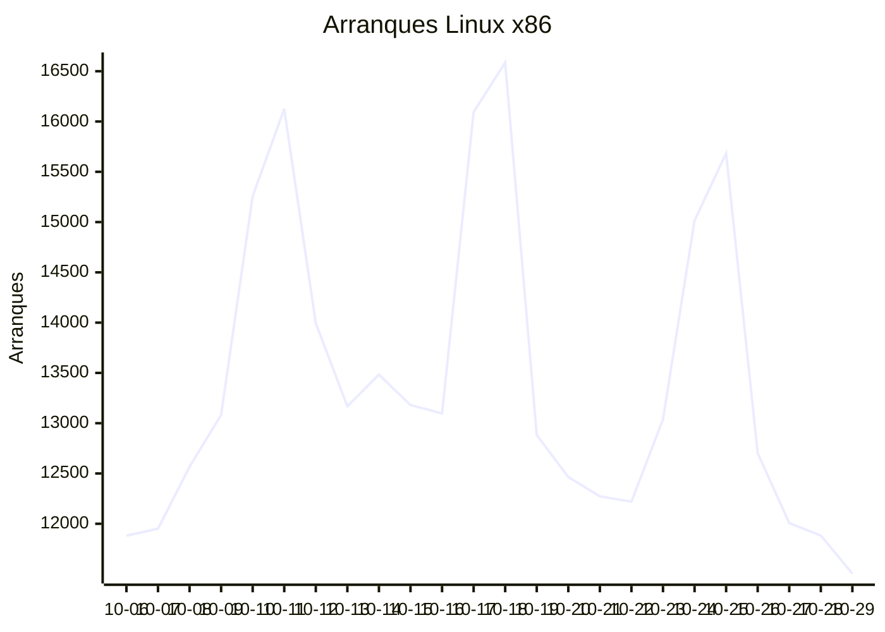
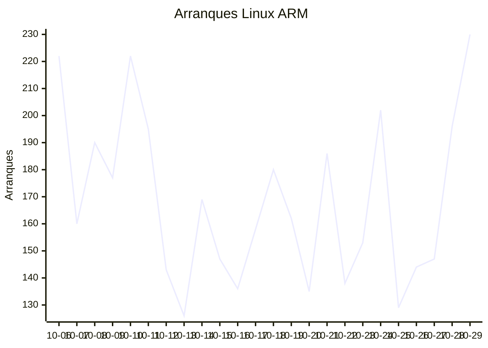
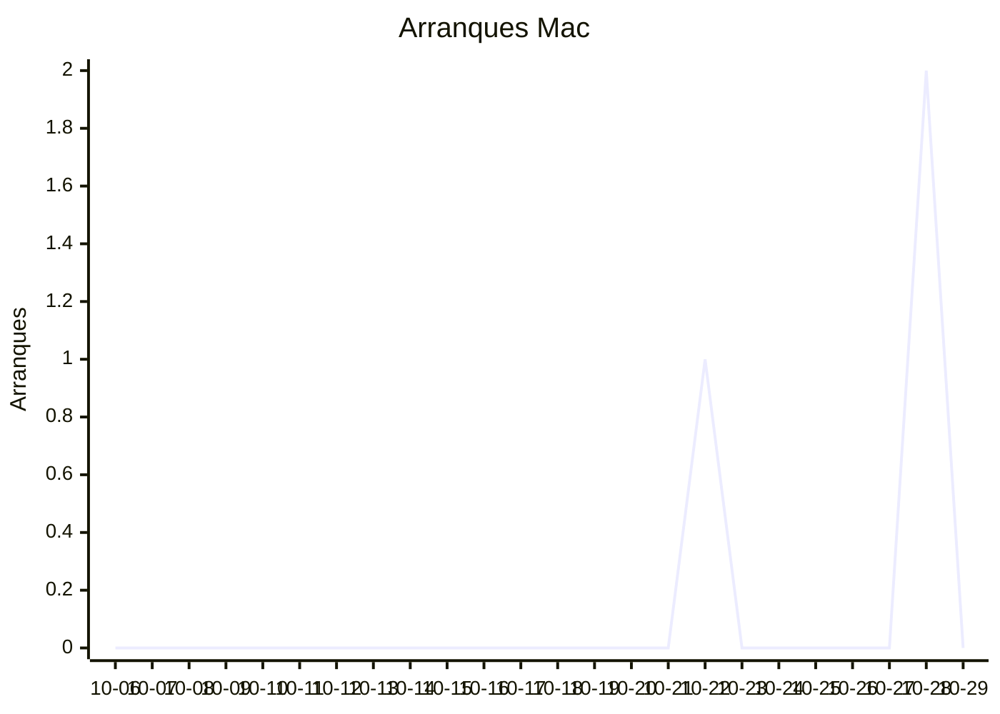
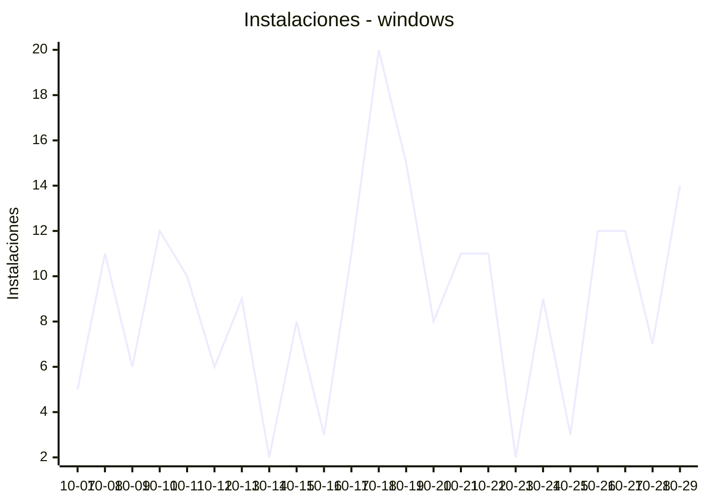
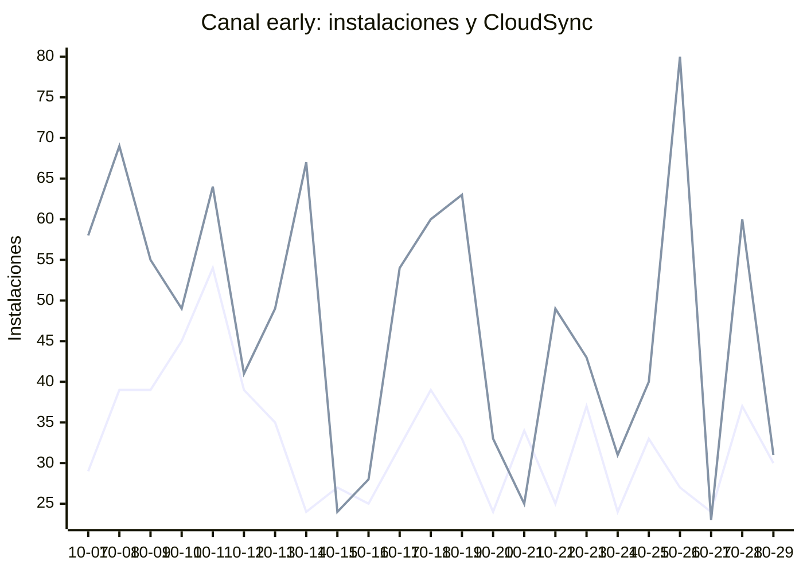

# Estadísticas de EmuDeck

Actualizado: 2026-10-30 20:35 UTC. Las gráficas no incluyen el día de hoy porque aún está incompleto.

## Arranques de la app (comprobaciones de actualización)

Cada arranque descarga el `latest*.yml` de su sistema. Cuenta arranques, no personas.

| Sistema | Ayer | Últimos 7 días |
|---|---|---|
| Linux x86 | 11505 | 91835 |
| Linux ARM | 230 | 1201 |
| Windows | 3263 | 24594 |
| Mac | 0 | 2 |

Instalaciones nuevas estimadas en Windows (7 días, `.exe` menos `.blockmap`): **2332**

## Instalaciones de EmuDeck (beacons)

Cada `setup` descarga `system-<sistema>.txt` y cada instalación de un emulador `<emulador>-<plataforma>.txt`. Los emuladores cuentan también las actualizaciones. Histórico completo desde el primer día.

| Sistema | Ayer | Últimos 7 días | Últimos 30 días | Total |
|---|---|---|---|---|
| linux | 25 | 208 | 739 | 773 |
| linux-arm | 3 | 40 | 123 | 129 |
| windows | 14 | 59 | 207 | 229 |

### Por mes

| Mes | Linux | Linux ARM | Windows | Total |
|---|---|---|---|---|
| 2026-10 | 739 | 123 | 207 | 1069 |

### Canal early (early + early-unstable)

Instalaciones de EmuDeck con el backend en una rama early, y cuántas de ellas instalan CloudSync.

| | Últimos 7 días | Últimos 30 días | Total |
|---|---|---|---|
| Instalaciones early | 212 | 755 | 795 |
| Con CloudSync | 308 | 1096 | 1180 |
| % con CloudSync | | | 148% |

Línea de arriba: instalaciones early. Línea de abajo: de ellas, con CloudSync.

### Por emulador

| Emulador | Linux (total) | Linux ARM (total) | Windows (total) | Últimos 7 días | Últimos 30 días | Total |
|---|---|---|---|---|---|---|
| pcsx2 | 2144 | 23 | 261 | 675 | 2287 | 2428 |
| azahar | 1879 | 194 | 267 | 658 | 2192 | 2340 |
| esde | 1747 | 161 | 424 | 664 | 2148 | 2332 |
| duckstation | 2048 | 174 | 107 | 654 | 2196 | 2329 |
| ryujinx | 1831 | 184 | 256 | 649 | 2143 | 2271 |
| rpcs3 | 1935 | 175 | 102 | 640 | 2090 | 2212 |
| cemu | 1886 | 179 | 91 | 608 | 2032 | 2156 |
| srm | 1703 | 158 | 285 | 623 | 2044 | 2146 |
| xenia | 1755 | 141 | 226 | 615 | 1999 | 2122 |
| shadps4 | 1639 | 152 | 204 | 581 | 1872 | 1995 |
| vita3k | 1713 | 154 | 70 | 544 | 1822 | 1937 |
| cloudsync | 811 | 40 | 377 | 318 | 1133 | 1228 |
| ppsspp | 693 | 109 | 204 | 286 | 946 | 1006 |
| dolphin | 754 | 125 | 112 | 280 | 938 | 991 |
| ra | 747 | 116 | 120 | 267 | 933 | 983 |
| mgba | 762 | 55 | 60 | 233 | 825 | 877 |
| xemu | 648 | 96 | 83 | 239 | 785 | 827 |
| melonds | 631 | 92 | 80 | 210 | 757 | 803 |
| primehack | 562 | 91 | 83 | 210 | 696 | 736 |
| supermodel | 540 | 105 | 22 | 176 | 630 | 667 |
| scummvm | 524 | 78 | 55 | 179 | 621 | 657 |
| model2 | 532 | 109 | 8 | 168 | 615 | 649 |
| bigpemu | 523 | 11 | 16 | 140 | 505 | 550 |
| armsx2 | 158 | 204 | 0 | 116 | 344 | 362 |
| flycast | 141 | 18 | 20 | 43 | 167 | 179 |
| rmg | 137 | 28 | 0 | 32 | 155 | 165 |
| mame | 74 | 3 | 18 | 17 | 86 | 95 |
| eden | 82 | 9 | 3 | 15 | 86 | 94 |
| pegasus | 20 | 0 | 16 | 13 | 33 | 36 |
| ares | 9 | 1 | 0 | 4 | 10 | 10 |
| yuzu | 8 | 0 | 2 | 4 | 10 | 10 |
| citron | 5 | 0 | 0 | 1 | 5 | 5 |
