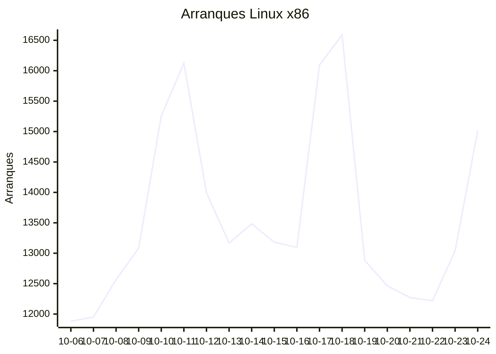
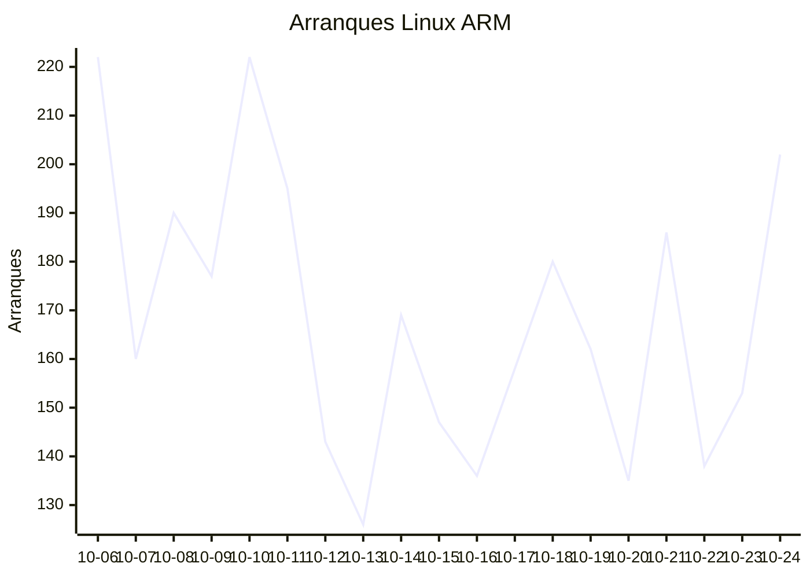
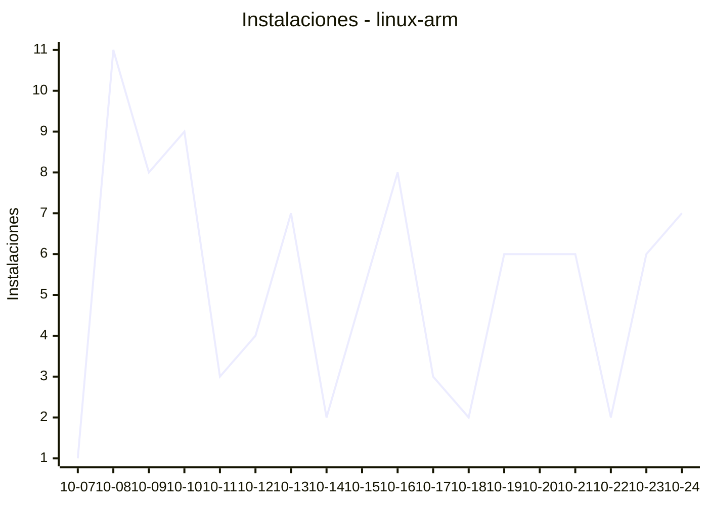
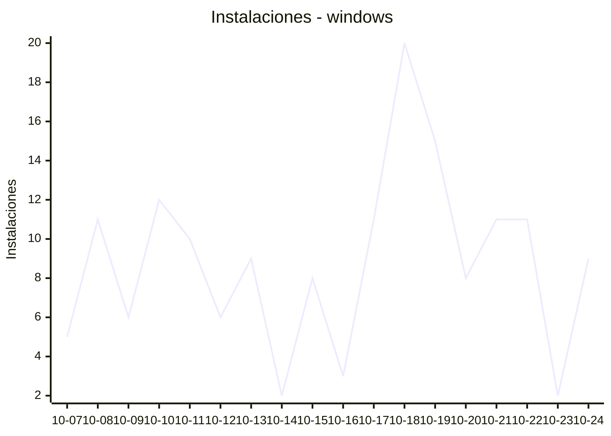
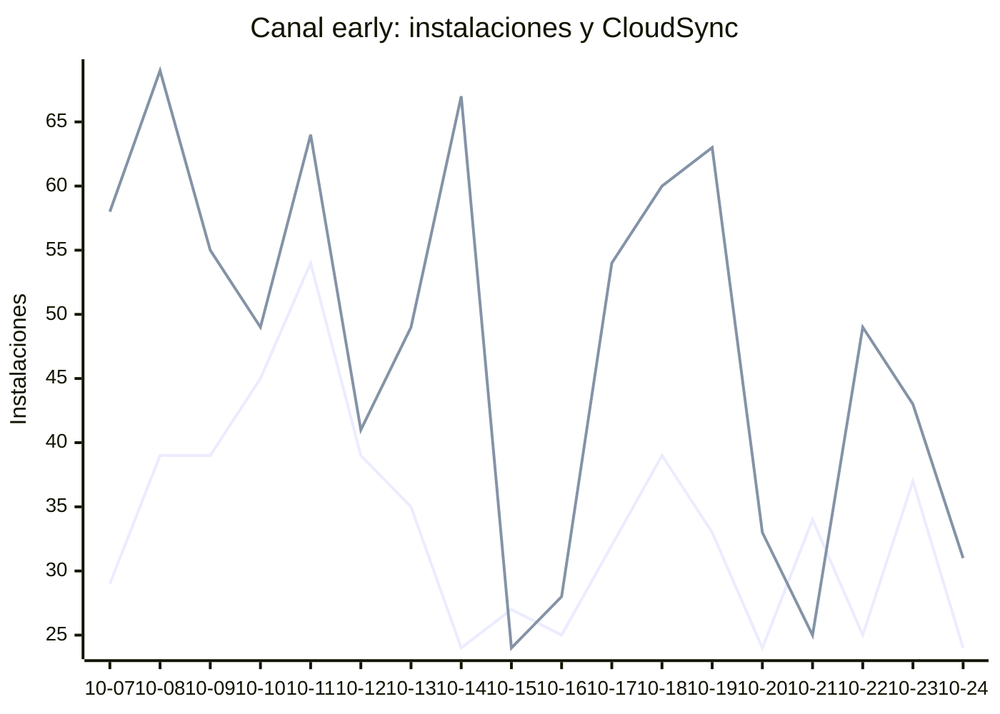

# Estadísticas de EmuDeck

Actualizado: 2026-10-25 21:37 UTC. Las gráficas no incluyen el día de hoy porque aún está incompleto.

## Arranques de la app (comprobaciones de actualización)

Cada arranque descarga el `latest*.yml` de su sistema. Cuenta arranques, no personas.

| Sistema | Ayer | Últimos 7 días |
|---|---|---|
| Linux x86 | 15016 | 94480 |
| Linux ARM | 202 | 1156 |
| Windows | 3877 | 24584 |
| Mac | 0 | 1 |

Instalaciones nuevas estimadas en Windows (7 días, `.exe` menos `.blockmap`): **2046**

## Instalaciones de EmuDeck (beacons)

Cada `setup` descarga `system-<sistema>.txt` y cada instalación de un emulador `<emulador>-<plataforma>.txt`. Los emuladores cuentan también las actualizaciones. Histórico completo desde el primer día.

| Sistema | Ayer | Últimos 7 días | Últimos 30 días | Total |
|---|---|---|---|---|
| linux | 22 | 196 | 595 | 649 |
| linux-arm | 7 | 35 | 96 | 101 |
| windows | 9 | 76 | 159 | 169 |

### Por mes

| Mes | Linux | Linux ARM | Windows | Total |
|---|---|---|---|---|
| 2026-10 | 595 | 96 | 159 | 850 |

### Canal early (early + early-unstable)

Instalaciones de EmuDeck con el backend en una rama early, y cuántas de ellas instalan CloudSync.

| | Últimos 7 días | Últimos 30 días | Total |
|---|---|---|---|
| Instalaciones early | 216 | 604 | 656 |
| Con CloudSync | 304 | 862 | 964 |
| % con CloudSync | | | 147% |

Línea de arriba: instalaciones early. Línea de abajo: de ellas, con CloudSync.

### Por emulador

| Emulador | Linux (total) | Linux ARM (total) | Windows (total) | Últimos 7 días | Últimos 30 días | Total |
|---|---|---|---|---|---|---|
| pcsx2 | 1782 | 22 | 199 | 684 | 1828 | 2003 |
| duckstation | 1704 | 137 | 84 | 662 | 1755 | 1925 |
| azahar | 1563 | 152 | 196 | 659 | 1747 | 1911 |
| ryujinx | 1527 | 147 | 205 | 651 | 1715 | 1879 |
| esde | 1443 | 113 | 314 | 657 | 1690 | 1870 |
| rpcs3 | 1608 | 137 | 82 | 628 | 1656 | 1827 |
| cemu | 1574 | 140 | 65 | 612 | 1624 | 1779 |
| srm | 1424 | 128 | 225 | 665 | 1625 | 1777 |
| xenia | 1452 | 111 | 168 | 600 | 1573 | 1731 |
| shadps4 | 1362 | 115 | 144 | 548 | 1468 | 1621 |
| vita3k | 1421 | 123 | 53 | 544 | 1454 | 1597 |
| cloudsync | 685 | 26 | 289 | 319 | 896 | 1000 |
| ra | 624 | 89 | 98 | 268 | 747 | 811 |
| ppsspp | 575 | 85 | 149 | 266 | 745 | 809 |
| dolphin | 625 | 92 | 86 | 254 | 739 | 803 |
| mgba | 634 | 51 | 48 | 250 | 669 | 733 |
| xemu | 541 | 75 | 64 | 225 | 624 | 680 |
| melonds | 536 | 72 | 63 | 214 | 617 | 671 |
| primehack | 468 | 69 | 67 | 200 | 555 | 604 |
| supermodel | 455 | 83 | 15 | 170 | 512 | 553 |
| scummvm | 443 | 61 | 41 | 173 | 500 | 545 |
| model2 | 448 | 86 | 7 | 163 | 501 | 541 |
| bigpemu | 441 | 10 | 11 | 170 | 422 | 462 |
| armsx2 | 135 | 155 | 0 | 109 | 267 | 290 |
| flycast | 121 | 15 | 17 | 50 | 144 | 153 |
| rmg | 118 | 26 | 0 | 41 | 134 | 144 |
| mame | 67 | 2 | 15 | 23 | 78 | 84 |
| eden | 73 | 9 | 0 | 23 | 72 | 82 |
| pegasus | 15 | 0 | 12 | 7 | 23 | 27 |
| yuzu | 8 | 0 | 2 | 4 | 10 | 10 |
| ares | 7 | 1 | 0 | 3 | 7 | 8 |
| citron | 4 | 0 | 0 | 1 | 4 | 4 |
