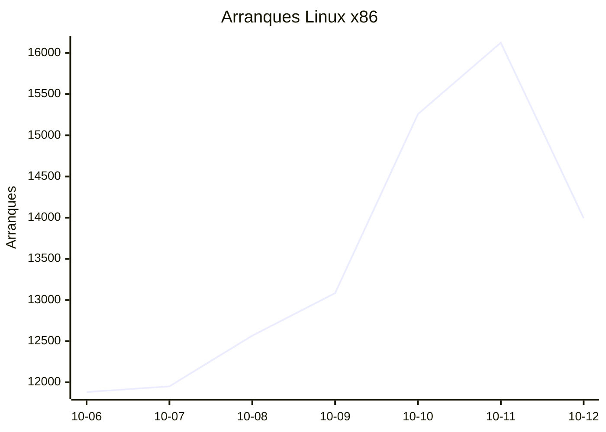
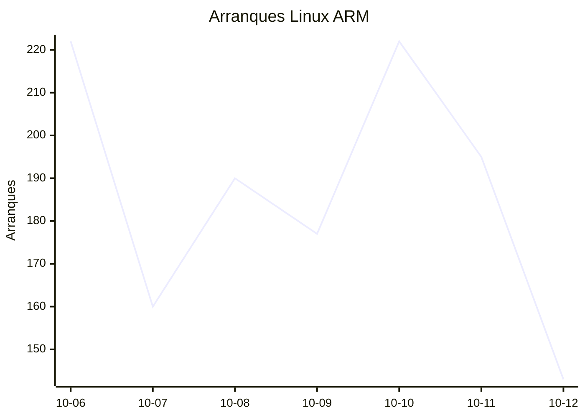
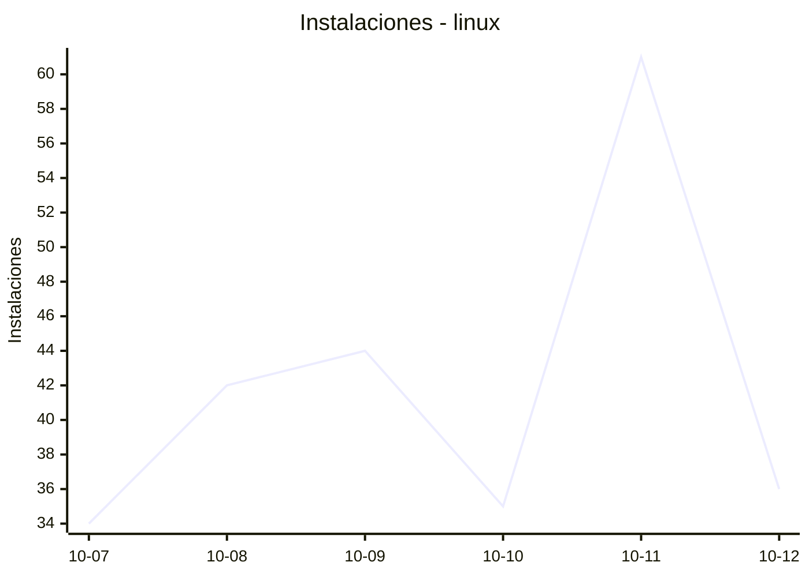
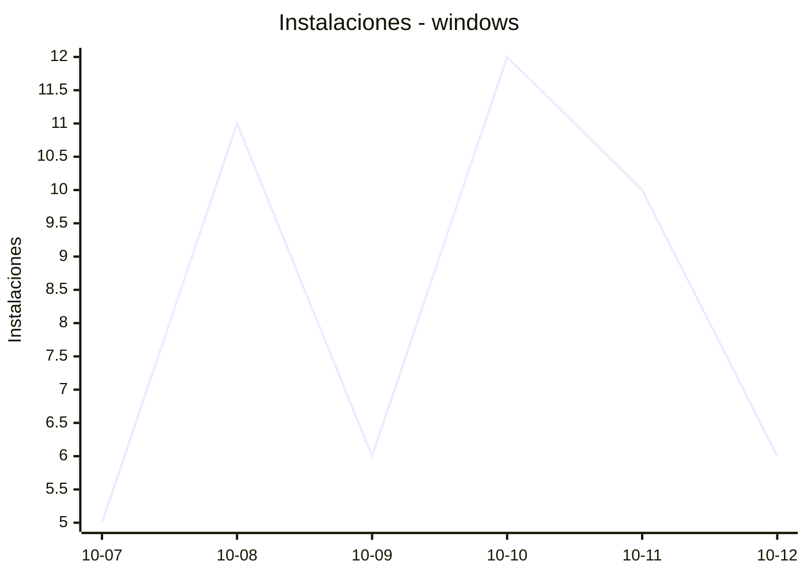
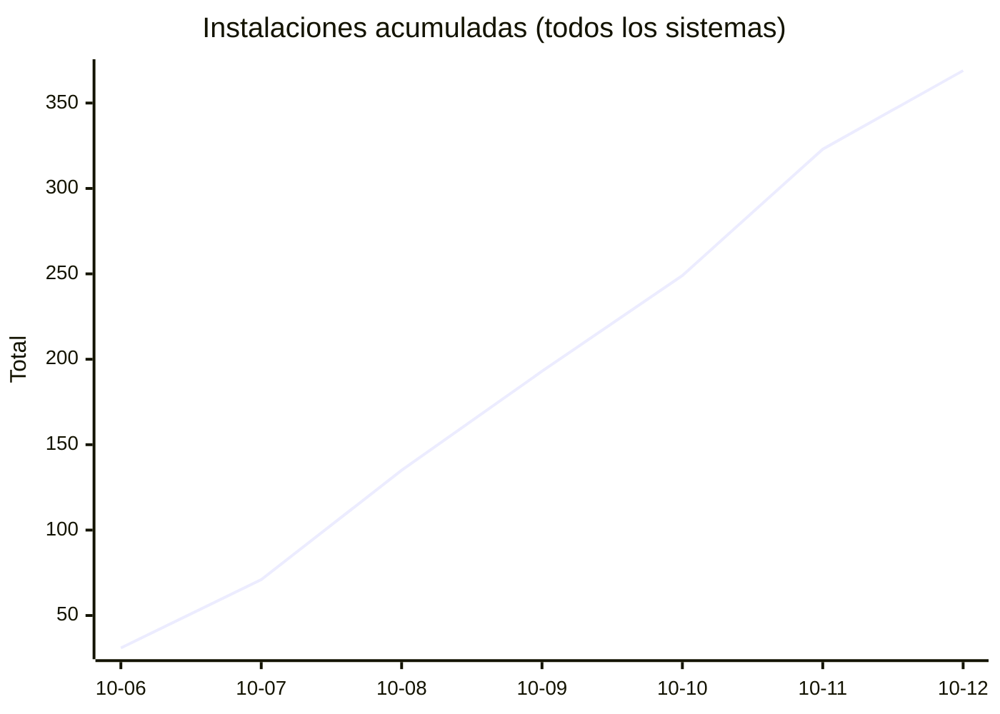
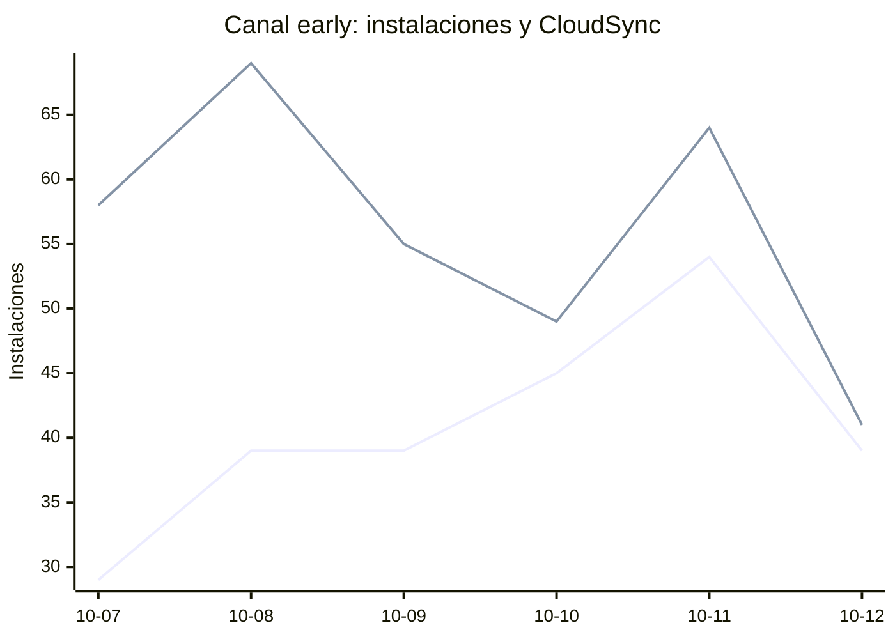

# Estadísticas de EmuDeck

Actualizado: 2026-10-13 23:11 UTC. Las gráficas no incluyen el día de hoy porque aún está incompleto.

## Arranques de la app (comprobaciones de actualización)

Cada arranque descarga el `latest*.yml` de su sistema. Cuenta arranques, no personas.

| Sistema | Ayer | Últimos 7 días |
|---|---|---|
| Linux x86 | 13994 | 94860 |
| Linux ARM | 143 | 1309 |
| Windows | 3719 | 25538 |
| Mac | 0 | 0 |

Instalaciones nuevas estimadas en Windows (7 días, `.exe` menos `.blockmap`): **1416**

## Instalaciones de EmuDeck (beacons)

Cada `setup` descarga `system-<sistema>.txt` y cada instalación de un emulador `<emulador>-<plataforma>.txt`. Los emuladores cuentan también las actualizaciones. Histórico completo desde el primer día.

| Sistema | Ayer | Últimos 7 días | Últimos 30 días | Total |
|---|---|---|---|---|
| linux | 36 | 252 | 252 | 299 |
| linux-arm | 4 | 36 | 36 | 46 |
| windows | 6 | 50 | 50 | 66 |

### Por mes

| Mes | Linux | Linux ARM | Windows | Total |
|---|---|---|---|---|
| 2026-10 | 252 | 36 | 50 | 338 |

### Canal early (early + early-unstable)

Instalaciones de EmuDeck con el backend en una rama early, y cuántas de ellas instalan CloudSync.

| | Últimos 7 días | Últimos 30 días | Total |
|---|---|---|---|
| Instalaciones early | 245 | 245 | 302 |
| Con CloudSync | 336 | 336 | 448 |
| % con CloudSync | | | 148% |

Línea de arriba: instalaciones early. Línea de abajo: de ellas, con CloudSync.

### Por emulador

| Emulador | Linux (total) | Linux ARM (total) | Windows (total) | Últimos 7 días | Últimos 30 días | Total |
|---|---|---|---|---|---|---|
| pcsx2 | 718 | 13 | 91 | 657 | 657 | 822 |
| azahar | 645 | 57 | 85 | 623 | 623 | 787 |
| duckstation | 701 | 55 | 27 | 622 | 622 | 783 |
| esde | 597 | 49 | 128 | 592 | 592 | 774 |
| ryujinx | 602 | 59 | 87 | 600 | 600 | 748 |
| cemu | 649 | 57 | 19 | 582 | 582 | 725 |
| rpcs3 | 638 | 55 | 29 | 572 | 572 | 722 |
| xenia | 588 | 49 | 62 | 557 | 557 | 699 |
| srm | 564 | 44 | 59 | 534 | 534 | 667 |
| shadps4 | 538 | 51 | 49 | 511 | 511 | 638 |
| vita3k | 575 | 49 | 13 | 506 | 506 | 637 |
| cloudsync | 330 | 13 | 125 | 354 | 354 | 468 |
| ppsspp | 265 | 40 | 65 | 300 | 300 | 370 |
| dolphin | 290 | 43 | 31 | 294 | 294 | 364 |
| ra | 293 | 43 | 27 | 302 | 302 | 363 |
| melonds | 246 | 32 | 22 | 240 | 240 | 300 |
| mgba | 257 | 22 | 20 | 233 | 233 | 299 |
| xemu | 244 | 33 | 22 | 248 | 248 | 299 |
| primehack | 211 | 34 | 24 | 222 | 222 | 269 |
| model2 | 206 | 43 | 4 | 205 | 205 | 253 |
| supermodel | 205 | 40 | 6 | 207 | 207 | 251 |
| scummvm | 205 | 30 | 12 | 202 | 202 | 247 |
| bigpemu | 179 | 3 | 2 | 136 | 136 | 184 |
| armsx2 | 57 | 58 | 0 | 88 | 88 | 115 |
| flycast | 63 | 10 | 5 | 60 | 60 | 78 |
| rmg | 52 | 17 | 0 | 52 | 52 | 69 |
| mame | 41 | 2 | 9 | 39 | 39 | 52 |
| eden | 26 | 3 | 0 | 12 | 12 | 29 |
| pegasus | 5 | 0 | 3 | 4 | 4 | 8 |
| ares | 3 | 1 | 0 | 4 | 4 | 4 |
| yuzu | 4 | 0 | 0 | 4 | 4 | 4 |
| citron | 1 | 0 | 0 | 1 | 1 | 1 |
