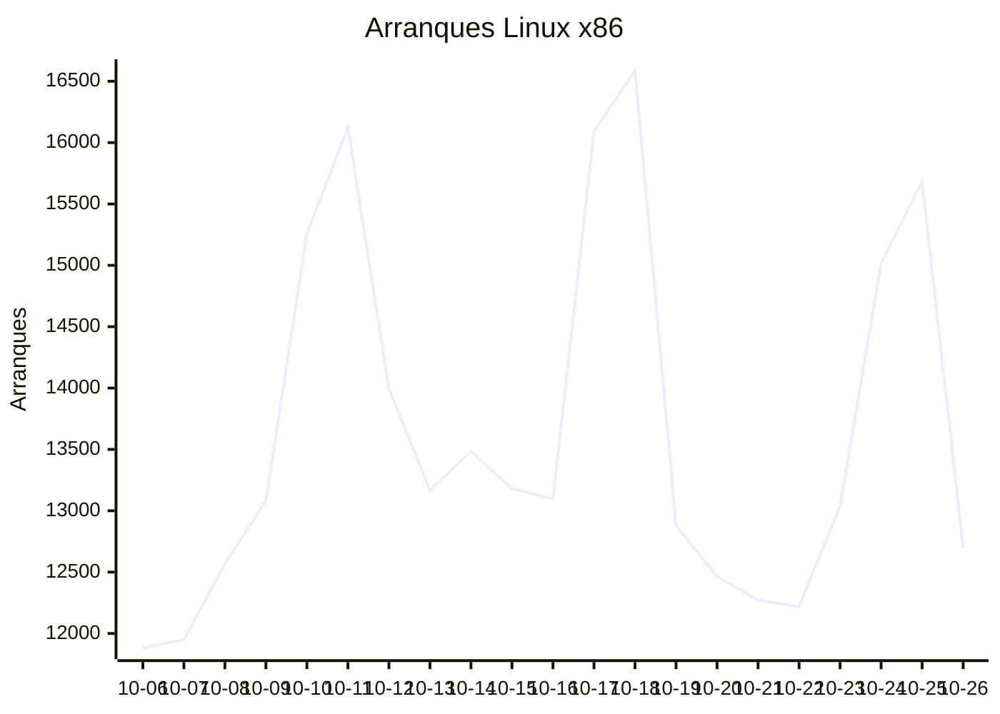
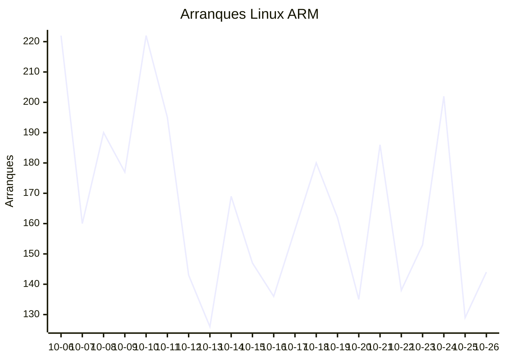
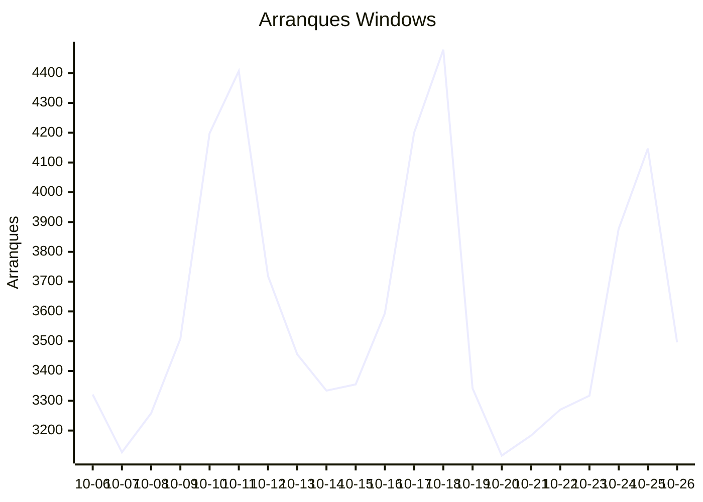
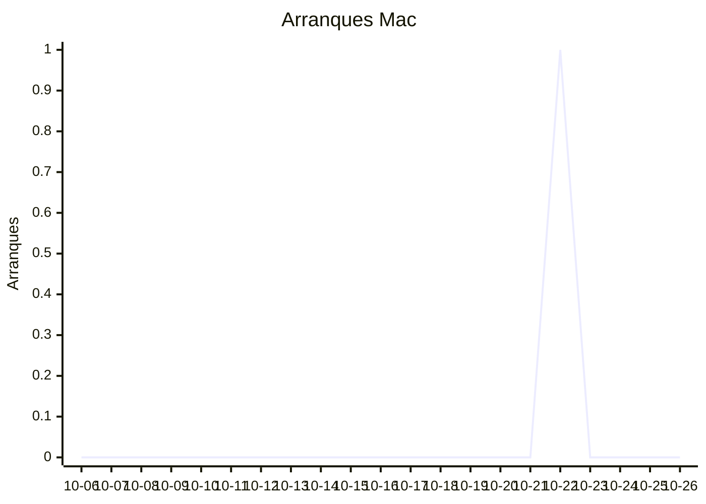
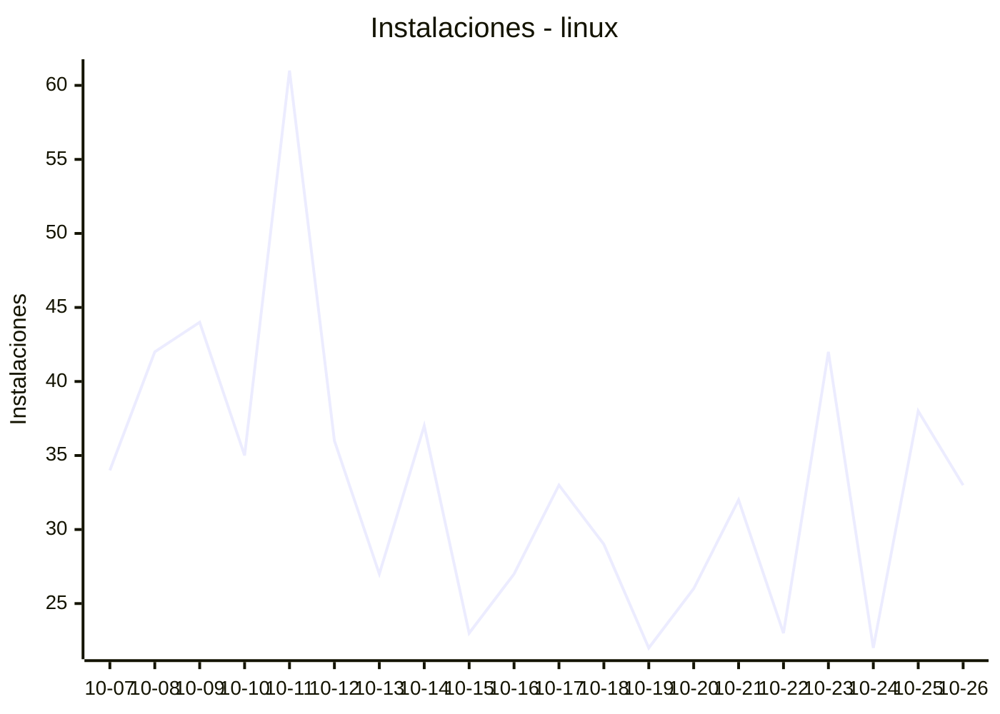
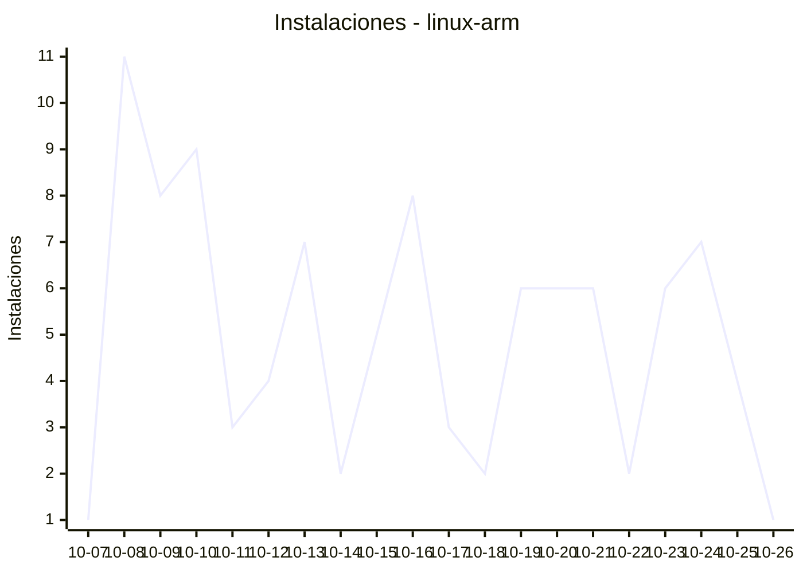
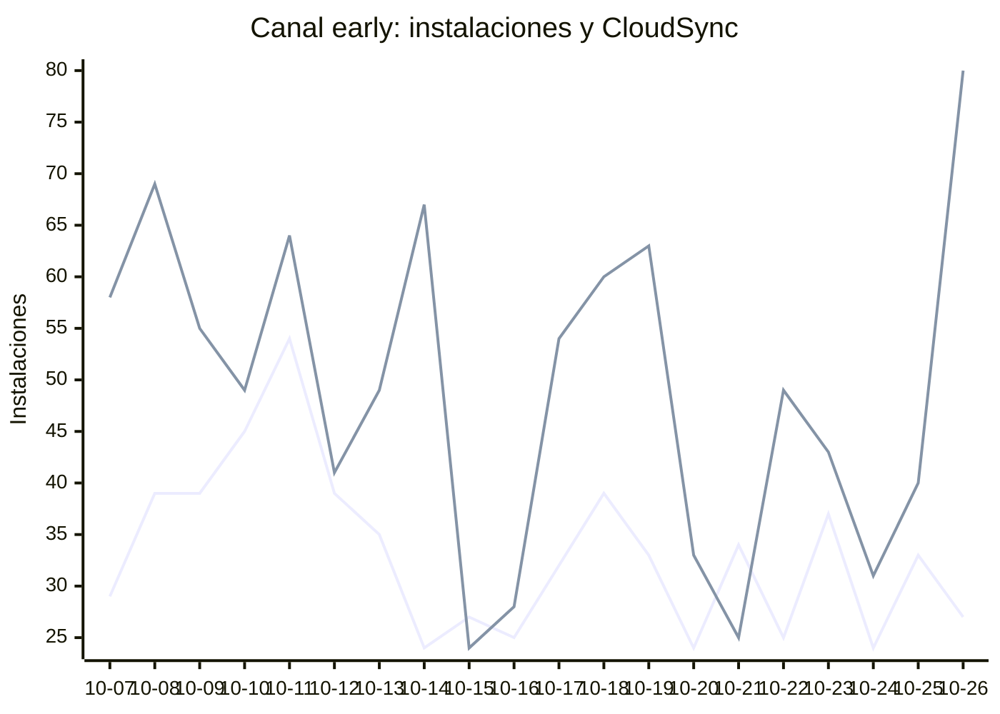

# Estadísticas de EmuDeck

Actualizado: 2026-10-27 02:27 UTC. Las gráficas no incluyen el día de hoy porque aún está incompleto.

## Arranques de la app (comprobaciones de actualización)

Cada arranque descarga el `latest*.yml` de su sistema. Cuenta arranques, no personas.

| Sistema | Ayer | Últimos 7 días |
|---|---|---|
| Linux x86 | 12702 | 93396 |
| Linux ARM | 144 | 1087 |
| Windows | 3496 | 24406 |
| Mac | 0 | 1 |

Instalaciones nuevas estimadas en Windows (7 días, `.exe` menos `.blockmap`): **2207**

## Instalaciones de EmuDeck (beacons)

Cada `setup` descarga `system-<sistema>.txt` y cada instalación de un emulador `<emulador>-<plataforma>.txt`. Los emuladores cuentan también las actualizaciones. Histórico completo desde el primer día.

| Sistema | Ayer | Últimos 7 días | Últimos 30 días | Total |
|---|---|---|---|---|
| linux | 33 | 216 | 666 | 688 |
| linux-arm | 1 | 32 | 101 | 105 |
| windows | 12 | 56 | 174 | 181 |

### Por mes

| Mes | Linux | Linux ARM | Windows | Total |
|---|---|---|---|---|
| 2026-10 | 666 | 101 | 174 | 941 |

### Canal early (early + early-unstable)

Instalaciones de EmuDeck con el backend en una rama early, y cuántas de ellas instalan CloudSync.

| | Últimos 7 días | Últimos 30 días | Total |
|---|---|---|---|
| Instalaciones early | 204 | 664 | 689 |
| Con CloudSync | 301 | 982 | 1053 |
| % con CloudSync | | | 153% |

Línea de arriba: instalaciones early. Línea de abajo: de ellas, con CloudSync.

### Por emulador

| Emulador | Linux (total) | Linux ARM (total) | Windows (total) | Últimos 7 días | Últimos 30 días | Total |
|---|---|---|---|---|---|---|
| pcsx2 | 1895 | 22 | 212 | 693 | 2048 | 2129 |
| duckstation | 1813 | 141 | 89 | 671 | 1961 | 2043 |
| azahar | 1655 | 156 | 211 | 660 | 1941 | 2022 |
| esde | 1540 | 121 | 345 | 671 | 1904 | 2006 |
| ryujinx | 1622 | 150 | 222 | 665 | 1919 | 1994 |
| rpcs3 | 1711 | 143 | 90 | 658 | 1869 | 1944 |
| cemu | 1666 | 147 | 72 | 628 | 1815 | 1885 |
| srm | 1505 | 133 | 238 | 668 | 1824 | 1876 |
| xenia | 1542 | 115 | 182 | 621 | 1774 | 1839 |
| shadps4 | 1452 | 120 | 155 | 569 | 1655 | 1727 |
| vita3k | 1510 | 127 | 58 | 554 | 1627 | 1695 |
| cloudsync | 737 | 29 | 326 | 315 | 1019 | 1092 |
| ppsspp | 610 | 88 | 161 | 266 | 826 | 859 |
| ra | 663 | 93 | 102 | 271 | 829 | 858 |
| dolphin | 663 | 97 | 92 | 260 | 820 | 852 |
| mgba | 672 | 51 | 49 | 252 | 746 | 772 |
| xemu | 572 | 79 | 69 | 230 | 693 | 720 |
| melonds | 562 | 75 | 68 | 211 | 676 | 705 |
| primehack | 495 | 72 | 70 | 198 | 611 | 637 |
| supermodel | 482 | 87 | 16 | 175 | 563 | 585 |
| scummvm | 467 | 64 | 45 | 176 | 551 | 576 |
| model2 | 474 | 90 | 7 | 164 | 549 | 571 |
| bigpemu | 461 | 10 | 11 | 156 | 462 | 482 |
| armsx2 | 146 | 166 | 0 | 118 | 301 | 312 |
| flycast | 126 | 16 | 18 | 49 | 154 | 160 |
| rmg | 123 | 27 | 0 | 41 | 145 | 150 |
| eden | 82 | 9 | 0 | 19 | 83 | 91 |
| mame | 69 | 2 | 15 | 20 | 81 | 86 |
| pegasus | 16 | 0 | 12 | 8 | 25 | 28 |
| yuzu | 8 | 0 | 2 | 4 | 10 | 10 |
| ares | 8 | 1 | 0 | 4 | 9 | 9 |
| citron | 5 | 0 | 0 | 1 | 5 | 5 |
