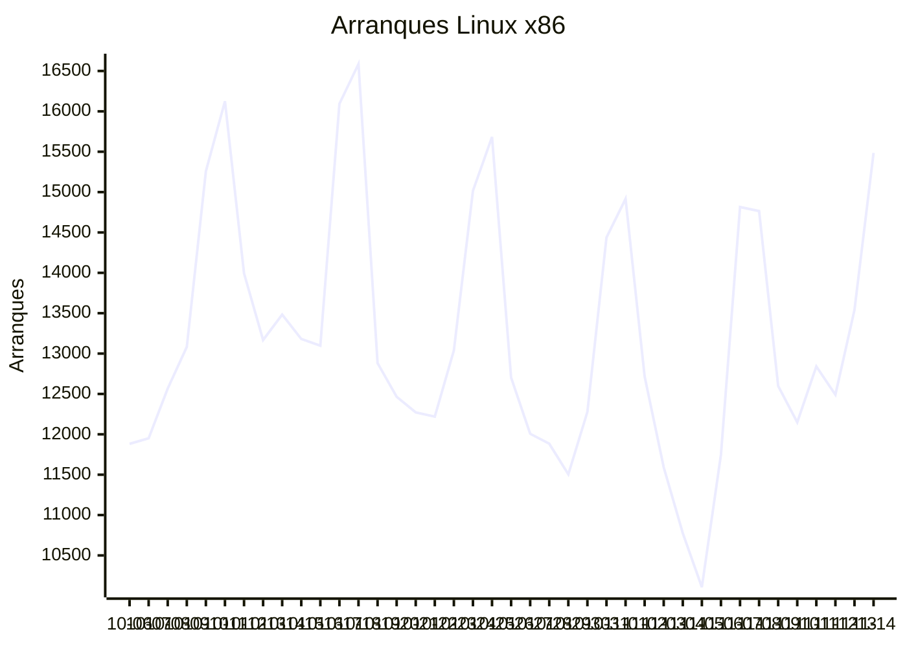
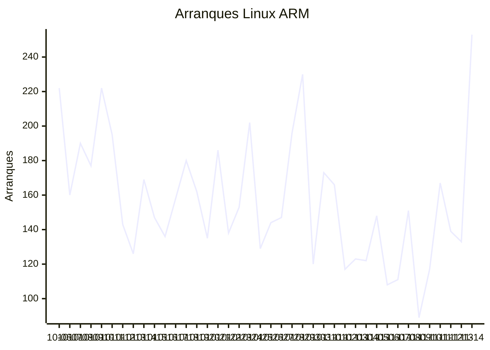
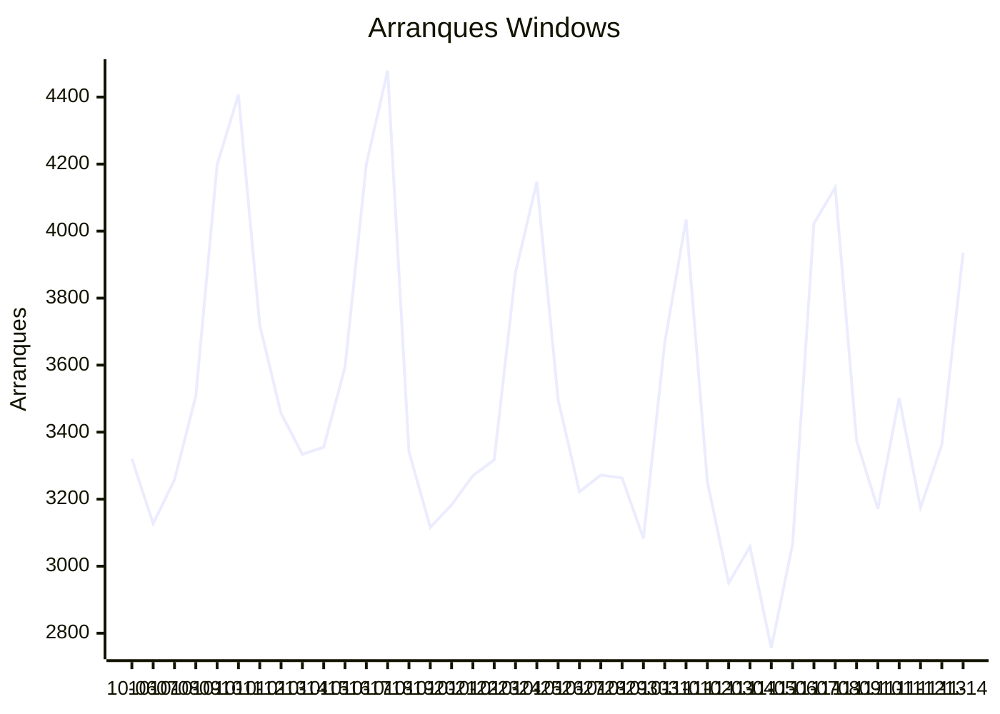
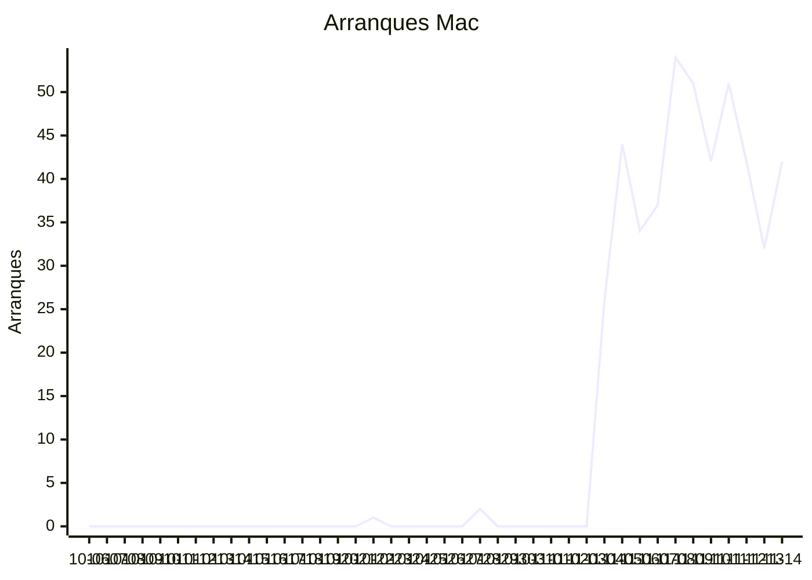
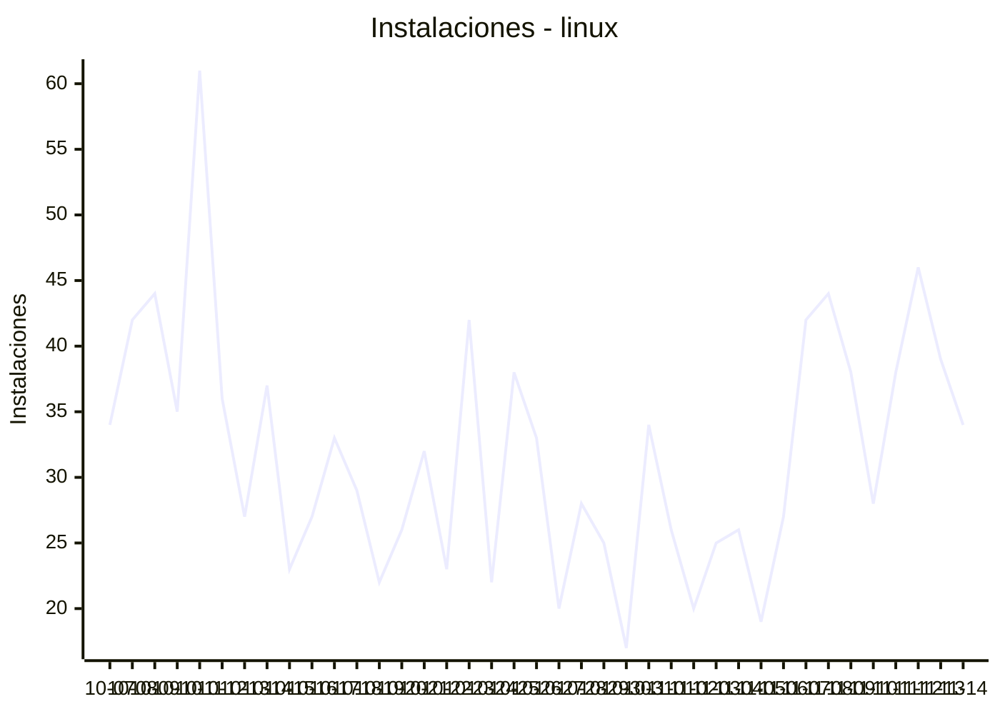
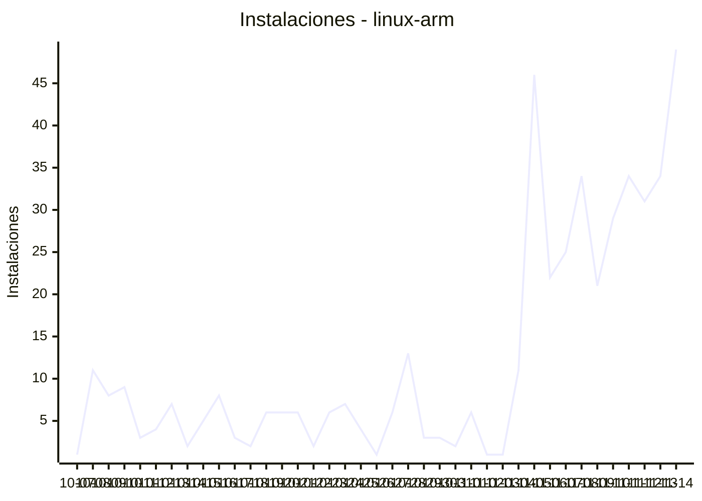
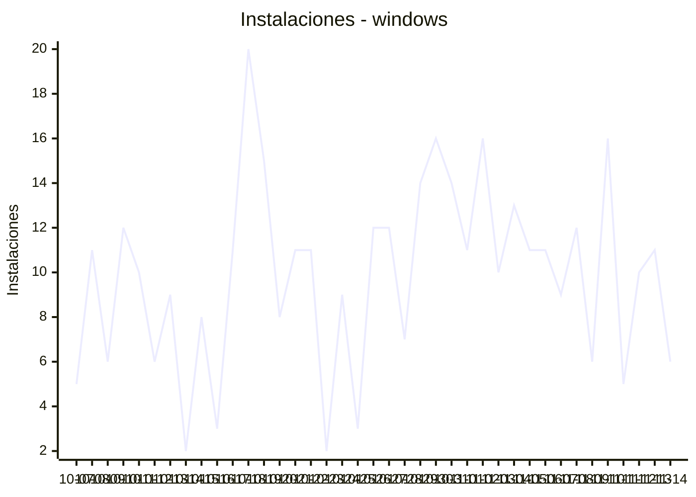
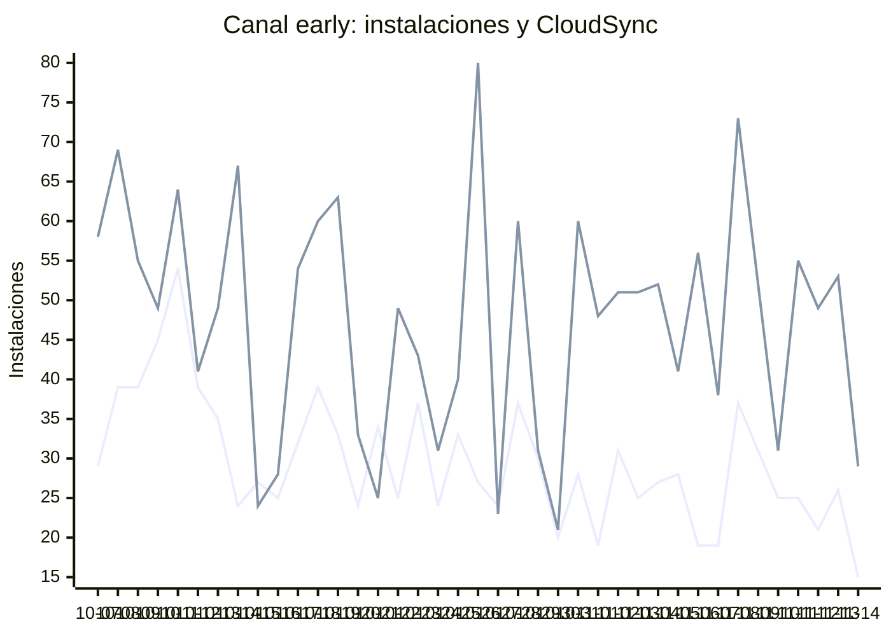

# Estadísticas de EmuDeck

Actualizado: 2026-11-15 03:35 UTC. Las gráficas no incluyen el día de hoy porque aún está incompleto.

## Arranques de la app (comprobaciones de actualización)

Cada arranque descarga el `latest*.yml` de su sistema. Cuenta arranques, no personas.

| Sistema | Ayer | Últimos 7 días |
|---|---|---|
| Linux x86 | 15485 | 93869 |
| Linux ARM | 253 | 1049 |
| Windows | 3936 | 24651 |
| Mac | 42 | 314 |

Instalaciones nuevas estimadas en Windows (7 días, `.exe` menos `.blockmap`): **2546**

## Instalaciones de EmuDeck (beacons)

Cada `setup` descarga `system-<sistema>.txt` y cada instalación de un emulador `<emulador>-<plataforma>.txt`. Los emuladores cuentan también las actualizaciones. Histórico completo desde el primer día.

| Sistema | Ayer | Últimos 7 días | Últimos 30 días | Total |
|---|---|---|---|---|
| linux | 34 | 267 | 903 | 1272 |
| linux-arm | 49 | 232 | 422 | 480 |
| windows | 6 | 66 | 315 | 392 |

### Por mes

| Mes | Linux | Linux ARM | Windows | Total |
|---|---|---|---|---|
| 2026-11 | 452 | 344 | 147 | 943 |
| 2026-10 | 790 | 128 | 237 | 1155 |

### Canal early (early + early-unstable)

Instalaciones de EmuDeck con el backend en una rama early, y cuántas de ellas instalan CloudSync.

| | Últimos 7 días | Últimos 30 días | Total |
|---|---|---|---|
| Instalaciones early | 180 | 820 | 1178 |
| Con CloudSync | 342 | 1380 | 1929 |
| % con CloudSync | | | 164% |

Línea de arriba: instalaciones early. Línea de abajo: de ellas, con CloudSync.

### Por emulador

| Emulador | Linux (total) | Linux ARM (total) | Windows (total) | Últimos 7 días | Últimos 30 días | Total |
|---|---|---|---|---|---|---|
| esde | 2832 | 485 | 805 | 920 | 3150 | 4122 |
| azahar | 2993 | 576 | 431 | 854 | 2994 | 4000 |
| duckstation | 3247 | 524 | 170 | 826 | 2944 | 3941 |
| ryujinx | 2934 | 562 | 431 | 866 | 2951 | 3927 |
| pcsx2 | 3407 | 37 | 459 | 703 | 2858 | 3903 |
| rpcs3 | 3096 | 544 | 176 | 828 | 2874 | 3816 |
| srm | 2791 | 468 | 528 | 874 | 2934 | 3787 |
| cemu | 2948 | 519 | 154 | 760 | 2690 | 3621 |
| xenia | 2751 | 429 | 375 | 736 | 2661 | 3555 |
| vita3k | 2675 | 462 | 120 | 684 | 2428 | 3257 |
| shadps4 | 2576 | 231 | 341 | 547 | 2313 | 3148 |
| cloudsync | 1284 | 53 | 659 | 354 | 1425 | 1996 |
| ppsspp | 1095 | 370 | 360 | 460 | 1374 | 1825 |
| dolphin | 1192 | 415 | 180 | 445 | 1328 | 1787 |
| ra | 1200 | 383 | 200 | 433 | 1333 | 1783 |
| xemu | 1014 | 313 | 139 | 360 | 1091 | 1466 |
| mgba | 1243 | 119 | 91 | 289 | 1071 | 1453 |
| melonds | 985 | 316 | 124 | 345 | 1044 | 1425 |
| primehack | 920 | 334 | 142 | 360 | 1051 | 1396 |
| supermodel | 859 | 306 | 41 | 295 | 877 | 1206 |
| scummvm | 822 | 277 | 89 | 292 | 874 | 1188 |
| model2 | 842 | 320 | 13 | 290 | 853 | 1175 |
| bigpemu | 821 | 39 | 35 | 162 | 654 | 895 |
| armsx2 | 268 | 600 | 0 | 303 | 711 | 868 |
| flycast | 213 | 38 | 37 | 55 | 198 | 288 |
| rmg | 211 | 61 | 0 | 71 | 186 | 272 |
| mame | 123 | 13 | 46 | 46 | 127 | 182 |
| eden | 131 | 11 | 20 | 43 | 123 | 162 |
| pegasus | 38 | 3 | 27 | 14 | 52 | 68 |
| yuzu | 16 | 0 | 8 | 7 | 18 | 24 |
| ares | 17 | 2 | 0 | 5 | 15 | 19 |
| citron | 6 | 0 | 2 | 1 | 5 | 8 |
